## Objectives {.smaller}

::: {.incremental}
- Compare lidar and UAS SfM point cloud characteristics
- Analyze point distribution by binning
- Extract bare ground and thin a point cloud
- Computing a DEM (DSM and DTM)
- Analyze vertical structure with voxel models and transects
:::

::: {.notes}
* 4A compared surfaces; today we go one step back, to the points the surfaces are made from
* Two clouds of the same site, Mid Pines at Lake Wheeler: 2013 airborne lidar and a 2015 UAS SfM flight
* The lab (4B) bins, classifies, interpolates, and validates those two clouds in GRASS
* Every concept today has a GRASS tool next to it; the lab uses them in the same order
:::

## Two kinds of point clouds {.center .text-center .section-divider background-color="#e9f2e9"}

::: {.notes}
* Section 1: what a point cloud is, and how a lidar cloud differs from an SfM cloud
:::

## What is a point cloud {.smaller}

::: {.term-card}
**Point cloud**: a dense set of points with x, y, z coordinates in 3D space, measured directly by lidar or derived from overlapping images by structure from motion
:::

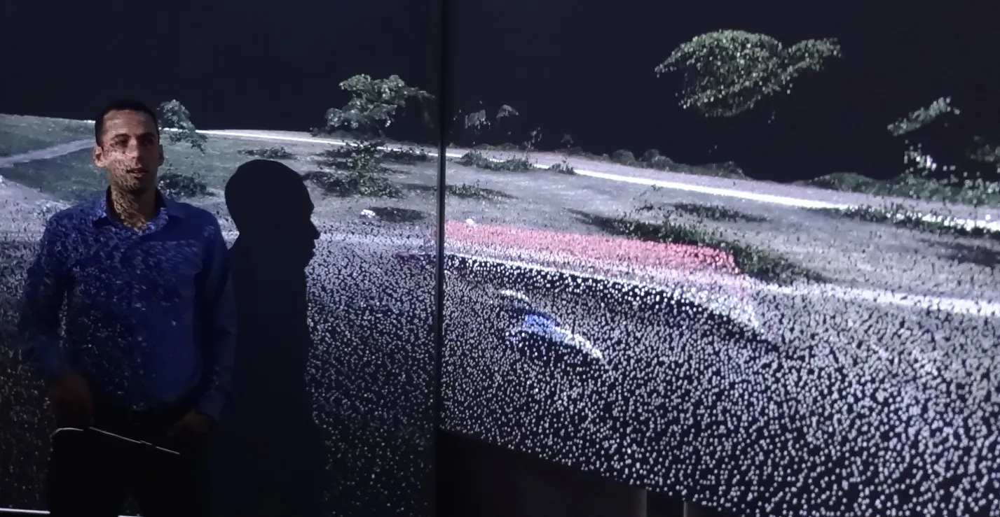{width="60%" fig-align="center" fig-alt="A person standing in front of a wall-sized projection of a UAS point cloud of the Mid Pines fields: a road, scattered trees, and a red-roofed building rendered as thousands of colored dots"}

UAS SfM point cloud of Mid Pines on the Hunt Library visualization wall.

::: {.notes}
* Same data structure from two very different sensors: lidar measures, SfM reconstructs (2A)
* Everything downstream, DEMs, DSMs, canopy models, starts from these points
* The picture is the 2015 Mid Pines SfM cloud the lab uses
:::

## Lidar acquisition {.smaller}

::: {.columns}
::: {.column width="35%"}
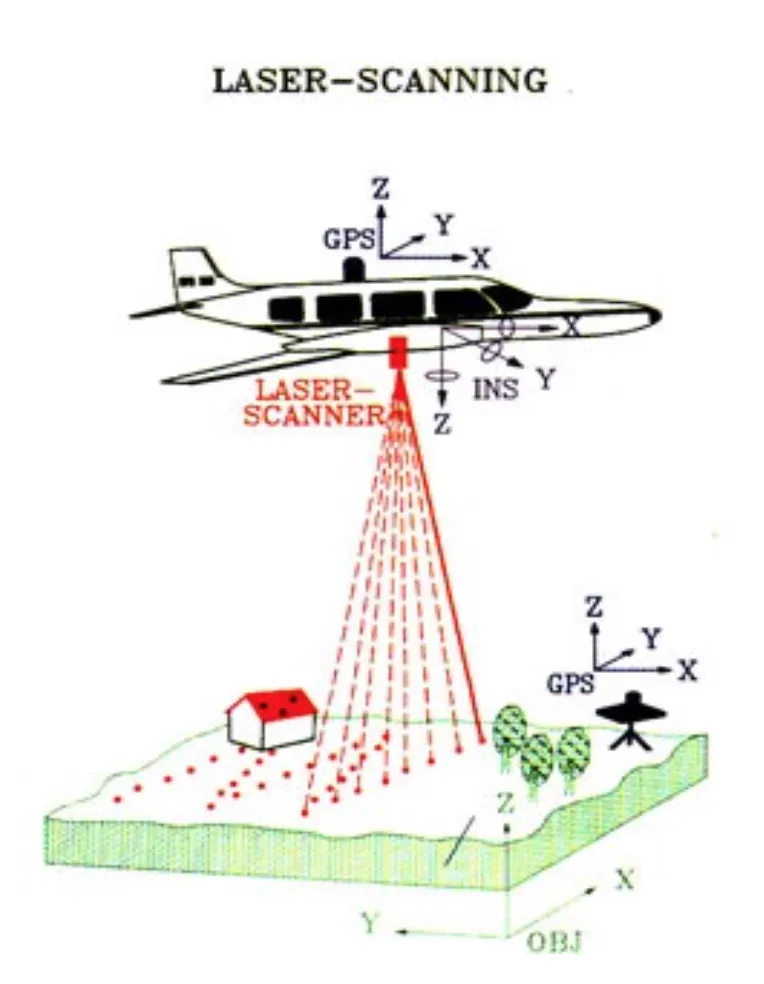{fig-alt="Diagram of airborne laser scanning: an aircraft with a GPS antenna and an INS sends a fan of laser pulses to the ground, where a building, trees, and a GPS base station are drawn on the terrain block"}
:::
::: {.column width="65%"}
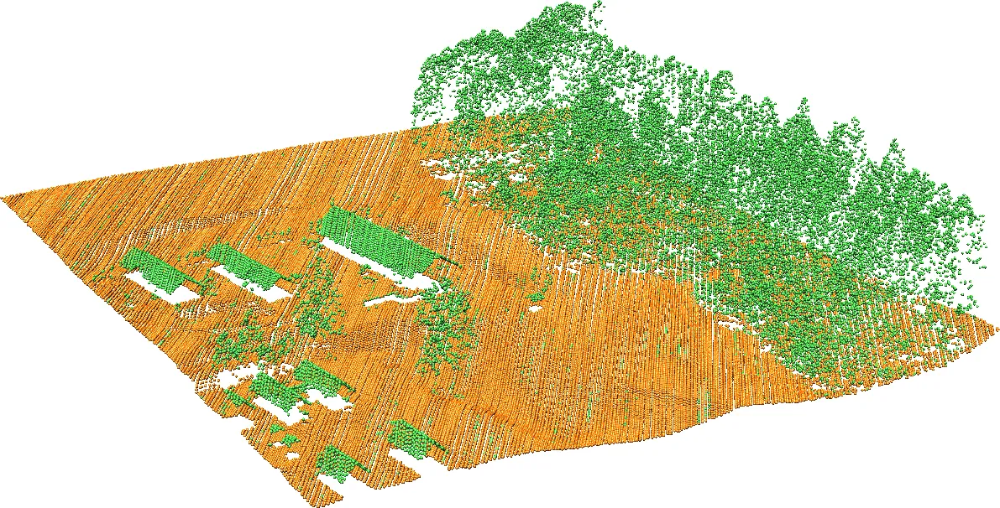{fig-alt="3D view of a lidar point cloud over a field and forest edge: ground points in orange in dense parallel scan lines, trees and roofs in green above them"}

- The measured time of flight of each pulse is converted to a distance
- Georeferencing comes from the platform's position (GNSS) and orientation (IMU), fused in the INS
:::
:::

::: {.notes}
* Active sensor: it emits the pulse and times the echo, so it works regardless of texture and light
* Position from GNSS plus attitude from the IMU place every point; the same two sensors a UAS uses for geotags (1A), with a far better IMU
* INS is the IMU plus the filter that integrates it with GNSS; spec sheets usually just say GNSS/IMU
* The scan lines in the 3D view are the scanner sweeping across the flight line
:::

## Multiple returns {.smaller}

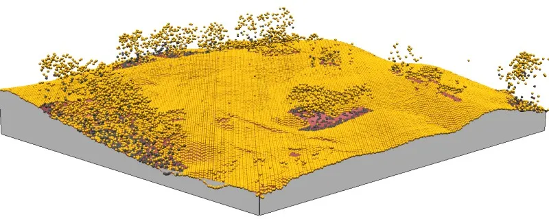{width="80%" fig-align="center" fig-alt="3D view of a lidar point cloud: a dense yellow carpet of first returns over the terrain with tree crowns rising above it, and dark brown second returns visible under the canopy at the forest edges"}

A lidar pulse can penetrate the tree canopy and produce several returns: yellow first returns, dark brown second returns.

::: {.notes}
* One pulse, several echoes: the top of the crown, branches, and often the ground
* This is what lets lidar map the ground under trees; SfM cannot do it
* The lab filters on return number to build a canopy surface and a ground surface from one file
:::

## Returns in profile {.smaller}

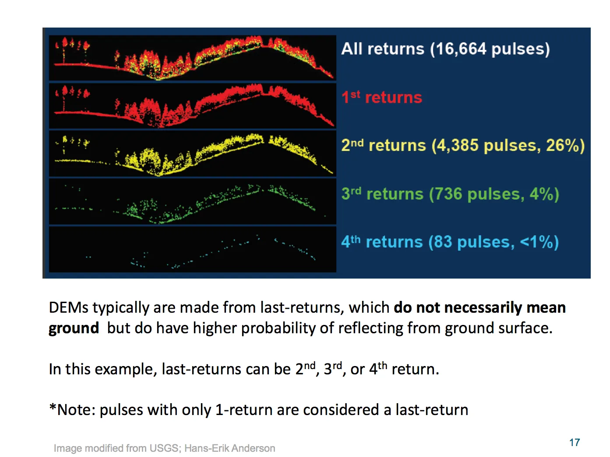{width="78%" fig-align="center" fig-alt="Five stacked profile views of the same forested hill: all returns from 16,664 pulses, then first returns in red, second returns in yellow (26 percent of pulses), third in green (4 percent), and fourth in blue (under 1 percent); a caption notes that DEMs are typically made from last returns, which do not necessarily mean ground"}

::: {.notes}
* Most pulses give one return; a quarter give two, a few percent three or more
* Last return has the highest chance of being ground, but it is not ground: a dense crown stops the pulse
* Hence the classified ground class in modern data, and the caution in the lab about last returns
:::

## Lidar points {.smaller}

::: {.term-card}
**Lidar point**: *[x, y, z, r, i, c, ...]*, a georeferenced position with the return number *r*, the intensity *i* of the echo, and a class *c* assigned by the provider
:::

- Additional attributes depend on the sensor and the provider: RGB from a camera, scan angle and direction, GPS time, number of returns per pulse
- Classes follow the [ASPRS LAS standard](https://asprsorg.sharepoint.com/:b:/r/sites/PublicAccess/Shared%20Documents/Public_Documents/Standards/LAS/asprs_las_format_v15_r00_2025.pdf?d=wfe26e8cdedcb42e782babe5bdc65b11b&csf=1&web=1&e=A5Vh5l): 1 unclassified, 2 ground, 7 noise, 9 water, and so on

::: {.notes}
* Intensity is the strength of the echo: roads dark, roofs bright, useful for classification
* Class is what a previous processing step decided; it can be wrong
* The lab's 2013 file uses classes 1, 2, 7, and 11; pdal info prints the counts
:::

## Lidar preview: swath overlap {.smaller}

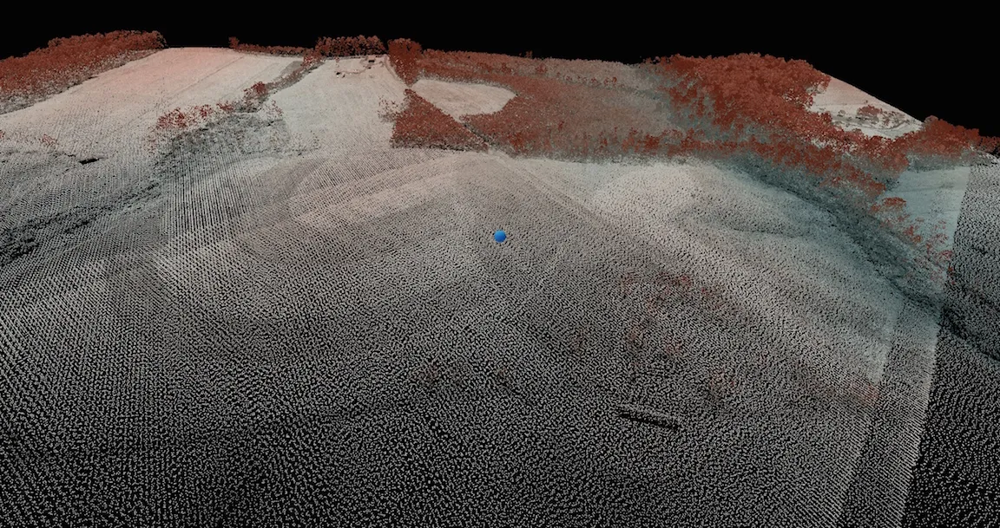{width="78%" fig-align="center" fig-alt="3D view of the Mid Pines lidar point cloud over the fields: regular scan lines across bare fields, trees along the field edges in reddish brown, and a visibly denser band where two flight swaths overlap"}

::: {.notes}
* Parallel flight lines overlap at their edges; the overlap band has twice the density
* Density is not uniform, which matters when you pick a raster resolution
* The lab's density maps show these bands as stripes
:::

## Lidar preview: canopy and walls {.smaller}

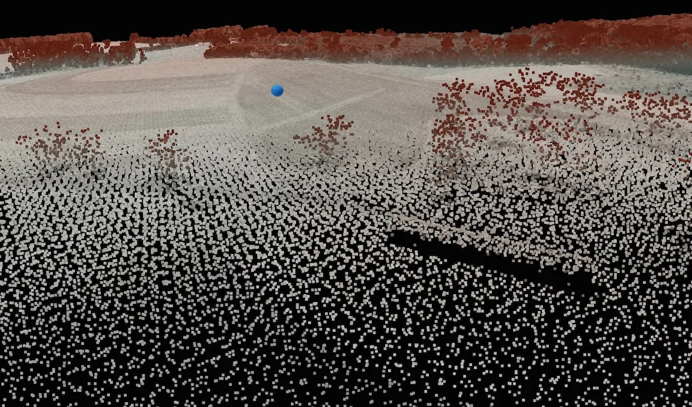{width="78%" fig-align="center" fig-alt="Close-up 3D view of the Mid Pines lidar cloud: points scattered through the tree crowns, the ground visible beneath them, and a building reduced to a flat roof with no points on its walls"}

- Points distributed throughout the canopy
- No points on the walls of the building

::: {.notes}
* Nadir-looking scanner: roofs and ground, but a wall is parallel to the beam and gets nothing
* Points inside the crowns come from the multiple returns
* Keep both in mind for the SfM comparison next
:::

## SfM points {.smaller}

::: {.term-card}
**SfM point**: *[x, y, z, R, G, B]*, a position reconstructed from overlapping imagery with the color sampled from the photos
:::

- No returns, no intensity: the camera sees one surface, the first one in view
- Classes only if a later step assigns them (Metashape and WebODM can classify ground points)
- Density depends on the GSD, the overlap, and the quality setting used in dense matching

::: {.notes}
* Same x, y, z, but the rest of the record is different: color instead of echo physics
* Nothing under the canopy; the leaves are the surface the camera sees
* The dense cloud quality setting from 2B decides how many points you get
:::

## UAS SfM preview {.smaller}

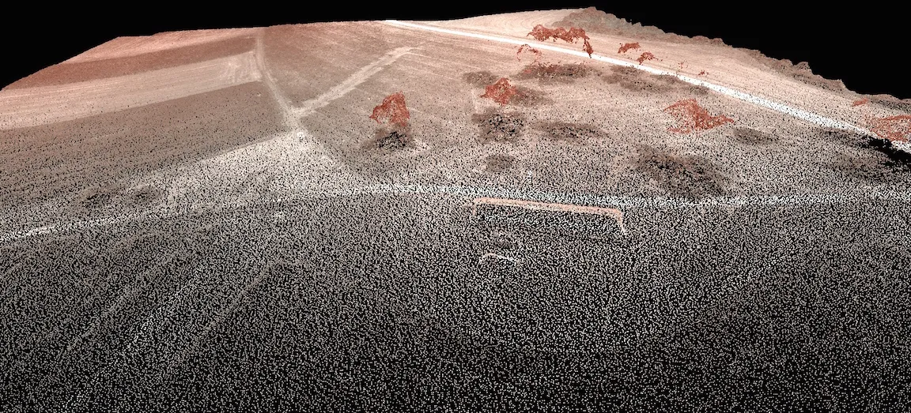{width="78%" fig-align="center" fig-alt="3D view of the Mid Pines UAS SfM point cloud: a dense carpet of points over bare fields and a road, tree crowns as solid reddish blobs, and a long building fully outlined including its walls"}

- Only the top of the tree canopy is captured
- The building is densely sampled, including the walls

::: {.notes}
* The mirror image of the lidar slide: walls yes, canopy interior no
* Oblique views from the overlapping photos see the walls
* Trees are solid shells; there is no ground under them in this cloud
:::

## UAS SfM preview in color {.smaller}

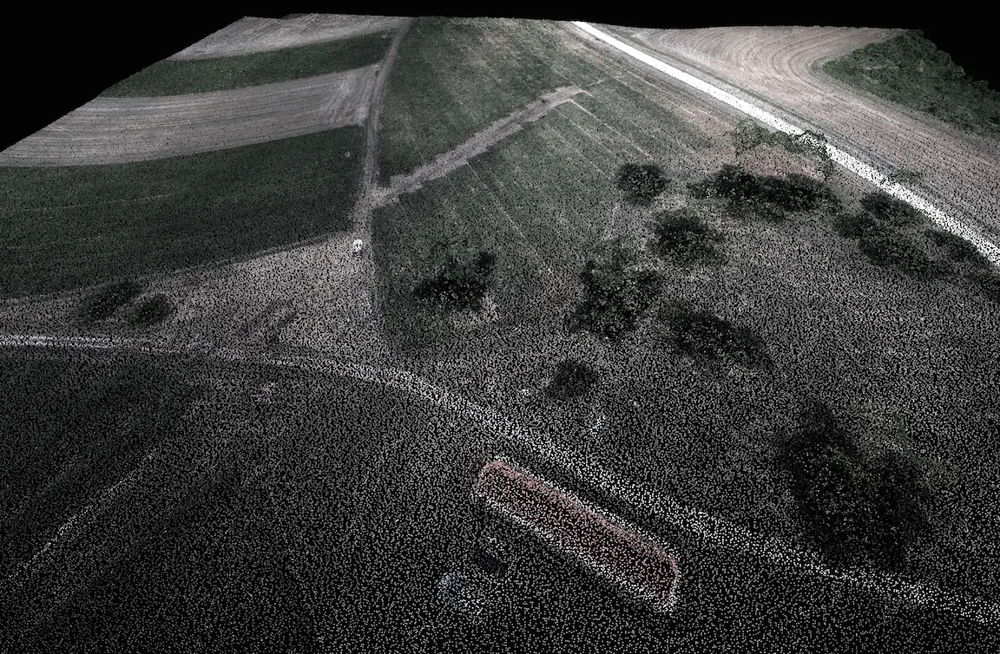{width="78%" fig-align="center" fig-alt="The same Mid Pines UAS point cloud colored by the photos: green crops, a pale dirt road, scattered dark tree crowns, and the red-roofed building, with the density of points visible as grain"}

Much higher density of points, with RGB from the photos.

::: {.notes}
* Several times the lidar density, and every point carries a color
* Looks like an orthophoto in 3D; that is also its weakness, it only knows what the photos show
* The lab bins both clouds at 1 m to compare densities side by side
:::

## Point cloud formats {.smaller}

| Format | Notes |
|---|---|
| ASCII x, y, z | Oldest and simplest; large, slow, no attributes beyond the columns |
| LAS | Binary industry standard from ASPRS: header, point records with x, y, z, intensity, returns, class |
| LAZ | Losslessly compressed LAS; a fraction of the size, read by most software |
| COPC | Cloud optimized LAZ with a spatial index, streamed straight from a web server |

The [ASPRS LAS 1.4 specification](https://github.com/ASPRSorg/LAS) defines the record and the standard classes; the [USGS Lidar Base Specification](https://pubs.usgs.gov/tm/11b4/pdf/tm11-B4.pdf) sets what public lidar must deliver.

::: {.notes}
* LAS is what you get from providers; LAZ is what you store; COPC is what you stream
* The lab opens the COPC version of the Mid Pines lidar in a browser before touching GRASS
* Waveform data (the full echo) has its own proprietary formats
:::

## Looking at the points {.center .text-center .section-divider background-color="#e9f2e9"}

::: {.notes}
* Section 2: before making a surface, find out how the points are distributed
:::

## Processing steps {.smaller}

::: {.incremental}
- Preview, and analyze the point distribution
- Filter outliers
- Extract bare earth points
- Classify: canopy, buildings, and so on
- Decimate (thin) the cloud
- Transform the points into surfaces or 3D objects
:::

::: {.notes}
* The order matters: you cannot pick a resolution before you know the density
* Provider data arrives with some of this done (classes); check it rather than trust it
* The lab does the first, the fourth by a simple rule, and the last two
:::

## Binning {.smaller}

::: {.term-card}
**Binning**: computing a statistic of the points that fall into each cell of a grid at a chosen resolution, with no interpolation; in GRASS, `r.in.pdal` with `method=`
:::

- Number of points per cell: a map of point density
- Range or standard deviation of z within the cell: a map of vertical variability
- Shows data gaps and where artifacts will appear
- The basis for choosing a resolution the data can support

::: {.notes}
* The cheapest thing you can do with a point cloud, and the most informative
* Count per cell is the density map; z range per cell says whether the cell holds flat ground or a tree
* Lab Part 2 is exactly this at 1 m for both clouds
:::

## Point density: county lidar {.smaller}

::: {.columns}
::: {.column width="33%"}
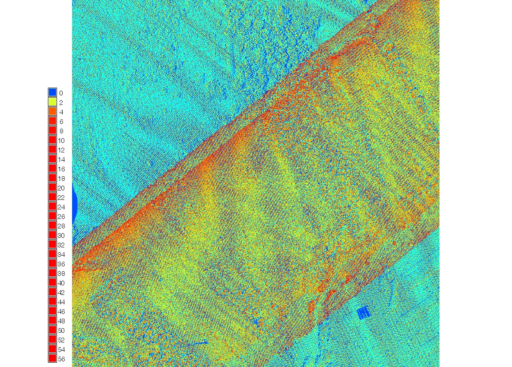{fig-alt="Map of first return point counts per 3 ft cell from the 2013 county lidar: cyan at one to two points over most of the area, with an orange and red diagonal band of four to six points where two swaths overlap"}
:::
::: {.column width="33%"}
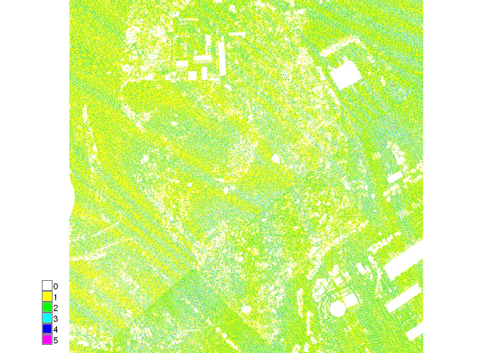{fig-alt="Map of bare earth point counts per 3 ft cell from the same lidar: mostly yellow and green at one to two points, with white gaps of zero points under buildings and tree stands"}
:::
::: {.column width="33%"}
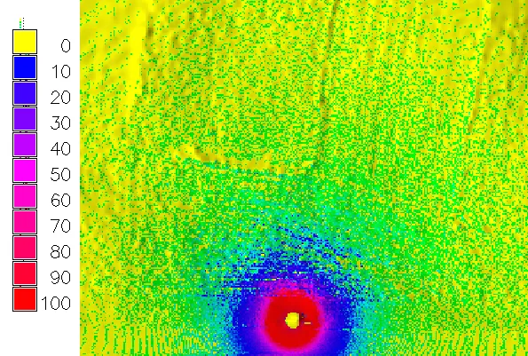{fig-alt="Map of terrestrial lidar point density at 20 cm cells: a red and magenta bullseye of over 100 points near the scanner position fading through blue to yellow near zero at the far edge"}
:::
:::

All returns and bare earth from the 2013 county lidar, and a terrestrial scan: density rises along swath overlaps and close to a terrestrial scanner.

::: {.notes}
* Airborne: the diagonal band is the swath overlap, twice the density
* Bare earth: the white holes are buildings and dense canopy, no ground points there
* Terrestrial: density falls with distance from the tripod; the same instrument gives 100 points per cell nearby and none far away
:::

## Point density: Mid Pines lidar {.smaller}

::: {.columns}
::: {.column width="50%"}
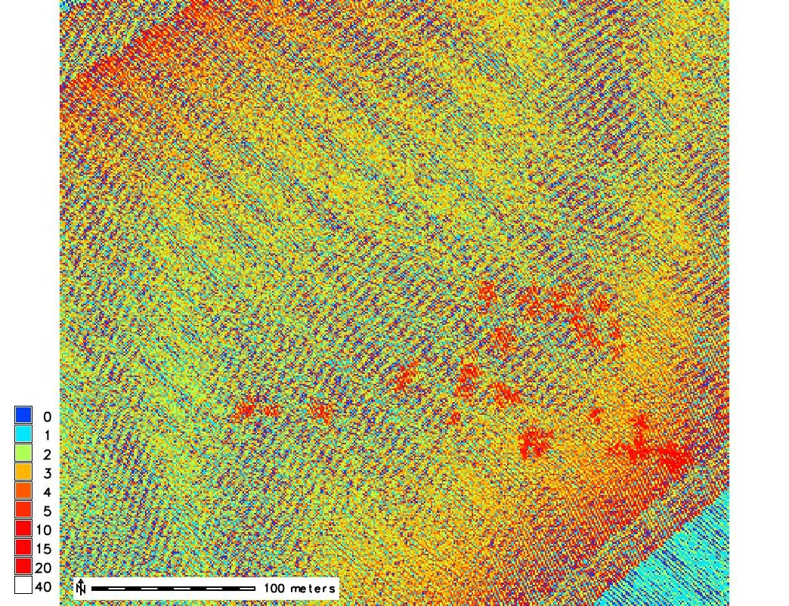{fig-alt="Map of all lidar returns per 1 m cell at Mid Pines: a speckled yellow and orange field of three to five points with diagonal scan stripes, red patches of ten or more points over tree crowns, and a 100 m scale bar"}

All returns
:::
::: {.column width="50%"}
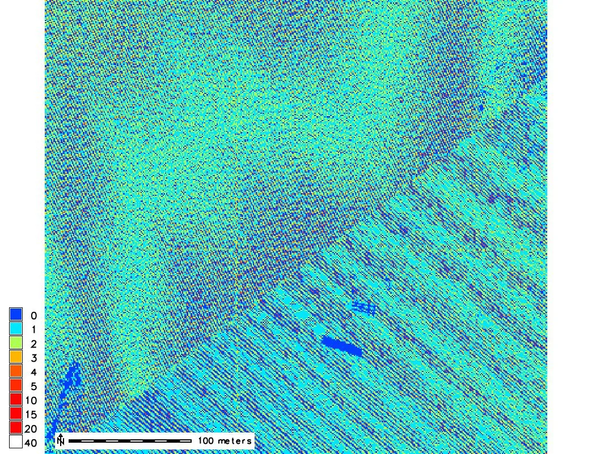{fig-alt="Map of ground class lidar points per 1 m cell at Mid Pines: mostly cyan at one point with blue zero cells in stripes, and a solid dark blue rectangle with no ground points where a building stands"}

Ground
:::
:::

::: {.notes}
* All returns: trees light up red because every pulse through a crown gives several echoes
* Ground only: about one point per square meter, zero under the building and in dense crowns
* The diagonal stripes in both are the scan pattern; they will show up in any surface you bin
:::

## Point density: Mid Pines SfM {.smaller}

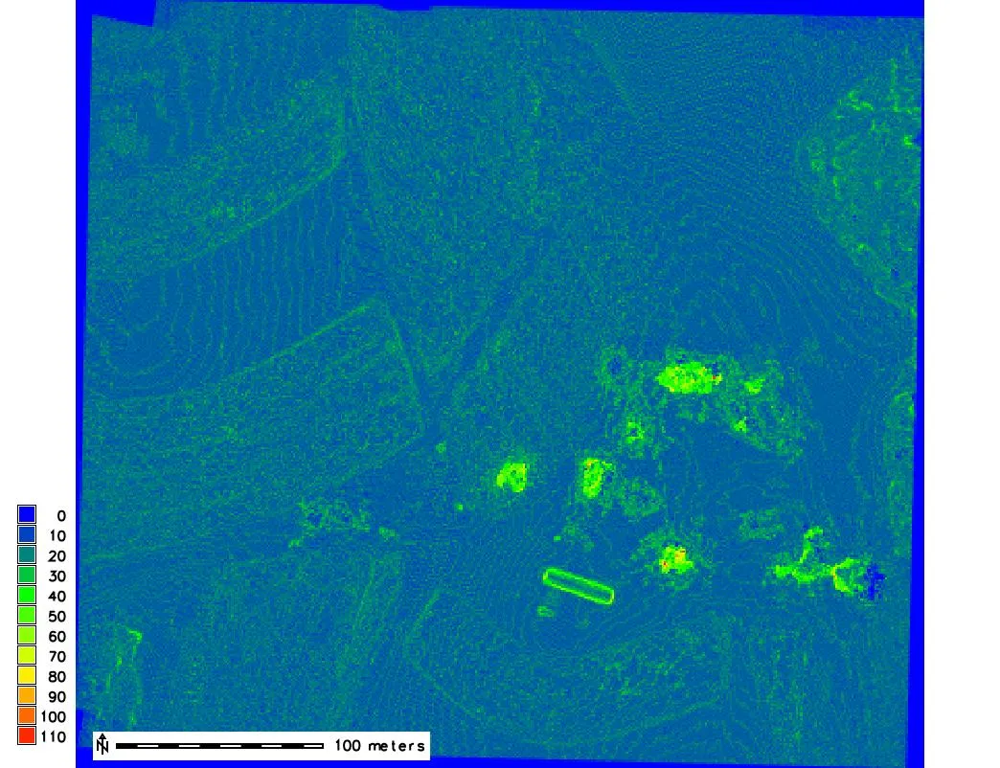{width="62%" fig-align="center" fig-alt="Map of UAS SfM points per 1 m cell at Mid Pines: a fairly even blue field of ten to twenty points with faint contour-like banding, green and yellow patches of fifty or more points on tree crowns and building edges"}

High point densities around trees and building edges.

::: {.notes}
* Ten to twenty points per square meter on the fields, several times the lidar
* Highest where the photos have the most texture: crowns and edges; the matcher finds more there
* Density is not accuracy; the SfM cloud has no ground under those crowns at all
:::

## Vertical range within a cell {.smaller}

::: {.columns}
::: {.column width="50%"}
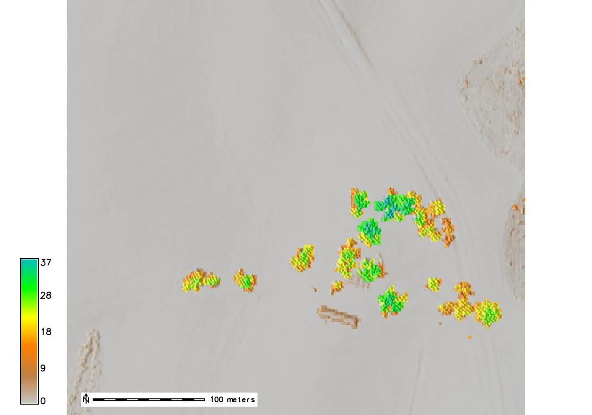{fig-alt="Map of the range of lidar z values per 3 m cell over a shaded relief of Mid Pines: grey near zero on the fields, and tree crowns as patches of green and cyan reaching 28 to 37 m of range"}

Lidar
:::
::: {.column width="50%"}
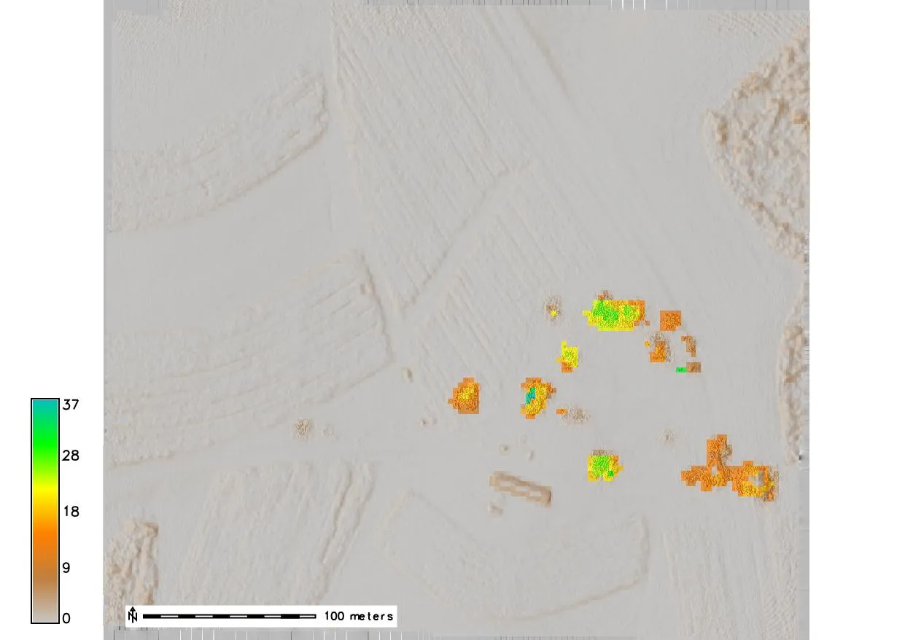{fig-alt="Map of the range of UAS SfM z values per 3 m cell over shaded relief: fields near zero, the same trees as smaller orange and yellow patches of 9 to 28 m of range, and the plowed field pattern visible in the relief"}

UAS SfM
:::
:::

Lidar reaches through the canopy, so it gives a larger z range and better information about the trees than the denser UAS cloud.

::: {.notes}
* Range of z per cell: zero on bare ground, tree height under a crown
* Lidar's range is the whole tree, crown to ground; SfM's is only the crown's shape
* Denser is not better here: the lidar knows the tree height, the SfM cloud does not
:::

## Outliers {.smaller}

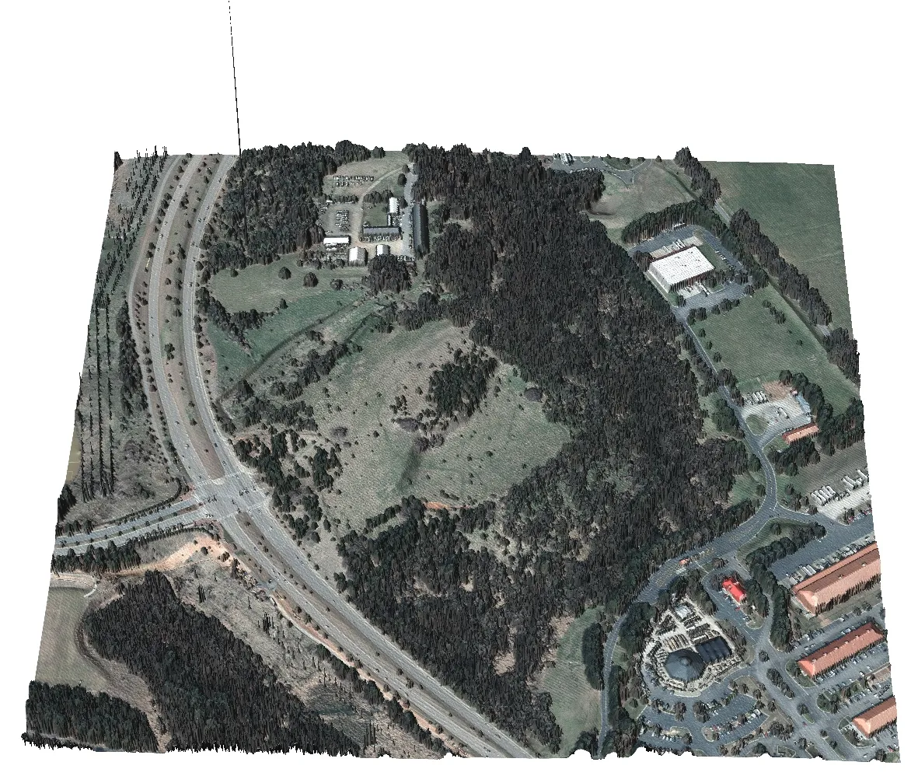{width="62%" fig-align="center" fig-alt="3D view of a binned first return lidar surface over an orthophoto of Centennial Parkway and a wooded campus: trees and buildings stand up correctly, and one thin vertical spike rises far above everything from a single stray point"}

- Lidar: birds, airborne particles, reflective materials
- SfM: errors in point matching
- Filter with local z-min, z-max, or range thresholds; outliers survive even in processed data

::: {.notes}
* The spike is one point, hundreds of meters up; a bird, or a multipath echo
* Providers filter most outliers (class 7), not all
* Binning with min or max makes them obvious; interpolation would turn the spike into a cone
:::

## Ground and thinning {.center .text-center .section-divider background-color="#e9f2e9"}

::: {.notes}
* Section 3: separating ground from everything else, and reducing the cloud to what you need
:::

## Bare ground extraction {.smaller}

::: {.term-card}
**Ground classification**: labeling the points that lie on the terrain so that a DEM can be built from them alone; the rest is vegetation, buildings, and noise
:::

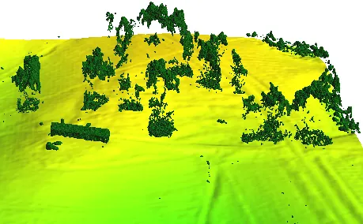{width="48%" fig-align="center" fig-alt="3D view of Mid Pines: a smooth green and yellow ground surface with the lidar points classified as above ground, trees and one long building, standing on it as dark green clusters"}

- Multiple returns help but are not required; the surface has to be sampled by enough points
- Multiscale curvature classification [@evans_multiscale_2007], `v.lidar.mcc` in GRASS
- Progressive morphological filter [@zhang_progressive_2003]

::: {.notes}
* Both algorithms grow a ground surface and reject points that stick up from it by more than a curvature or slope tolerance
* MCC works scale by scale, so it keeps terraces and rejects crowns; it is the addon in the lab's optional part
* Works on SfM clouds too, with no returns: the geometry is enough on open ground
:::

## Decimation {.smaller}

::: {.incremental}
- Thinning the cloud by subsampling, to make the data manageable
- The thinning threshold follows from the features that must be preserved
- Count based: keep every n-th point; preserves variations in density
- Grid based: keep one point per cell; removes variations in density
- Distance and geometry based: keep points where the surface changes; more expensive
:::

::: {.notes}
* A 5 GB cloud does not need 5 GB of points to make a 1 m DEM
* Count based is fast and keeps the swath overlap pattern; grid based evens it out
* `v.in.pdal` and `r.in.pdal` thin on import with the skip and preserve options
:::

## Decimation: count based {.smaller}

::: {.columns}
::: {.column width="50%"}
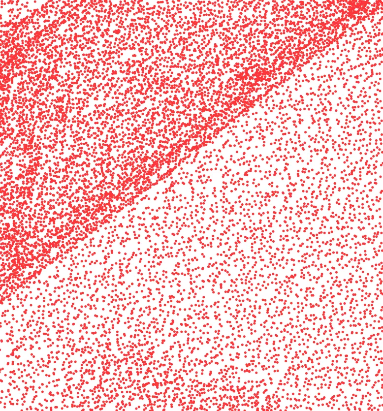{fig-alt="Plan view of a terrestrial lidar point cloud as red dots: very dense in the upper left near the scanner, thinning toward the lower right, with a diagonal ridge of higher density"}

Full cloud
:::
::: {.column width="50%"}
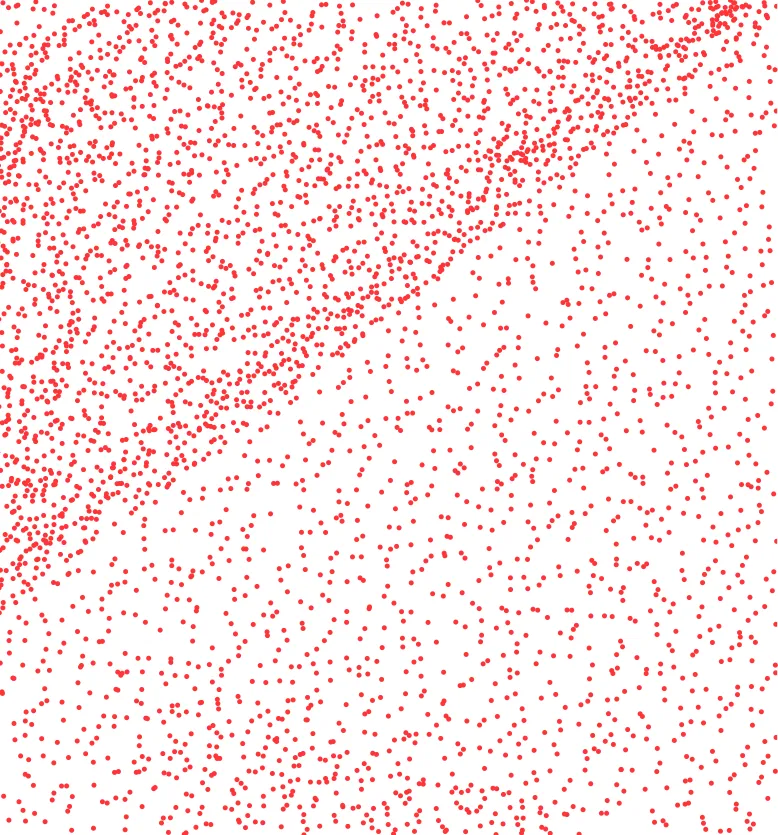{fig-alt="The same cloud keeping every third point: fewer dots everywhere, but the dense upper left and the sparse lower right are still visibly different"}

Every third point
:::
:::

Preserves the relative point densities.

::: {.notes}
* One point in three, everywhere; the density gradient of the terrestrial scan survives
* Right choice when you want the data to keep telling you where the sensor was strong
:::

## Decimation: grid based {.smaller}

::: {.columns}
::: {.column width="50%"}
{fig-alt="Plan view of the full terrestrial lidar point cloud as red dots, dense near the scanner and sparse far from it"}

Full cloud
:::
::: {.column width="50%"}
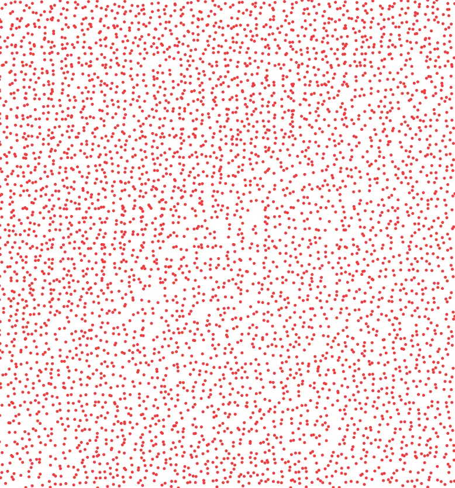{fig-alt="The same cloud thinned to one point per grid cell: an even scatter of red dots across the whole area with no density gradient left"}

One point per cell
:::
:::

Removes the variations in point density.

::: {.notes}
* One point per cell: the near field loses most of its points, the far field keeps all of them
* Right choice before interpolation, when uneven density would bias the surface
:::

## From points to surfaces {.center .text-center .section-divider background-color="#e9f2e9"}

::: {.notes}
* Section 4: three ways to turn points into a DEM or DSM, and what each costs
:::

## Three ways to a surface {.smaller}

| Method | How | Strengths | Weaknesses |
|---|---|---|---|
| Binning | Per cell statistic: mean, min, max, nearest | No import, fast, enough for many uses | Noisy, no-data cells where points are missing |
| TIN | Triangulate the points into a mesh | Variable resolution, standard in 3D design | Flat triangles on roads, dams across valleys, few analysis tools, hard to share |
| Interpolation | Fit a surface to the points and sample it on a raster | Resolution above the point spacing, smooth, every GIS tool applies | Result depends on the method; large rasters |

::: {.notes}
* Binning is `r.in.pdal` with method mean, min, or max; the lab's Part 3
* TIN is what Metashape's mesh is, with the same problems in valleys
* Interpolation is `v.surf.rst`; the lab's Part 4 at 0.5 m from 1 m point spacing
* With dense clouds most interpolation methods agree; the choice matters at the edges and under trees
:::

## Binning: Jockey's Ridge 1999 lidar {.smaller}

::: {.columns}
::: {.column width="50%"}
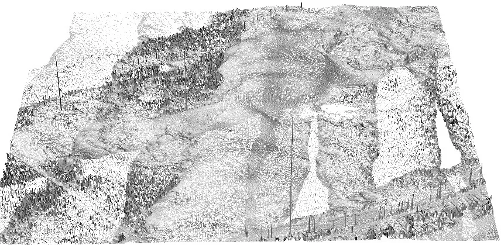{fig-alt="3D view of a lidar dune field binned at 1 m: the dune shape is visible but the surface is riddled with white holes where cells have no points, and tall spikes stand along one edge"}

Binned at 1 m: many null cells
:::
::: {.column width="50%"}
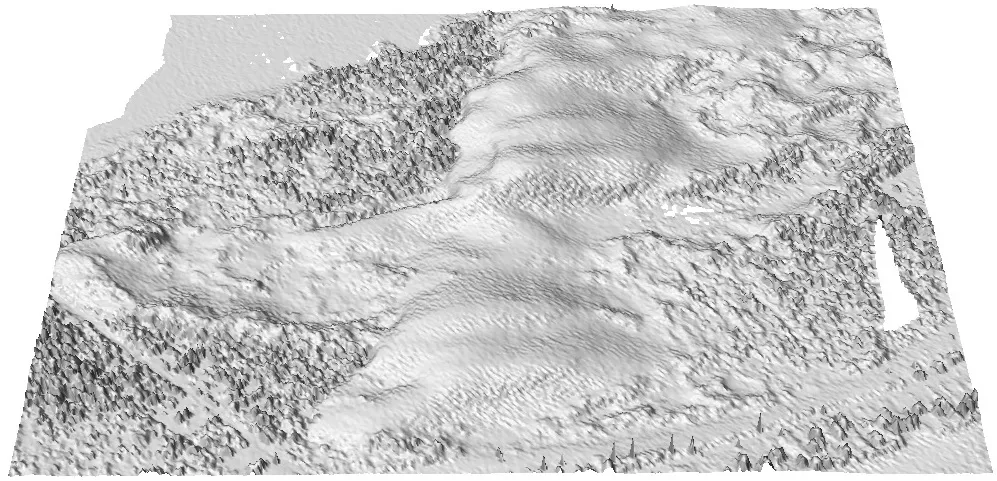{fig-alt="3D view of the same dunes binned at 3 m: a continuous grey shaded surface with the dune crests, a few remaining holes at the edges, and rough texture on the vegetated flanks"}

Binned at 3 m
:::
:::

::: {.notes}
* 1999 data at about one point per 3 m: at 1 m most cells are empty
* 3 m is the resolution the density supports; binning works, but it is coarse
* This is why the density map comes first
:::

## Interpolation: Jockey's Ridge 1999 lidar {.smaller}

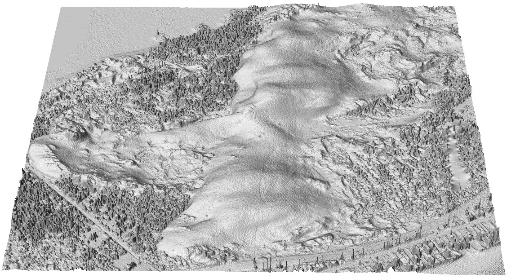{width="70%" fig-align="center" fig-alt="3D shaded view of the Jockey's Ridge dunes interpolated at 1 m: a continuous smooth surface with the dune ridges, slip faces, and vegetation texture, and no holes"}

Interpolated at 1 m from the same points.

::: {.notes}
* Same 1999 points, now a 1 m surface with no holes: the spline fills between points
* The detail on the dune is real; the roughness on the flanks is the vegetation in the first returns
* The price is that the surface is a model between the points, not a measurement
:::

## TIN from the Mid Pines SfM cloud {.smaller}

::: {.columns}
::: {.column width="50%"}
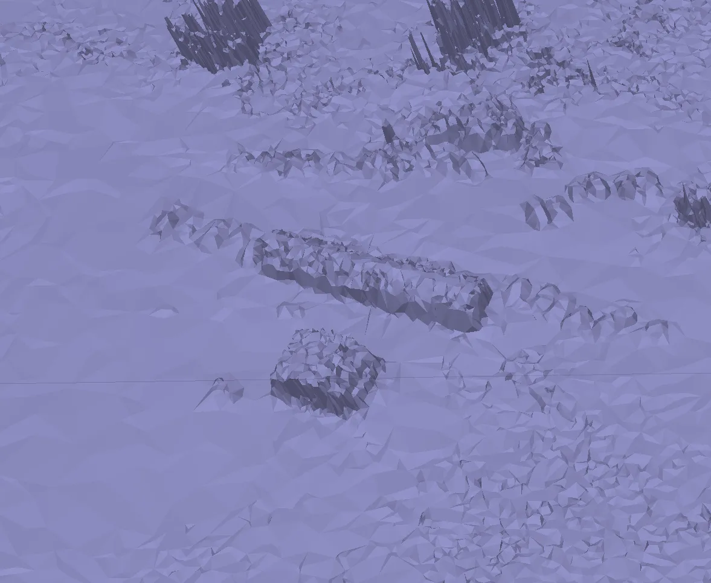{fig-alt="Close-up of a low density triangulated mesh of the Mid Pines SfM cloud in flat blue shading: a long building and a small structure as jagged blocks, trees as clusters of thin spikes, and large flat triangles between"}

Low density
:::
::: {.column width="50%"}
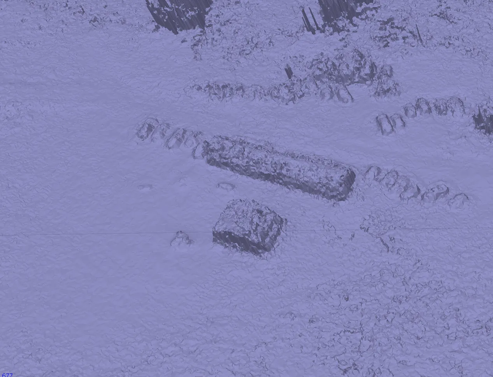{fig-alt="The same area as a high density mesh: the building and structure have crisp edges, the ground shows fine texture, and the trees are dense spiky clusters"}

High density
:::
:::

::: {.notes}
* Metashape's mesh at two face counts; the 2B face count setting in action
* Low density: large triangles smear the building edges; high density: edges are sharp but every bush is a spike field
* Either way the mesh is for visualization and volumes, not for terrain analysis
:::

## Smoothed TIN {.smaller}

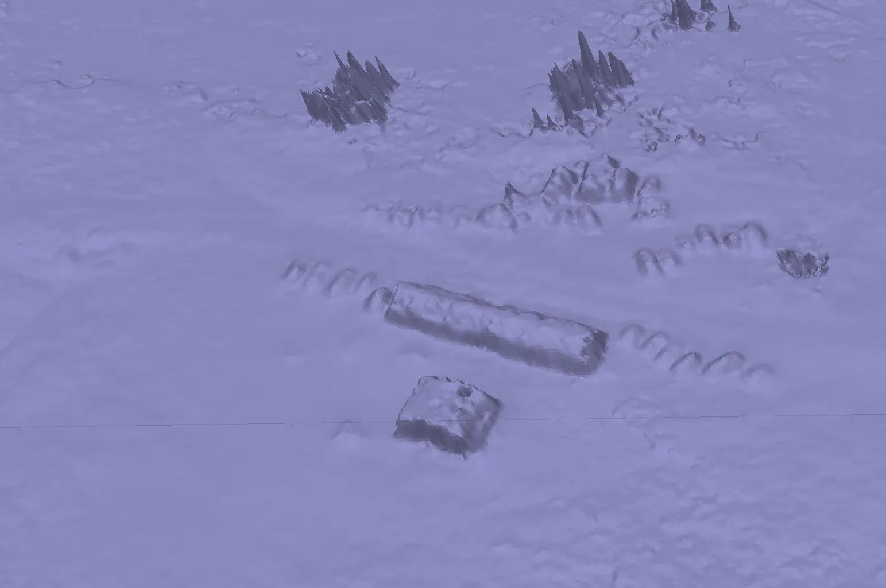{width="66%" fig-align="center" fig-alt="The high density mesh after smoothing: the building and structure as rounded blocks, the ground as a gently undulating surface, and the trees as softened spiky mounds"}

::: {.notes}
* Smoothing removes the matching noise and also the sharp edges
* Good for a 3D model to look at; it has quietly changed the volume of every pile and building
:::

## Interpolated SfM surface {.smaller}

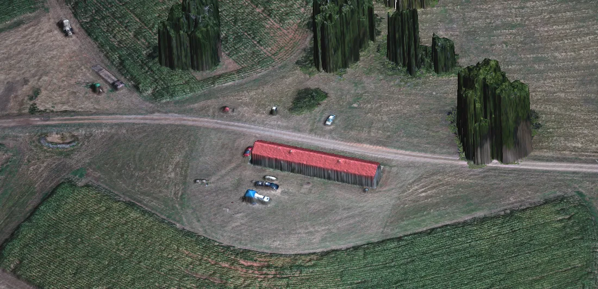{width="78%" fig-align="center" fig-alt="Oblique 3D view of the Mid Pines SfM cloud interpolated by spline and draped with the orthophoto: a long red-roofed building, parked vehicles, a dirt road, and trees that stand up as solid green columns because the surface wraps the crowns"}

High density SfM point cloud imported to GRASS and interpolated with the regularized spline with tension.

::: {.notes}
* `v.surf.rst` on the dense cloud: a raster DSM you can run every GRASS tool on
* The trees are columns, not cones: the spline follows the crown shell and drops to the ground at the edge
* This is the surface the 4A DSM comparisons were made from
:::

## Lidar and SfM DSMs of Mid Pines {.smaller}

::: {.columns}
::: {.column width="50%"}
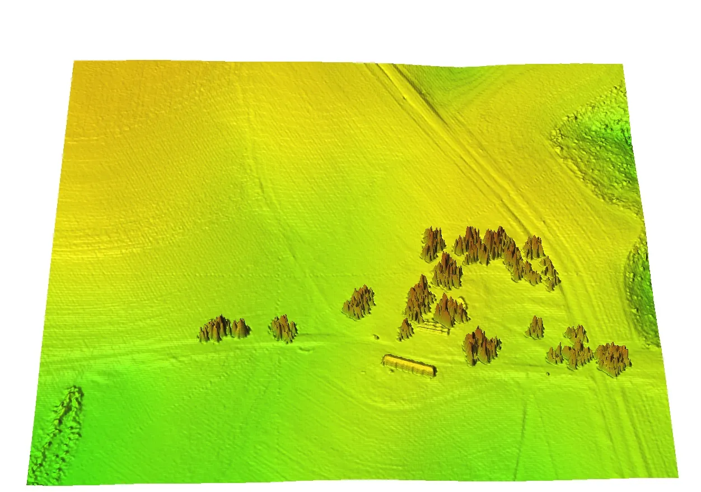{fig-alt="3D view of the interpolated lidar DSM of Mid Pines colored by elevation from green to yellow: smooth fields, a few rows of trees as pointed brown mounds, and the long building as a small block"}

Lidar
:::
::: {.column width="50%"}
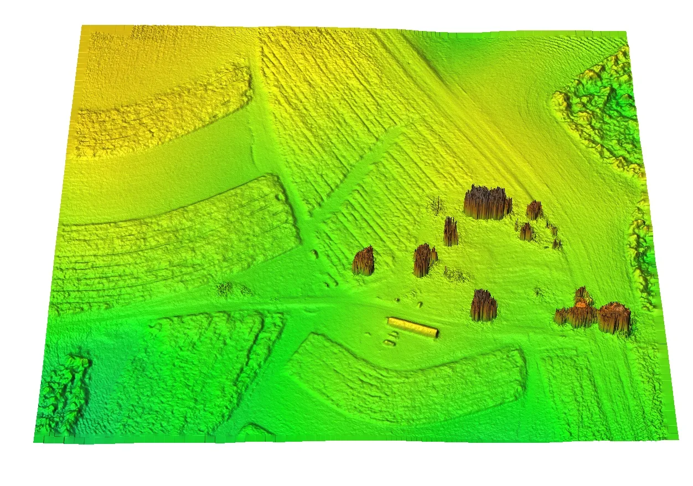{fig-alt="3D view of the interpolated UAS SfM DSM of the same area: the plowed strips and terraces of the fields stand out as fine texture, the trees are dense dark mounds, and the building is sharply outlined"}

UAS SfM
:::
:::

::: {.notes}
* Lidar at 1 point per square meter gives a smooth, slightly generalized surface
* SfM at 15 points per square meter resolves the plow rows; it also carries the matching noise
* The lab interpolates the lidar at 0.5 m; Topic 5 differences the two
:::

## Topographic analysis {.center .text-center .section-divider background-color="#e9f2e9"}

::: {.notes}
* Section 5: slope, aspect, and curvature from point cloud surfaces, and why it is harder than it looks
:::

## Why derivatives are hard here {.smaller}

::: {.incremental}
- Point cloud DEMs are noisy, so slope and curvature can reflect the noise or the scan pattern rather than the terrain
- At high resolution a landform is represented by tens or hundreds of cells, and a 3 x 3 window sees only a fraction of it
- The result is noisy derivatives, or derivatives biased toward the point distribution
:::

::: {.notes}
* 4A ran `r.slope.aspect` on a 0.3 m DSM and the speckle was visible; that is this problem
* A terrace 5 m wide is 15 cells at 0.3 m; a 3 x 3 window is a tenth of the feature
* Two fixes: smooth the DEM first, or compute the derivatives from the points
:::

## Topographic analysis with splines {.smaller}

- The regularized spline with tension has explicit equations for its partial derivatives, so slope, aspect, and curvatures are computed in the same run as the interpolation [@mitasova_simultaneous_2005]
- The parameters come from the original points, tens to hundreds of them per location, not from a 3 x 3 window
- Tension and smoothing tune the level of detail

::: {.term-card}
In GRASS: `v.surf.rst input=points elevation=dem slope=slope aspect=aspect pcurv=pcurv tension=20 smooth=1`
:::

::: {.notes}
* One command, one pass over the points: the DEM and its derivatives, consistent with each other
* Tension controls how stiff the surface is; smoothing how far it may depart from the points
* The lab runs this on the ground points and on the first returns, with slope and profile curvature
:::

## Tuning the level of detail {.smaller}

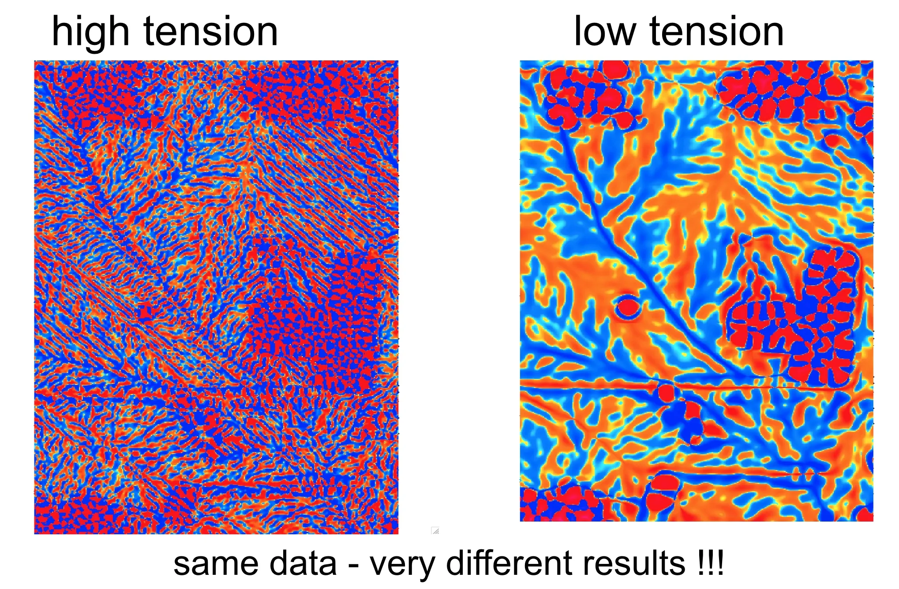{width="66%" fig-align="center" fig-alt="Two profile curvature maps of the same lidar area side by side: with high tension the map is a fine red and blue speckle that follows the scan lines; with low tension it shows branching red and blue valley and ridge patterns with round blobs for the trees; the caption reads same data, very different results"}

Same points, different tension: high tension follows every point and the scan pattern, low tension shows the landforms.

::: {.notes}
* Left: tension too high, the surface is tight to the points and the curvature maps the scan stripes
* Right: tension lower, the channels and ridges appear; the blobs are tree crowns in the first returns
* There is no single right value; it depends on the feature size you are after
:::

## Curvature and slope on a 1 m DEM {.smaller}

{width="78%" fig-align="center" fig-alt="Two 3D views of a 1 m lidar DEM of a stream valley with cultivated terraces: on the left profile curvature in red, blue, and green speckle draped over the terrain; on the right slope in yellow and red, with the terrace faces and the valley sides standing out"}

Profile curvature and slope draped over the 1 m DEM.

::: {.notes}
* Curvature finds the terrace edges and the channel; slope shows the valley sides
* Both computed by the spline from the ground points, so the terraces are continuous, not stair steps
* `npmin` in the lab controls how many points each segment uses; too few and segment seams appear
:::

## Vertical structure {.center .text-center .section-divider background-color="#e9f2e9"}

::: {.notes}
* Section 6: when a surface is not enough, keep the third dimension
:::

## Voxel models {.smaller}

::: {.term-card}
**Voxel model**: a 3D raster whose cells hold a statistic of the points inside each volume element, for example the point count; in GRASS, `r3.in.xyz` after setting a 3D region
:::

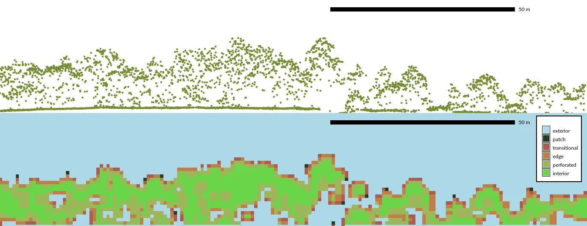{width="90%" fig-align="center" fig-alt="Top: a side profile of lidar points through a forest edge in green, showing crown shapes and the ground line, with a 50 m scale bar. Bottom: the same profile as a classified voxel slice, with interior canopy in green, edge and transitional cells in orange and red, and exterior in light blue"}

Vertical profile through the point cloud, and the same profile as voxels classified by a 3D fragmentation index.

::: {.notes}
* A DSM keeps one number per column; the voxel model keeps the whole column
* Point count per voxel maps where the canopy is dense and where it is open
* The fragmentation index classifies each voxel by its neighbors: interior, edge, perforated
:::

## Voxel cross sections in 3D {.smaller}

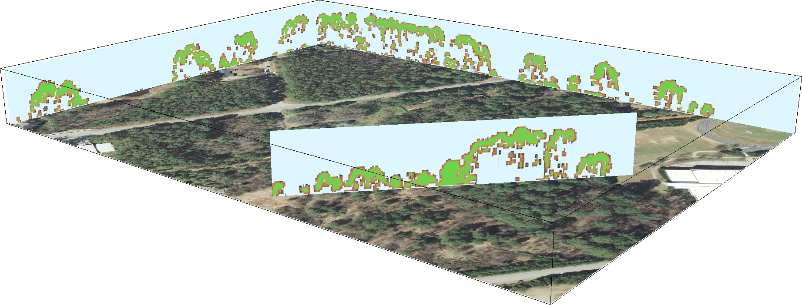{width="80%" fig-align="center" fig-alt="3D view of a forest orthophoto with two vertical slices of a voxel model standing on it, along the far edge and across the middle, each slice showing the canopy as green cells with orange edge cells against a pale blue background"}

::: {.notes}
* Slices through the 3D raster, placed where you want to look
* The lab's optional part builds this voxel model from the Mid Pines lidar and slices it in the 3D view
:::

## Full waveform lidar {.smaller}

::: {.columns}
::: {.column width="50%"}
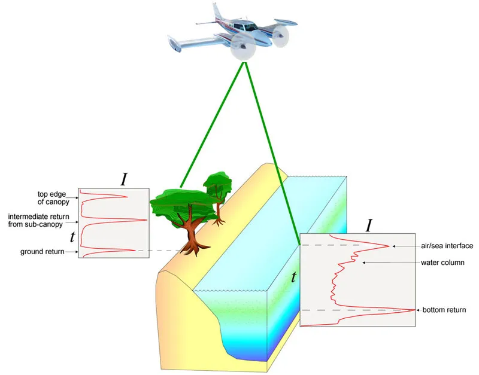{fig-alt="Diagram of an aircraft sending a laser pulse over trees and a coastal water block; two inset graphs of intensity against time show the full returned waveform, with peaks for the top of canopy, sub-canopy, and ground on land, and for the sea surface, water column, and bottom in water"}
:::
::: {.column width="50%"}
- A discrete return lidar records a few peaks of the echo; a full waveform system records the entire echo
- Mammoth Cave National Park: classified point cloud in LAS, raw waveform, and imagery
- Vertical structure of the canopy from the waveform, not only its top
:::
:::

::: {.notes}
* The returns we have been using are peaks picked from this curve by the instrument
* Keeping the curve gives the vegetation profile below the crown and bathymetry in clear water
* The Mammoth Cave data set is the example for the next two slides
:::

## Mammoth Cave: canopy {.smaller}

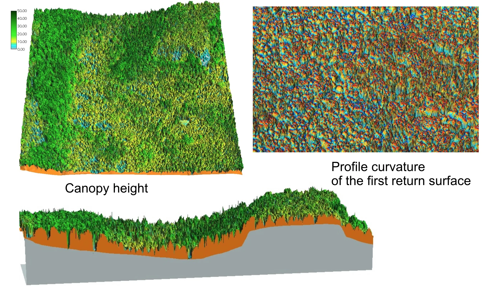{width="80%" fig-align="center" fig-alt="Three panels: a 3D canopy height model of a forested block colored green with a 0 to 50 m legend; a profile curvature map of the first return surface as dense red and blue speckle; and a cross section showing the canopy in green above the orange ground surface and grey bedrock block"}

::: {.notes}
* Canopy height is DSM minus DEM, both from the same cloud
* Curvature of the first return surface: every crown is a bump, which is how individual trees are found
* The cross section shows what the DEM hides: 30 m of forest on top of the terrain
:::

## Mammoth Cave: bare earth {.smaller}

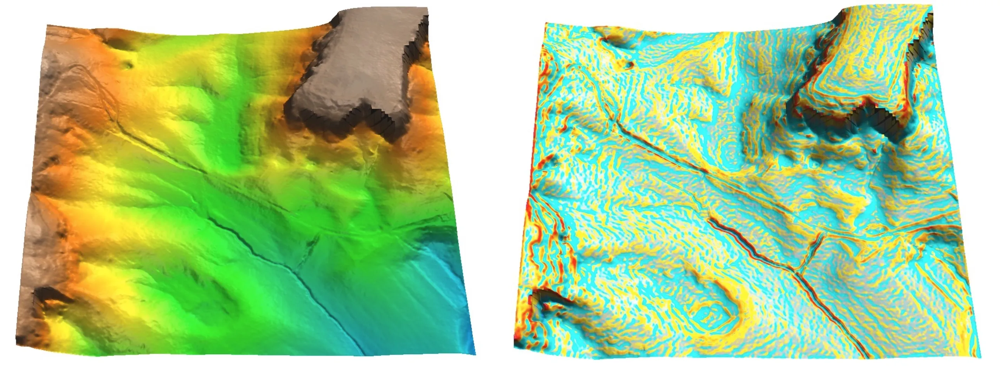{width="80%" fig-align="center" fig-alt="Two 3D views of the Mammoth Cave bare earth DEM: on the left colored by elevation from blue valleys through green to orange and brown ridges, with a flat-topped plateau in one corner; on the right profile curvature in cyan and yellow with red along the sharp breaks of the plateau edge and the stream channels"}

::: {.notes}
* Ground points only, under a full canopy; this is the lidar's whole advantage over imagery
* The curvature map picks the plateau edge and the drainage; the sinkholes of the karst show as closed rings
* Everything here was computed from the classified LAS with the tools from this lecture
:::

## Voxel models of canopy density {.smaller}

::: {.columns}
::: {.column width="50%"}
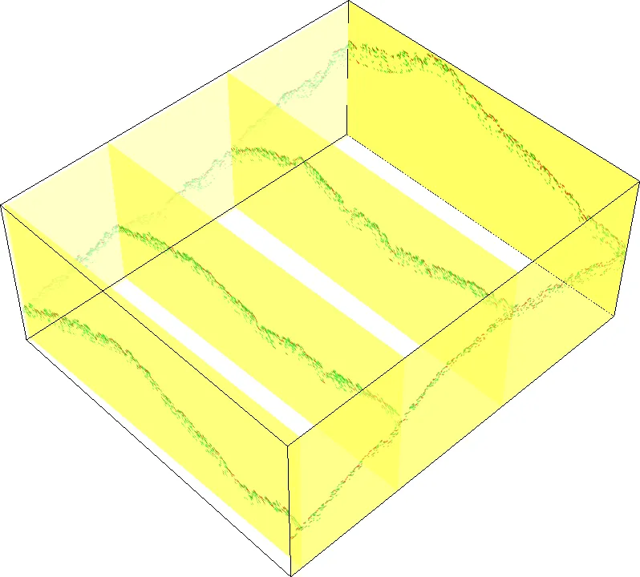{fig-alt="A translucent yellow 3D box with four vertical slices through it, each slice showing a wavy green and red line where the canopy surface cuts the slice"}
:::
::: {.column width="50%"}
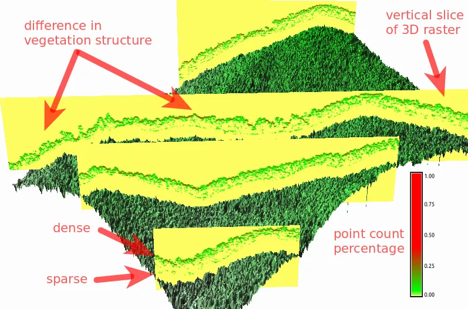{fig-alt="3D view of forested terrain with vertical yellow slices of a voxel model showing the canopy as a band colored from green for sparse to red for dense point count percentage; arrows mark a difference in vegetation structure between two stands and label dense and sparse canopy"}
:::
:::

Point count per voxel as a percentage, sliced through two forest stands with different structure [@petras_processing_2016].

::: {.notes}
* Same voxel approach on the Mid Pines lidar: green sparse, red dense canopy
* The two stands differ in where the dense layer sits, which no DSM would show
* The paper is the lab's reference for all of the GRASS point cloud tools
:::

## Lidar today {.center .text-center .section-divider background-color="#e9f2e9"}

::: {.notes}
* Section 7: what is changing in lidar, and where to get public data
:::

## Airborne lidar today {.smaller}

::: {.incremental}
- Manned aircraft carry the newest sensors: full waveform, multispectral, and single photon lidar
- Single photon lidar detects one photon per return, so it maps terrain and forest structure over whole counties from high altitude in a few flights [@swatantran_rapid_2016]
- Against full waveform lidar it needs fewer passes for the same density, but the cloud is noisier and needs more filtering [@mandlburger_comparison_2019]
- Geiger mode lidar is the other photon counting design: each detector pixel records one photon per pulse, so the cloud is built from thousands of overlapping looks [@stoker_evaluation_2016]
:::

::: {.notes}
* None of these are UAS sensors; they are large-area mapping systems on manned aircraft
* Single photon (Leica SPL100) and Geiger mode (L3Harris) are both photon counting, which is what lets them fly high and fast; they differ in the detector
* Geiger mode: avalanche photodiode array, one range per pixel per pulse, noise from sunlight, near infrared so no bathymetry; USGS tested both for 3DEP and found them usable for QL2 with more filtering than linear lidar
* Swatantran et al. mapped Garrett County, Maryland, at 12 points per square meter; canopy height and terrain matched conventional lidar
* Mandlburger et al. flew both systems over Vienna in 2018: single photon precision was mostly under 10 cm, with more noise on slopes and grass
* Full waveform was the Mammoth Cave example a few slides back
:::

## UAS lidar today {.smaller}

::: {.incremental}
- Small spinning and solid state scanners made UAS lidar routine
    - a DJI Zenmuse L2 on a Matrice 350 maps a field at several hundred points per square meter
- Discrete return, a few returns per pulse, like the 2013 cloud in the lab
- Accuracy still rests on the GNSS and IMU of the platform
:::

::: {.notes}
* Ten years ago UAS lidar was experimental; now it is a camera-sized payload
* It sees under the canopy like airborne lidar and at SfM densities; the GNSS/IMU quality decides the accuracy, not the scanner
* An attitude error of 0.1 degree at 100 m range moves a point 17 cm; that is why UAS lidar payloads carry a better IMU than a camera needs
* Same trade as always: active sensor, no color, more expensive than a camera
:::

## Public lidar data sources {.smaller}

| Source | What you get |
|---|---|
| [USGS 3DEP](https://usgs.entwine.io/) | Nationwide point clouds streamed as Entwine tiles, plus DEMs through The National Map |
| [NOAA Digital Coast](https://coast.noaa.gov/digitalcoast/) | Coastal point clouds with on the fly binning and download |
| [NC OneMap](https://www.nconemap.gov/) | The statewide QL2 lidar flown 2014 to 2017: points, DEMs, and derived products |
| [OpenTopography](https://opentopography.org/) | Research lidar (NCALM and others) with on demand DEM generation |

More on lidar in GRASS at the [GRASS wiki](https://grasswiki.osgeo.org/wiki/LIDAR), and a full workshop at [Processing lidar and UAV point clouds in GRASS](https://grasswiki.osgeo.org/wiki/Processing_lidar_and_UAV_point_clouds_in_GRASS_GIS_(workshop_at_FOSS4G_Boston_2017)).

::: {.notes}
* The 2013 Mid Pines data in the lab is the Wake County part of the NC statewide program
* 3DEP through Entwine is the same COPC streaming idea as the lab's browser viewer
* The workshop page is the long form of today's lecture, with every command
:::

## Key terms {.smaller}

::: {.columns}
::: {.column width="50%"}
::: {.term-card}
**Return**: one echo of a lidar pulse; a pulse through a canopy gives several, the last one most likely from the ground
:::
::: {.term-card}
**Class**: the label a provider or an algorithm assigned to a point: ground, unclassified, noise, water
:::
::: {.term-card}
**Binning**: a per cell statistic of the points, with no interpolation
:::
:::
::: {.column width="50%"}
::: {.term-card}
**Interpolation**: a surface fitted to the points and sampled on a raster, at a resolution the point spacing can support
:::
::: {.term-card}
**DEM vs DSM**: ground points give the terrain; first returns or all points give the surface, canopy and roofs included
:::
::: {.term-card}
**Voxel model**: a 3D raster of point statistics, keeping the vertical structure a DSM throws away
:::
:::
:::

::: {.notes}
* Midterm vocabulary, and the words the lab report has to use correctly
* The grading rubric asks for conclusions in these terms: returns, classes, binning versus interpolation
:::

## Wrap-up

::: {.term-card}
**Assignment 4B**: [Processing lidar and UAS SfM point clouds](../assignments/assignment_4b.qmd): bin and compare the densities of the two Mid Pines clouds, classify by returns, interpolate a DEM and DSM with their derivatives, and validate the lidar DEM against the surveyed GCPs
:::

::: {.notes}
* Recap: lidar measures through the canopy with returns; SfM reconstructs the first surface in color
* Look at the density before choosing a resolution; bin for a quick look, interpolate for analysis
* Derivatives from the spline, not from a 3 x 3 window, when the DEM is noisy
* The lab validates the lidar DEM with the twelve surveyed GCPs the UAS flights used
:::

## References {.smaller}

::: {#refs}
:::
