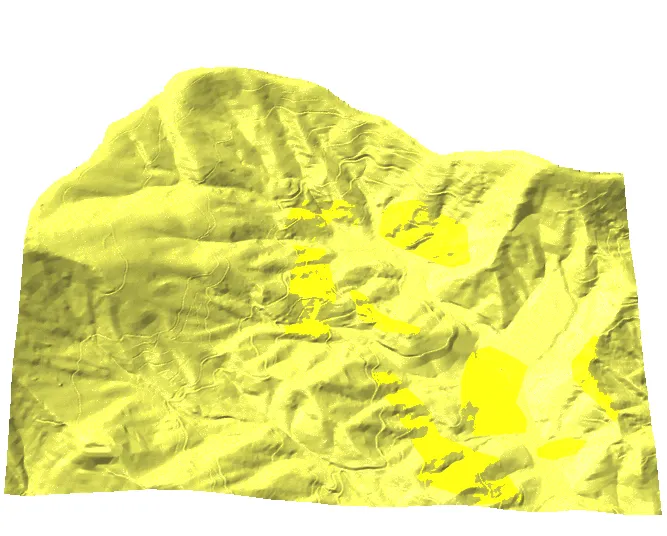

[](https://colab.research.google.com/github/ncsu-geoforall-lab/gis-584-uas-course/blob/gh-pages/course/topics/topic_5_advanced_analytics/assignments/fusion_analysis.ipynb)

## Task

In this assignment you combine the 2013 airborne lidar surfaces of Mid Pines with the June 2015 UAS SfM DSM. You first compare the lidar DSM with the UAS DSMs from two SfM packages, as difference maps and along a profile on the road, to find systematic shifts and distortions and to pick the part of the UAS DSM worth keeping. You then patch that part into the lidar DSM, once by a simple patch and once by a weighted average across an overlap, and fuse the UAS bare ground with the lidar DEM using `r.patch.smooth` with a fixed and a spatially variable overlap. Finally you simulate overland flow on three of the surfaces and compare the flow patterns at the edges. The optional last part animates the simulation.

Keep in mind what each surface represents. The lidar DEM is bare ground; the lidar DSM and the UAS DSM include the crop, which in June stands 1 to 2 m above the soil. A seam between two surfaces a few centimeters apart is invisible in an elevation map and obvious in shaded relief and in simulated flow.

Work through the steps below in the GRASS GUI or command line, or open the notebook in Colab (badge above), which runs the same steps in Python and produces the maps and statistics for you. The GUI Profile Tool in Part 1 and the Animation Tool in Part 5 are GUI only; the notebook plots the profile and the time steps instead. Either way, the report is the same.

## Data

- [Lake Wheeler GRASS project: Lake_Wheeler_NCspm]() (EPSG:3358; you have it from the earlier assignments; it holds the 2015 UAS DSMs in `PERMANENT`)
- [2013 lidar DEM and DSM of Mid Pines]() (zip with GRASS raster packs; you have it from Assignment 4B, restore with `r.unpack`)
- [Color rules for difference maps: dif_lidar_uav.txt]() (a text file for `r.colors`)

## Software

- [GRASS]() 
- The addon [r.patch.smooth](https://grass.osgeo.org/grass85/manuals/addons/r.patch.smooth.html), installed from GRASS with:

```bash
g.extension extension=r.patch.smooth
```

## Part 1: Compare the lidar and UAS DSMs

Start GRASS in the `Lake_Wheeler_NCspm` project and create a new mapset `fusion` for this assignment. Put the unzipped lidar packs and the color rules file in your working directory, then restore the lidar surfaces:

```bash
r.unpack -o input=mid_pines_lidar2013_dsm.pack
r.unpack -o input=mid_pines_lidar2013_dem.pack
```

### Difference maps

Set the region to the lidar DSM and subtract the June 2015 UAS DSMs from it, first the one from Agisoft Metashape, then the one from Pix4D. Both were processed with the same eleven GCPs. Apply the color rules to both and look at the statistics:

```bash
g.region raster=mid_pines_lidar2013_dsm -p
r.mapcalc "diff_lidardsm_agi_june = mid_pines_lidar2013_dsm - 2015_06_20_DSM_agi_11GCP"
r.colors map=diff_lidardsm_agi_june rules=dif_lidar_uav.txt
r.univar map=diff_lidardsm_agi_june
r.mapcalc "diff_lidardsm_pix4d_june = mid_pines_lidar2013_dsm - 2015_06_20_pix4d_11GCP_dsm"
r.colors map=diff_lidardsm_pix4d_june rules=dif_lidar_uav.txt
r.univar map=diff_lidardsm_pix4d_june
```

The color rules keep differences within 10 cm grey, so that only real differences show color, orange and red where the UAS surface is higher than the lidar and cyan and blue where it is lower:

```bash
-40 red
-1 orange
-0.5 yellow
-0.1 grey
0 white
0.1 grey
0.5 cyan
1 aqua
40 blue
```

If you run `r.colors` from the command line, the rules file has to be in your current working directory, or give its full path.

> diff_lidardsm_agi_june: mean -0.54, standard deviation 2.34
> diff_lidardsm_pix4d_june: mean -0.40, standard deviation 2.42

The means are dominated by the crop, which the UAS surface includes and the 2013 lidar does not. The extremes of 30 m and more are tree crowns and building edges, where a half meter shift in position becomes a large difference in elevation. Look at the pattern instead: where are the two maps alike, and where does the Pix4D map show a difference the Agisoft map does not?

### Profile along the road

Stable, hard features show systematic shifts. Sample the Agisoft difference map along a line on the road, import the profile as points, and summarize the difference column:

```bash
r.profile -g input=diff_lidardsm_agi_june output=road.txt coordinates=637208,219491,637059,219734
v.in.ascii input=road.txt output=profile_road separator=space columns="x double,y double,profile double,diff double"
v.univar map=profile_road column=diff
```

`r.profile -g` writes four columns, the coordinates, the distance along the line, and the raster value, which is why `v.in.ascii` is told the column names and types.

> n: 951
> mean: 0.0785
> population standard deviation: 0.0671

The UAS surface sits about 8 cm below the lidar along the road, with a spread of 7 cm. Repeat the three commands for `diff_lidardsm_pix4d_june` and compare the two means.

For a visual comparison, use the GUI Profile Tool:

1. In the Map Display toolbar, open **Analyze map > Profile surface map** and select the rasters `mid_pines_lidar2013_dsm`, `2015_06_20_DSM_agi_11GCP`, and `2015_06_20_pix4d_11GCP_dsm`.
2. In the Profile toolbar, pick **Draw transect**, then click in the Map Display on the road where the profile should start and where it should end.
3. Use **Plot options** (the yellow wheel icon) to show the legend and set the colors of the three profiles.

::: {.callout-tip}
Why are the differences small along the road and large in the fields? Draw a second profile across a field to see what the crop does to the UAS surface.
:::

### Clip the UAS DSM

The shift of 8 cm is small compared with the differences in the fields, so we do not correct for it here. We do use the difference maps to pick the part of the Agisoft DSM with the least distortion and clip it to that region:

```bash
g.region n=219720.9 s=219257.1 w=636762.9 e=637190.4 res=0.3 -p
r.mapcalc "2015_06_20_DSM_agi_11GCP_cl = 2015_06_20_DSM_agi_11GCP"
```

The rest of the assignment uses `2015_06_20_DSM_agi_11GCP_cl`, `mid_pines_lidar2013_dsm`, and `mid_pines_lidar2013_dem`. Copy them to short names to keep the commands readable:

```bash
g.copy raster=2015_06_20_DSM_agi_11GCP_cl,uas
g.copy raster=mid_pines_lidar2013_dsm,lidar_dsm
g.copy raster=mid_pines_lidar2013_dem,lidar_dem
```

## Part 2: Patch the UAS DSM into the lidar DSM

### Simple patch

Set the region to the whole lidar DSM, fill it with the UAS DSM where the UAS has data, and compute a shaded relief to look for seams:

```bash
g.region raster=lidar_dsm -p
r.patch input=uas,lidar_dsm output=lid_uas_patch
r.relief input=lid_uas_patch output=lid_uas_patch_relief zscale=5
```

`r.patch` takes the first input wherever it is not null, so the UAS clip wins inside its rectangle and the lidar fills the rest. The `zscale=5` exaggerates the relief so that a step of a few centimeters casts a shadow. Zoom to the edge of the clip rectangle in the relief map.

### Weighted average across an overlap

The seam is a step between two surfaces that each have a few centimeters of noise. To remove it, blend the two with a weight that goes from the lidar at the edge of the UAS clip to the UAS a few meters inside it. Compute the distance from the edge inward, then blend with an overlap of 5 m and of 20 m:

```bash
r.grow.distance -n input=uas distance=distance
r.mapcalc "patched_smooth_5 = if(distance > 5, uas, if(distance == 0, lidar_dsm, (1 - distance/5) * lidar_dsm + (distance/5 * uas)))"
r.mapcalc "patched_smooth_20 = if(distance > 20, uas, if(distance == 0, lidar_dsm, (1 - distance/20) * lidar_dsm + (distance/20 * uas)))"
r.relief input=patched_smooth_5 output=patched_smooth_5_relief zscale=5
r.relief input=patched_smooth_20 output=patched_smooth_20_relief zscale=5
```

`r.grow.distance -n` measures the distance from the null cells inward, so `distance` is zero outside the UAS clip and grows toward its center. Compare the three relief maps at the clip edge and explain in your report how the weights work and what the overlap width changes.

## Part 3: Fuse UAS bare ground with the lidar DEM

### Extract the UAS bare ground

To model water flow on the UAS surface, the crop has to be removed, because water runs along the soil, not over the sorghum. The UAS cannot see the soil under the crop, so keep only the UAS cells that lie within 30 cm of the lidar bare ground and set the rest to null:

```bash
g.region raster=uas -p
r.mapcalc "uas_ground = if(uas - lidar_dem < 0.3, uas, null())"
```

About 59 percent of the cells in the clip pass this test: the bare field strips, the roads, and the lawns.

### Fixed overlap

Fill the holes with the lidar DEM using `r.patch.smooth`, which does the same distance-weighted blend as Part 2 along every edge of the bare ground patches. First with an overlap of 10 m:

```bash
g.region raster=lidar_dsm -p
r.patch.smooth input_a=uas_ground input_b=lidar_dem output=lidar_uas_ground_smooth smooth_dist=10
r.relief input=lidar_uas_ground_smooth output=lidar_uas_ground_smooth_relief zscale=5
```

### Spatially variable overlap

Then with the `-s` flag, which lets the overlap width follow the elevation difference between the two surfaces along the edges, wide where they disagree and narrow where they agree. `transition_angle` is the angle of the transition in degrees, and `parallel_smoothing` is the size of the window, an odd number of cells, that smooths the zone along the edge (see the [r.patch.smooth manual](https://grass.osgeo.org/grass85/manuals/addons/r.patch.smooth.html)):

```bash
r.patch.smooth -s input_a=uas_ground input_b=lidar_dem output=lidar_uas_ground_smooth2 overlap=overlap transition_angle=1.3 parallel_smoothing=13
r.relief input=lidar_uas_ground_smooth2 output=lidar_uas_ground_smooth2_relief zscale=5
```

Both runs take a few seconds. Display the `overlap` raster over the relief to see how the width varies along the edges of the bare ground patches.

## Part 4: Compare the overland flow on the three surfaces

An overland flow simulation is a sensitive test of a fused surface, because the flow follows every step in the surface. We simulate overland flow with [r.sim.water](https://grass.osgeo.org/grass85/manuals/r.sim.water.html) on the simply patched DSM, on the DSM blended with a 20 m overlap, and on the fused bare ground, and compare the depth maps at the seams.

First look at the watershed boundaries on the lidar DEM to pick a region that drains within the study area:

```bash
g.region raster=lidar_dem -p
r.watershed elevation=lidar_dem threshold=50000 accumulation=flowacc basin=basin
r.to.vect -t input=basin output=basin type=area
```

The simulation needs the first derivatives of the surface, from [r.slope.aspect](https://grass.osgeo.org/grass85/manuals/r.slope.aspect.html) here, or from `v.surf.rst` when you interpolate the surface yourself. Set the region, then run the first simulation on the simply patched DSM:

```bash
g.region n=219728.7 s=219435 w=636708.9 e=637122.6 res=0.3 -pa
r.slope.aspect elevation=lid_uas_patch dx=lid_uas_patch_dx dy=lid_uas_patch_dy
r.sim.water -t elevation=lid_uas_patch dx=lid_uas_patch_dx dy=lid_uas_patch_dy rain_value=30 man_value=0.15 depth=lid_uas_patch_depth discharge=lid_uas_patch_disch nwalkers=100000 niterations=20 output_step=1 hmax=0.2 halpha=8.0 hbeta=1.0
```

The region reaches west of the UAS clip on purpose, so that the seam is inside it. The simulation runs 20 minutes of rainfall at 30 mm per hour (`niterations` and `rain_value`). With `-t` it writes a depth and a discharge map every simulated minute (`output_step`), named `lid_uas_patch_depth.01` to `lid_uas_patch_depth.20`, so you can look at the first results while it runs. Each simulation takes 5 to 10 minutes on one processor core; add `nprocs=4` (or however many cores you have) to run it in parallel, or make the region smaller.

Then on the DSM blended with the 20 m overlap:

```bash
r.slope.aspect elevation=patched_smooth_20 dx=patched_smooth_20_dx dy=patched_smooth_20_dy
r.sim.water -t elevation=patched_smooth_20 dx=patched_smooth_20_dx dy=patched_smooth_20_dy rain_value=30 man_value=0.15 depth=patched_smooth_20_depth discharge=patched_smooth_20_disch nwalkers=100000 niterations=20 output_step=1 hmax=0.2 halpha=8.0 hbeta=1.0
```

Compare `lid_uas_patch_depth.20` with `patched_smooth_20_depth.20` at the edge of the UAS clip. Finally on the bare ground fused from the UAS DSM and the lidar DEM:

```bash
r.slope.aspect elevation=lidar_uas_ground_smooth dx=lidar_uas_ground_smooth_dx dy=lidar_uas_ground_smooth_dy
r.sim.water -t elevation=lidar_uas_ground_smooth dx=lidar_uas_ground_smooth_dx dy=lidar_uas_ground_smooth_dy rain_value=30 man_value=0.15 depth=ground_depth discharge=ground_disch nwalkers=100000 niterations=20 output_step=1 hmax=0.2 halpha=8.0 hbeta=1.0
```

Compare `ground_depth.20` with the two DSM results. The flow pattern is easiest to read in 2D with the depth map draped over the matching shaded relief, with the water depth color table set so that depths under a centimeter are transparent or near white.

## Part 5 (optional): Animate the flow

The [Animation Tool](https://grass.osgeo.org/grass85/manuals/wxGUI.animation.html) in the GUI builds an animation from a series of rasters and exports it as an animated GIF. Pick one or more of the simulations and load its twenty `*_depth.NN` maps into the tool. Add the matching relief raster underneath and set the transparency of the depth layer to 50 percent (the last icon in the Add new animation dialog) so that the flow reads against the terrain:

{width="60%"}

Export the animation as a GIF. This [video](https://www.youtube.com/watch?v=Pi1ESk9iPwk) shows how to control the Animation Tool.

## Report

Prepare a report (3 to 5 pages including figures):

1. **Difference maps and profile**: the two difference maps with the same color rules and their statistics, the road profile statistics for both UAS DSMs, and a paragraph on what the patterns show: systematic shift, processing distortion, or real change, and which UAS DSM you would fuse and why.
2. **Patching**: the shaded relief of the simple patch and of the 5 m and 20 m blends at the clip edge, with an explanation of how the weighted average works and what the overlap width changes.
3. **Fused bare ground**: the bare ground extraction, the two `r.patch.smooth` results, and the `overlap` raster, with a paragraph on where the variable overlap is wide and why.
4. **Flow comparison**: the depth maps at the last minute of the simulation for the three surfaces, and an interpretation of the differences at the seams and in the fields: which patterns are artifacts of the surface and which are real drainage.
5. **Optional**: the animated GIF, or a few frames from it, with a sentence on what the animation shows that the final map does not.

## Submission

Upload to Moodle, Assignment 5A:

* Your report as a PDF.
* Optional: your animated GIF.
* Optional: your completed notebook (`.ipynb`) if you worked in Colab.

## Grading

* **Difference maps and profile**: both difference maps use the given color rules, the road profile is summarized, and the patterns are read as shift, distortion, or change.
* **Patching**: the seam is shown in relief and the weighted average and the effect of the overlap width are explained correctly.
* **Fused bare ground**: the bare ground test is explained, both `r.patch.smooth` runs are shown, and the variable overlap is interpreted.
* **Flow comparison**: the three simulations are compared at the seams and the artifacts are told apart from real drainage.
* **Interpretation**: conclusions tie back to the lecture: independent errors, systematic error, seam, overlap width, flow as a test.
* On-time submission.

### Due 
