## Objectives {.smaller}

::: {.incremental}
- Explain why lidar and UAS SfM surfaces of the same site differ
- Evaluate the differences with difference maps and with profiles along stable features
- Separate systematic error, processing distortion, and real change in the landscape
- Patch and fuse DEMs with a fixed and a spatially variable overlap
- Evaluate a fused surface with an overland flow simulation
:::

::: {.notes}
* 4B built surfaces from the points; today we combine surfaces from two sensors into one
* Same site again: Mid Pines at Lake Wheeler, the 2013 lidar and the June 2015 UAS flights
* The lab (5A) runs this whole sequence: difference maps, a road profile, patching, smooth fusion, and a flow simulation on each result
* Every concept has a GRASS tool next to it; the lab uses them in the same order
:::

## Lidar and UAS SfM data {.center .text-center .section-divider background-color="#e9f2e9"}

::: {.notes}
* Section 1: properties of lidar and SfM data, and the motivation for fusion
:::

## Point clouds from lidar {.smaller}

{width="70%" fig-align="center" fig-alt="3D view of the Mid Pines lidar point cloud: sparse white ground points in regular scan lines on a black background, red-brown tree points along the far edge, and a rectangular building footprint"}

- The measured variable is the time of flight of each pulse
- Georeferencing from the platform position (GNSS) and orientation (IMU), fused in the INS
- Each (x, y, z) comes from range, position, and attitude; ground control serves only as a check

::: {.notes}
* Recap from 4B: an active sensor, a few returns per pulse, about one point per square meter in this 2013 cloud
* Points fall in scan lines; the ground under the trees is sampled
* Accuracy comes from the navigation system, not from targets on the ground
:::

## Point clouds from SfM {.smaller}

{width="70%" fig-align="center" fig-alt="Perspective view of the dense UAS SfM point cloud of the same fields: near-continuous light-toned ground, crop rows as dark stripes, red-brown trees at the horizon, and a building"}

- The measured variable is reflected light captured as overlapping images
- Georeferencing from GCPs, or from the camera positions when the UAS carries RTK or PPK GNSS
- Each (x, y, z) is reconstructed from matched image features

::: {.notes}
* Recap from 2A and 3B: a passive sensor, tens to hundreds of points per square meter, color on every point
* The cloud is a reconstruction of what the camera saw: the top of the crop, not the soil under it
* The GCP layout and the camera model decide the accuracy; 4A showed what happens without GCPs
:::

## Properties of lidar and SfM point clouds {.smaller}

::: {.columns}
::: {.column width="50%"}
**Airborne lidar**

- Penetrates vegetation, several returns per pulse
- Shifts between swaths, the corduroy effect
- Regional coverage, repeated every few years
- High cost per flight, low cost per hectare
:::
::: {.column width="50%"}
**UAS SfM**

- Very high point density, color on every point
- Cannot see the ground under vegetation
- Distorted by cast shadows and by weak GCP layouts
- Low cost per flight, limited area, flown on demand
:::
:::

::: {.term-card}
The errors and distortions of the two methods are different and independent, so each surface can be used to check the other
:::

::: {.notes}
* Lidar gives the ground and the wide area, SfM gives the detail and the date of your choice
* Because the error sources are independent, a difference map between them shows the error of whichever surface is worse at that spot
* The lab uses this: lidar ground under the UAS crop
:::

## Motivation for fusion {.smaller}

::: {.incremental}
- Low cost DEM updates where the landscape changes fast: construction sites, mines, eroding coasts
- Replace vegetation in a UAS DSM with lidar bare ground
- Watershed analysis when the UAS mapped only part of the watershed
- More accuracy and detail over stable features: buildings, bridges, road surfaces
:::

::: {.notes}
* The lidar serves as the base map and the UAS as the update
* The second bullet is the lab's Part 3: the crop in the UAS DSM is replaced by lidar ground so water can flow through it
* The third is why the lab fuses first and simulates flow after: the UAS clip alone does not cover the drainage
:::

## Fusion techniques {.smaller}

| Approach | Cost |
|---|---|
| Merge the point clouds, bin or decimate, interpolate once | Heavy computation, one consistent surface |
| Interpolate each, sample randomly, patch, reinterpolate | Loss of detail, slow |
| Interpolate each and patch the rasters | Fast, but a sharp edge at the seam |
| Smooth fusion of the rasters | Fast, no edge; both DEMs must share a resolution |

::: {.notes}
* The first row gives the most consistent surface but is rarely practical with tens of points per square meter or more
* The last row is what this lecture is about: a weighted blend across an overlap zone
* Shared resolution is the precondition; in the lab both surfaces are at 0.3 m
:::

## Workflow {.smaller}

::: {.incremental}
1. Evaluate both point clouds and choose a common resolution
2. Interpolate the lidar and the UAS DEMs at that resolution
3. Map and measure the differences between them
4. Identify systematic errors and distortions; correct or exclude them
5. Fuse with a smooth overlap and check the result
:::

::: {.notes}
* Steps 1 and 2 were 4B; today is steps 3 to 5
* Step 4 is often skipped; fusing a distorted DSM into a good DEM makes both worse
* The check in step 5 is a shaded relief first, and a flow simulation when the surface is for hydrology
:::

## Difference maps and profiles {.center .text-center .section-divider background-color="#e9f2e9"}

::: {.notes}
* Section 2: difference maps and profiles; distinguishing error from change
:::

## Identifying distortions from processing {.smaller}

::: {.term-card}
**Difference map**: one surface subtracted from the other cell by cell, `r.mapcalc`; the pattern tells you whether you are looking at error, distortion, or real change
:::

::: {.columns}
::: {.column width="50%"}
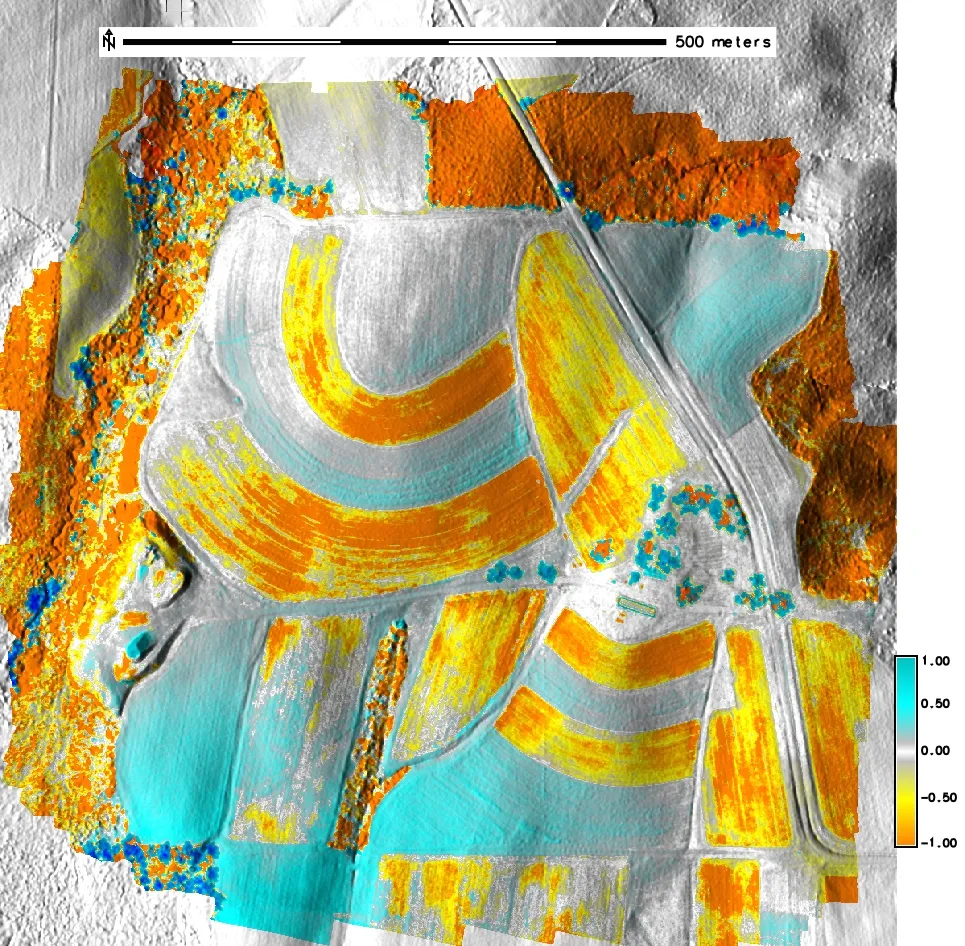{width="62%" fig-align="center" fig-alt="Difference map of the lidar DSM minus the June 2015 Agisoft DSM over shaded relief: curved crop fields in yellow and orange where the UAS surface is 0.5 to 1 m higher, cyan patches where it is lower, forest edges in orange and blue, legend from minus 1 to 1 m, 500 m scale bar"}

Lidar DSM minus Agisoft DSM
:::
::: {.column width="50%"}
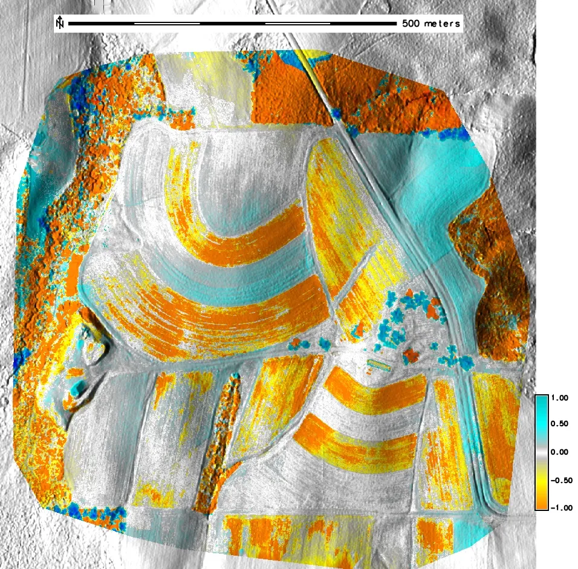{width="62%" fig-align="center" fig-alt="The same difference map computed with the Pix4D DSM: the same yellow and orange crop fields, with larger cyan areas in the northern fields where the Pix4D surface sits below the lidar"}

Lidar DSM minus Pix4D DSM
:::
:::

::: {.notes}
* Same images, same GCPs, two software packages: the crop fields look alike, the open fields do not
* The cyan in the Pix4D map is a processing distortion, a gentle warp of the whole surface
* Lab Part 1 computes both of these maps and their statistics with the same color rules
:::

## Identifying changes in topography {.smaller}

::: {.columns}
::: {.column width="45%"}
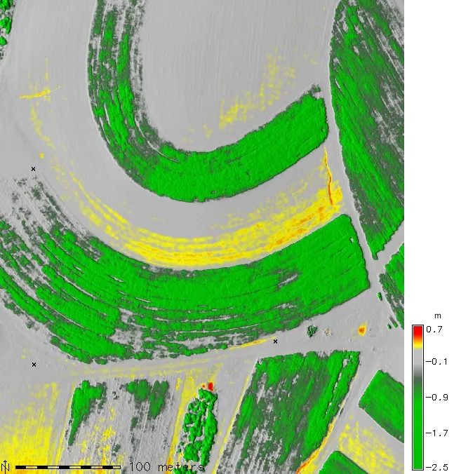{width="75%" fig-align="center" fig-alt="Difference map of the 2013 lidar DSM minus the June UAS DSM: crop field strips in green where the UAS surface is up to 2.5 m above the lidar, yellow strips near zero, grey roads and bare ground, legend from 0.7 to minus 2.5 m, 100 m scale bar"}
:::
::: {.column width="30%"}
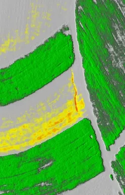{width="80%" fig-align="center" fig-alt="Zoom of the same difference map: green crop strips and a yellow bare strip, with a thin red line where a gully has cut into the field since the lidar flight"}
:::
::: {.column width="25%"}
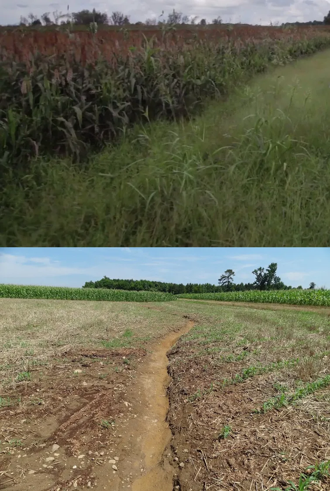{width="55%" fig-align="center" fig-alt="Two photographs: tall sorghum beside a mown grass path, and below it a rill eroded into bare soil between crop rows"}
:::
:::

- Vegetation growth or removal: the crop strips, two years apart
- Erosion and deposition: the red gully line
- Custom color rules center the scale on zero so that near-zero differences stay grey

::: {.notes}
* Not every difference is an error: here the green is sorghum that was not there in 2013
* The red line is a gully, a real change of a few decimeters, visible only because the rest of the field is near zero
* The lab provides a color rules file for this: grey within 10 cm, color beyond
:::

## Profiles: fields {.smaller}

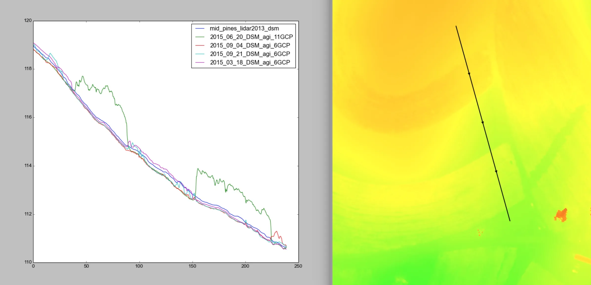{width="80%" fig-align="center" fig-alt="Profile plot of the lidar DSM and four UAS DSMs along a 250 m line down a slope from 119 to 110 m: the lines coincide on bare ground, and the green June line rises 1 to 2 m above the others where it crosses the crop; the map at right shows the black transect"}

- A vertical offset of the whole line is a systematic error
- A local bump is vegetation, or erosion and deposition

::: {.notes}
* Profiles show what a map does not: a constant offset versus a local change
* March and September lines sit on the lidar; June floats above it where the crop stands
* In the lab the GUI Profile Tool draws this; `r.profile` gives the numbers
:::

## Profiles: a building {.smaller}

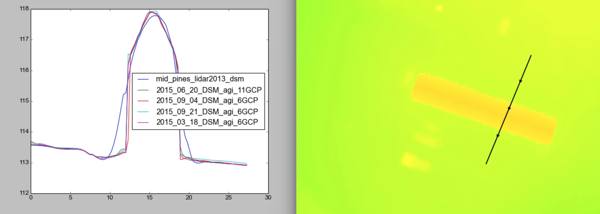{width="80%" fig-align="center" fig-alt="Profile plot across a flat-roofed building: all five surfaces coincide, with the roof at 117.5 m and the ground at 113 m; the lidar line has slightly rounded corners at the roof edges; the map at right shows the transect across a rectangular roof"}

- High accuracy in all surfaces, less detail in the lidar at the roof edges
- Negligible systematic error between lidar and UAS

::: {.notes}
* A stable, hard feature: if the surfaces disagree here, one of them has a problem
* The rounded corners are the one point per square meter lidar sampling, not an error
* Same test the lab does on the road
:::

## Profiles: a road {.smaller}

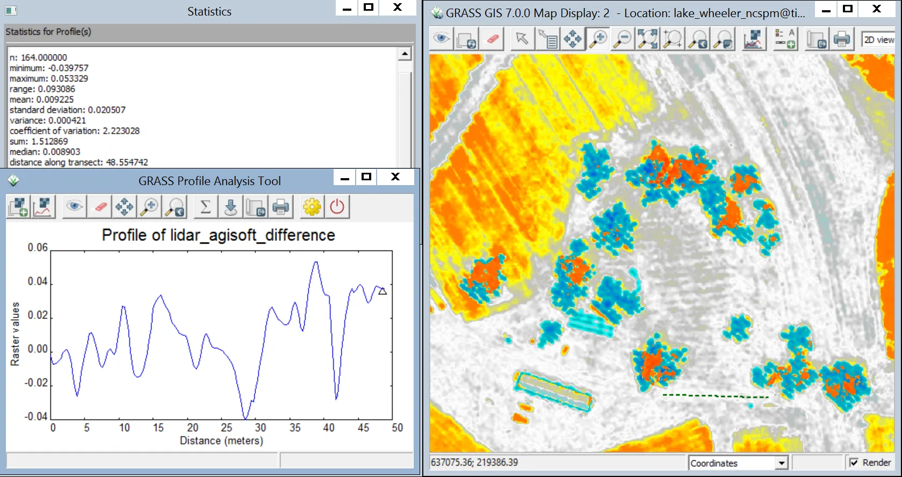{width="80%" fig-align="center" fig-alt="GRASS GUI with the Profile Tool plotting the lidar minus Agisoft difference along a 50 m road transect, values between minus 0.04 and 0.05 m, a Statistics window showing a mean of 0.009 m and a standard deviation of 0.02 m, and the map display with the difference map and the dashed transect on the road"}

- Roads and parking lots are easy to find and do not grow
- Lidar and UAS SfM agree within 4 cm here, with a mean offset under 1 cm

::: {.notes}
* This is lab Part 1: `r.profile` of the difference map along the road, `v.in.ascii` to a vector, `v.univar` for the mean
* A mean near zero means no vertical shift; the 4 cm spread is noise in both surfaces
* The lab's longer transect along the same road gives a mean of about 8 cm for the Agisoft DSM and 16 cm for the Pix4D DSM
* If the mean were 20 cm, you would subtract it before fusing
:::

## Correcting systematic errors {.smaller}

::: {.term-card}
**Systematic error**: a difference that follows a rule over the whole surface, a constant shift or a tilt, as opposed to random noise or local change
:::

::: {.incremental}
- A constant vertical shift (GNSS datum or antenna height): subtract the median difference over stable features
- A tilt (weak GCP geometry): fit a plane or a low-order polynomial to the differences and subtract it
- Complex SfM distortions: interpolate the GCP residuals or the lidar differences and subtract that surface
- Well distributed, accurate GCPs prevent most of this (4A)
:::

::: {.notes}
* Diagnose first with the profile, then pick the correction that matches the pattern
* Median, not mean: vegetation and outliers would pull the mean
* The lab's June Agisoft DSM is shifted about 8 cm along the road, small against the differences in the fields, so the lab does not correct it
:::

## Patching {.center .text-center .section-divider background-color="#e9f2e9"}

::: {.notes}
* Section 3: patching and the edge it produces
:::

## Updating a lidar DEM by patching {.smaller}

::: {.term-card}
**Patching**: filling the cells of one raster with another where the first has data, `r.patch`; the first input wins wherever it is not null
:::

::: {.columns}
::: {.column width="50%"}
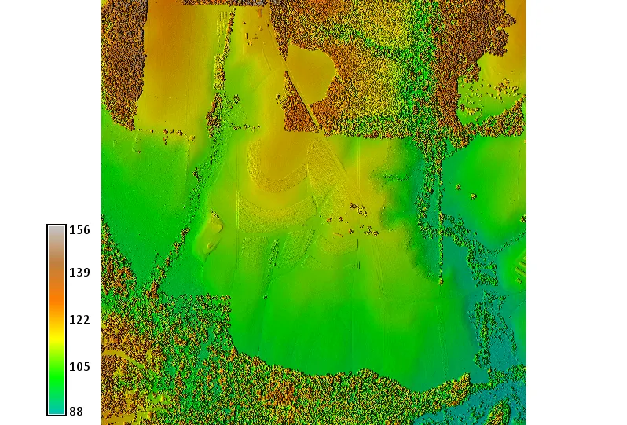{width="78%" fig-align="center" fig-alt="Elevation map from 88 to 156 m in green, yellow and orange with a textured UAS patch inserted into the smooth lidar DEM along a straight seam"}
:::
::: {.column width="50%"}
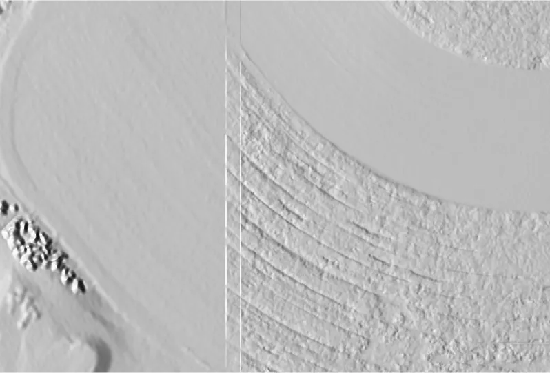{width="78%" fig-align="center" fig-alt="Shaded relief of the patched DEM: smooth lidar surface on the left, textured UAS surface with crop rows on the right, and a visible vertical seam and a horizontal step between them"}
:::
:::

A UAS DEM patched into a lidar DEM, elevation and shaded relief (images by Brendan Harmon)

::: {.notes}
* The elevation map looks fine; the shaded relief shows the seam at once
* Always check a patch in relief: `r.relief` with an exaggerated `zscale` finds steps of a few centimeters
* Lab Part 2 does this with the clipped UAS DSM and the lidar DSM
:::

## Edge between the patched DEMs {.smaller}

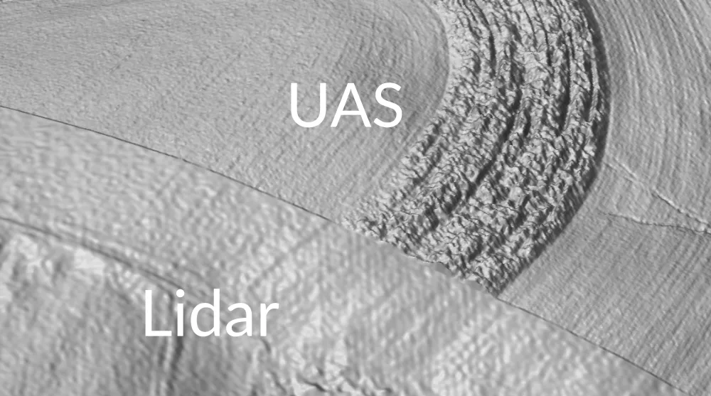{width="75%" fig-align="center" fig-alt="Shaded relief labeled UAS at the top and Lidar at the bottom: a sharp line separates the smooth lidar relief from the UAS relief with its crop rows"}

- A step of a few centimeters at the seam, and a change of texture
- Water flow follows the step: an artificial channel along the edge

::: {.notes}
* Two surfaces that each have a few centimeters of noise will never meet exactly
* The texture change is also real: the UAS sees crop rows the lidar never resolved
* The step matters most for hydrology, as Section 5 shows
:::

## Smooth fusion {.center .text-center .section-divider background-color="#e9f2e9"}

::: {.notes}
* Section 4: weighted blending across an overlap
:::

## Smooth fusion {.smaller}

::: {.term-card}
**Smooth fusion**: a weighted average of the two surfaces across an overlap zone along the edge, the weight going from one surface to the other with the distance from the edge; `r.patch.smooth` in GRASS
:::

::: {.columns}
::: {.column width="50%"}
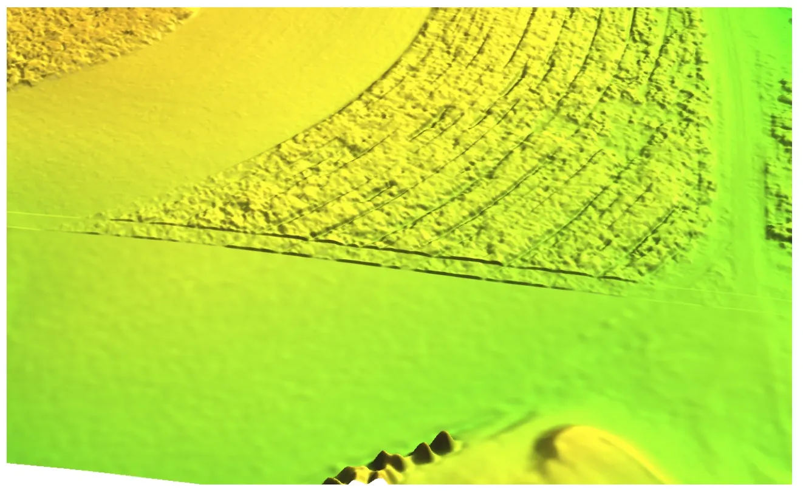{width="80%" fig-align="center" fig-alt="Colored shaded relief, yellow to green by elevation, of a patched DSM with a visible horizontal seam line running across the field"}

Patched
:::
::: {.column width="50%"}
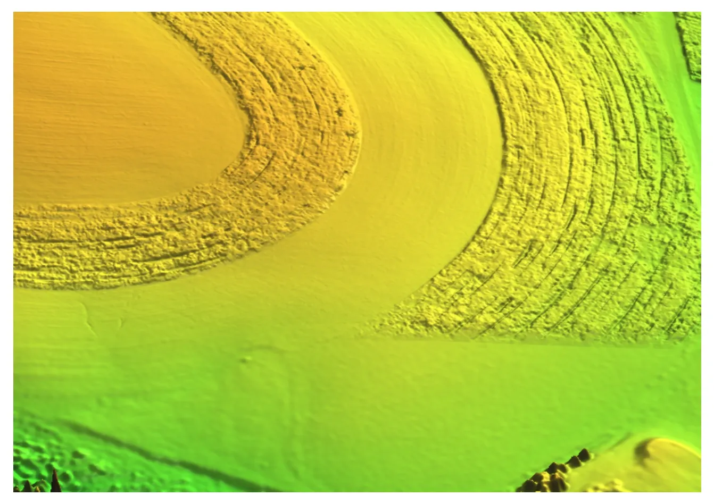{width="80%" fig-align="center" fig-alt="The same area after smooth fusion: no seam, and the curved crop rows blend into the smooth surrounding surface"}

Fused
:::
:::

::: {.notes}
* Two steps: derive the overlap zone from the distance to the edge, then blend with distance-based weights
* The lab does it by hand first with `r.grow.distance` and `r.mapcalc`, then with the addon
* Doing it by hand once shows what the addon's `smooth_dist` parameter does
:::

## Fusion method {.smaller}

A linear combination of the two elevation surfaces $z_A$ and $z_B$, weighted by the distance $d$ to the edge of $A$ over an overlap of width $s$:

::: {.columns}
::: {.column width="45%"}
$$
z_{AB} = w\, z_A + (1 - w)\, z_B
$$
$$
w = \begin{cases} d / s & 0 \le d < s \\ 1 & d \ge s \end{cases}
$$
:::
::: {.column width="55%"}
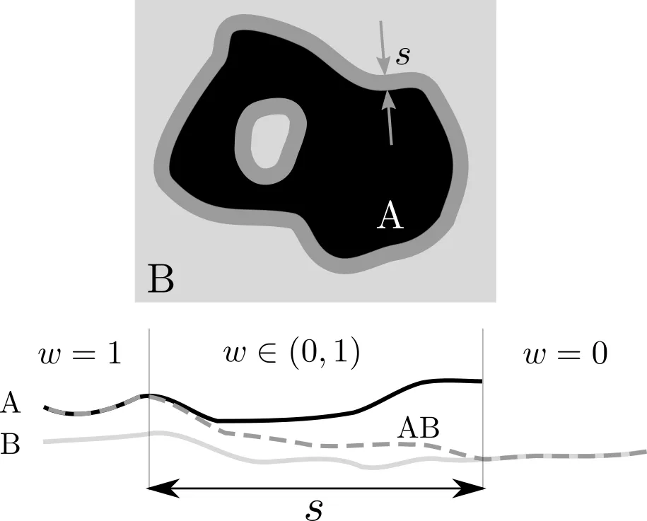{width="80%" fig-align="center" fig-alt="Diagram: at the top, area A in black inside area B in grey with an overlap band of width s along the edge of A; below, profiles of A, B and the fused AB, with weight w equal to 1 inside A, between 0 and 1 across the overlap, and 0 outside"}
:::
:::

::: {.notes}
* At the edge of A the weight is 0, so the fused surface equals B; s meters inside A it equals A
* In the lab: `r.grow.distance -n` gives d, then one `r.mapcalc` expression does the blend: `if(distance > s, uas, if(distance == 0, lidar, (1 - distance/s) * lidar + distance/s * uas))`
* `r.grow.distance -n` measures the distance inward from the null boundary, which is what d is here
* The lab runs this with s of 5 m and 20 m and compares the relief
:::

## Influence of the overlap width s {.smaller}

::: {.term-card}
**Overlap width**: how far into the updated surface the blend reaches; too narrow leaves a visible step, too wide erases detail of the better surface
:::

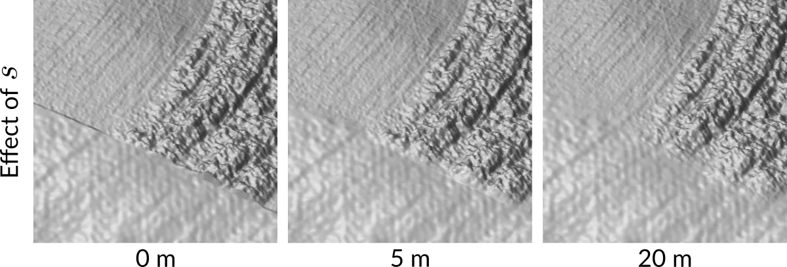{width="85%" fig-align="center" fig-alt="Three shaded relief panels of the same patch edge with overlap widths of 0, 5 and 20 m: the seam is sharp at 0 m, faint at 5 m, and gone at 20 m"}

::: {.notes}
* The difference between the two surfaces at the edge decides the width you need
* With a 3 cm step a few meters is enough; with a 30 cm step you need tens of meters
* The next step lets the elevation difference set s
:::

## Fusion with spatially variable overlap {.smaller}

::: {.columns}
::: {.column width="45%"}
- The width $s(x, y)$ follows the elevation difference $\Delta z$ between the two surfaces along the edge
- Wide transition where they disagree, narrow where they agree
- Fine features of both surfaces survive where the difference is small
:::
::: {.column width="55%"}
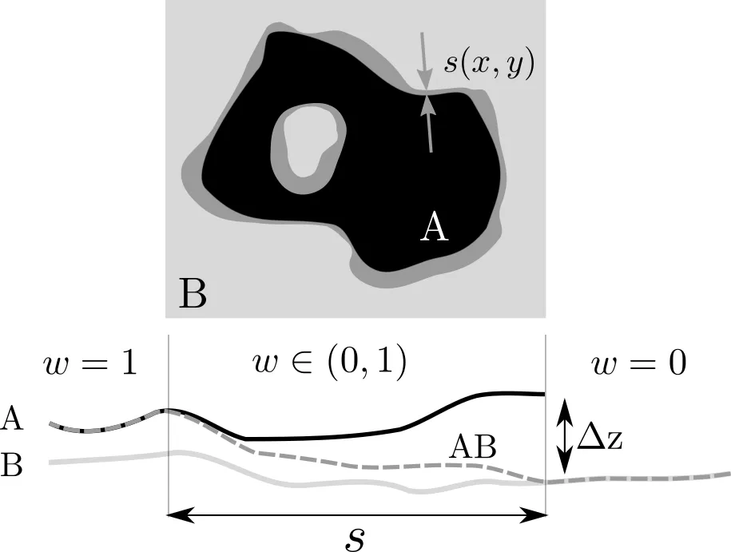{width="78%" fig-align="center" fig-alt="The same fusion diagram with a spatially variable overlap width s of x and y around area A, and the elevation difference delta z between the A and B profiles marked at the edge"}
:::
:::

::: {.term-card}
In GRASS: `r.patch.smooth -s input_a=uas_ground input_b=lidar_dem output=fused overlap=overlap transition_angle=1.3 parallel_smoothing=13` [@petrasova_fusion_2017]
:::

::: {.notes}
* The `-s` flag turns on the variable overlap; `transition_angle` is the angle of the transition in degrees (1 to 5 recommended), so the width grows with the elevation difference at the edge
* `parallel_smoothing` is the size of the window that smooths the zone along the edge, an odd number; larger values make the width less variable
* Lab Part 3 runs both variants on the bare ground and looks at the `overlap` raster
:::

## Overlap width from the elevation difference {.smaller}

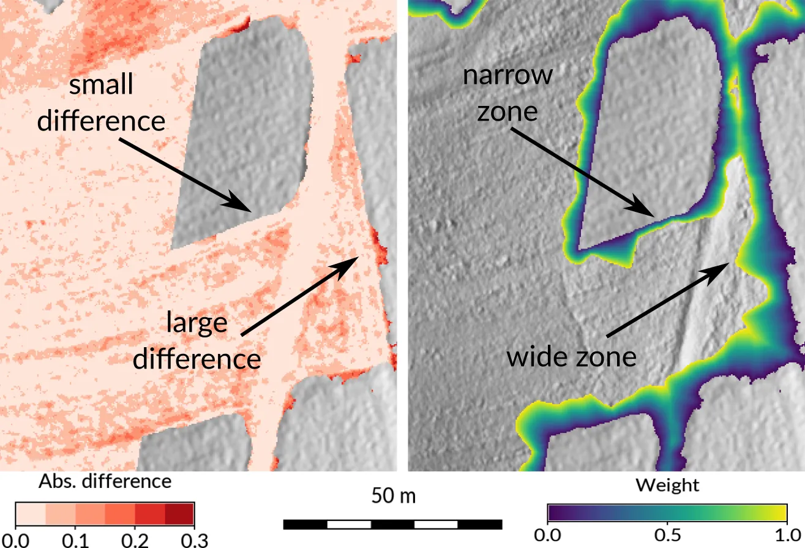{width="90%" fig-align="center" fig-alt="Two panels over shaded relief: the absolute difference between the two DEMs from 0 to 0.3 m in pink to red, labeled small difference and large difference, and the resulting weight raster from 0 to 1 in purple to yellow, labeled narrow zone and wide zone; 50 m scale bar"}

::: {.notes}
* Left: where the surfaces disagree by 20 to 30 cm; right: the weight raster the blend uses
* The zone is a few meters wide where the difference is near zero and tens of meters where it is large
* This is the `overlap` output the lab asks you to display
:::

## Patched and fused lidar and UAS DSMs {.smaller}

::: {.columns}
::: {.column width="50%"}
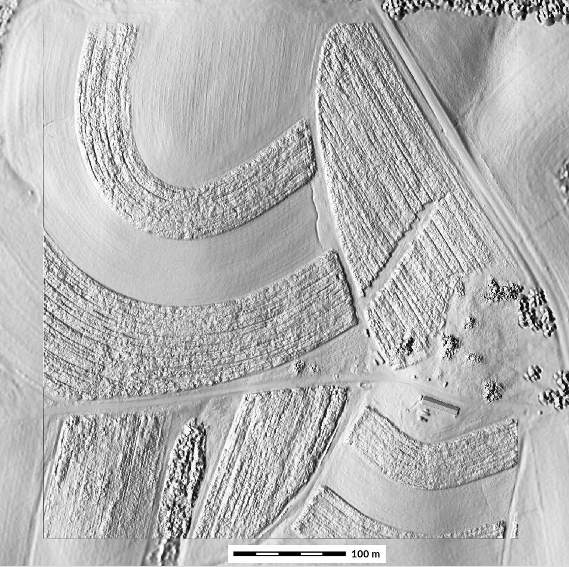{fig-alt="Shaded relief of the Mid Pines fields with the clipped UAS DSM patched into the lidar DSM: textured crop rows inside the UAS area and straight seams visible along the clip boundary; 100 m scale bar"}

Patched
:::
::: {.column width="50%"}
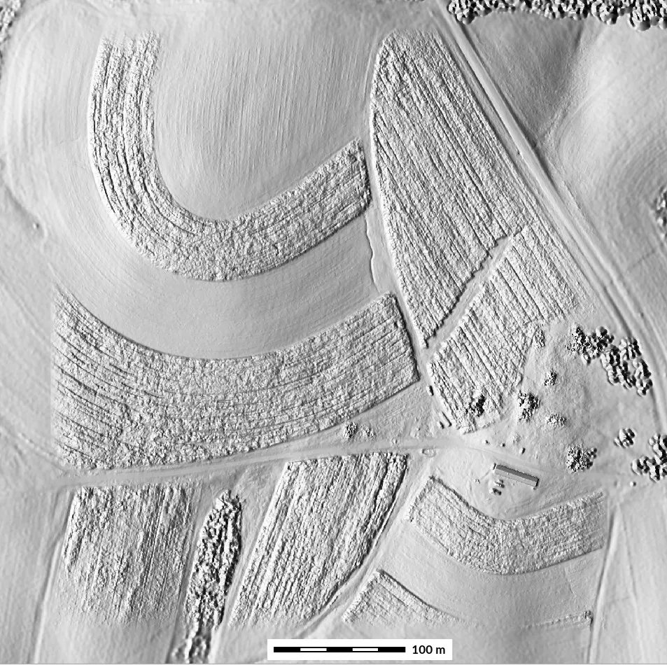{fig-alt="The same area after smooth fusion with a 20 m overlap: the seams along the clip boundary are gone"}

Fused, $s = 20$ m
:::
:::

::: {.notes}
* Lab Part 2 output: the clip boundary is a rectangle, so the seam is four straight lines
* After fusion the rectangle disappears; the UAS detail inside is untouched beyond 20 m from the edge
* Compare the two in relief, and later in flow
:::

## Fusing UAS bare ground with the lidar DEM {.smaller}

::: {.columns}
::: {.column width="50%"}
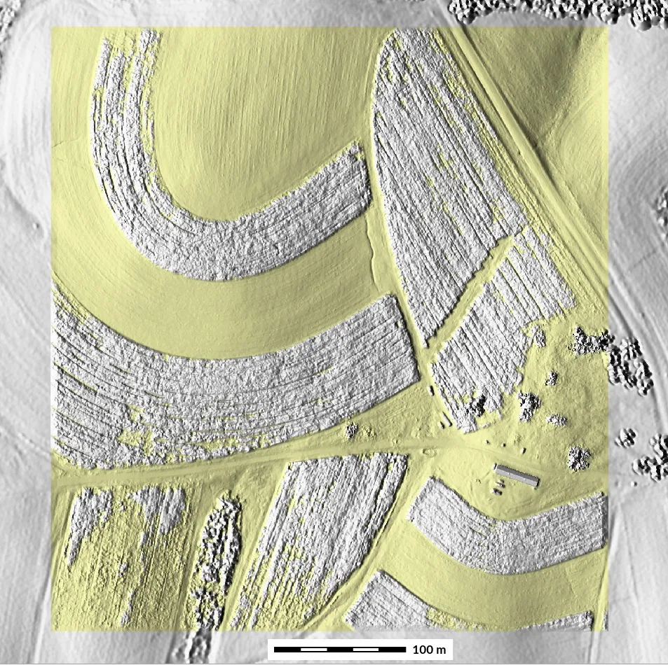{width="78%" fig-align="center" fig-alt="Shaded relief with the UAS bare ground highlighted in yellow: the bare field strips, roads and lawns are yellow, while the crop strips stay unhighlighted and textured"}

UAS cells within 0.3 m of the lidar ground, in yellow
:::
::: {.column width="50%"}
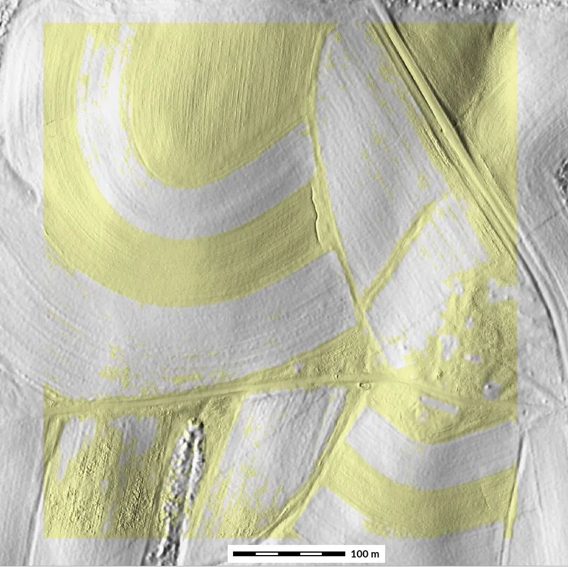{width="78%" fig-align="center" fig-alt="Shaded relief of the fused bare ground: the textured crop strips are replaced by smooth lidar ground, with yellow where the UAS ground was kept"}

Fused bare ground
:::
:::

::: {.notes}
* The UAS cannot see the soil under the crop, so the crop cells are set to null and the lidar ground fills them
* The test is the height above the lidar DEM: under 30 cm counts as ground
* The result is a current bare ground surface with UAS detail where the ground was visible
:::

## Spatially variable overlap at Mid Pines {.smaller}

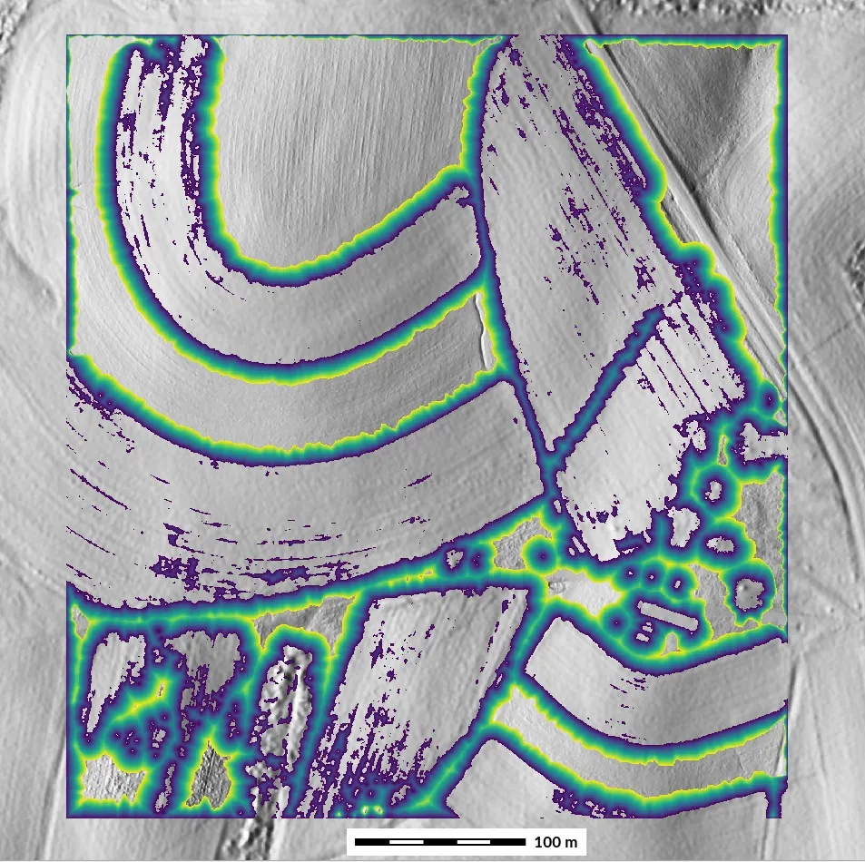{width="70%" fig-align="center" fig-alt="The spatially variable overlap raster drawn over shaded relief: purple to yellow bands along the edges of every bare ground patch, wide where the UAS and lidar surfaces differ and narrow where they agree; 100 m scale bar"}

::: {.notes}
* Every crop strip edge gets its own transition zone
* Wide bands where the UAS ground sits a few decimeters off the lidar, narrow bands where they agree
* This is what `overlap=overlap` writes in Part 3
:::

## Overland flow simulation {.center .text-center .section-divider background-color="#e9f2e9"}

::: {.notes}
* Section 5: overland flow simulation as a test of a fused surface
:::

## Modeling overland flow at high resolution {.smaller}

::: {.incremental}
- Real depressions are features, not errors to fill
- Water ponds, overtops barriers, and splits: standard flow routing cannot represent this
- A noisy surface needs a robust algorithm that does not chase every cell
:::

::: {.term-card}
**Path sampling**: a stochastic solution of the flow continuity equations; many walkers are released as rainfall and move downslope, and their density gives the water depth; `r.sim.water` in GRASS [@mitasova_path_2004]
:::

::: {.notes}
* `r.watershed` routes every cell to an outlet, through depressions; at 0.3 m that removes the ponding the surface really has
* Path sampling keeps the depressions and lets water accumulate in them
* The lab uses `r.sim.water` with 100,000 walkers over 20 simulated minutes of rain at 30 mm per hour, writing a depth map every minute, on three surfaces
:::

## Path sampling {.smaller}

::: {.columns}
::: {.column width="50%"}
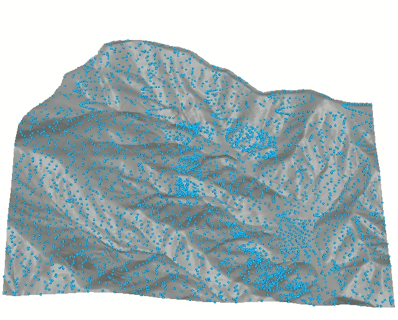{fig-alt="3D view of a hilly terrain covered with thousands of small blue dots, the walkers of a path sampling simulation"}

Walkers released over the terrain
:::
::: {.column width="50%"}
{fig-alt="The same 3D terrain with the simulated water depth in yellow: streams in the valleys and ponds in the flat areas"}

Water depth from the walker density
:::
:::

::: {.notes}
* Each walker carries a bit of water downslope following the gradient, with some randomness
* Where walkers crowd together the depth is high: a stream, a pond
* The method needs the first derivatives, hence `r.slope.aspect` with `dx` and `dy` before the simulation
:::

## Flow over a UAS mapped field {.smaller}

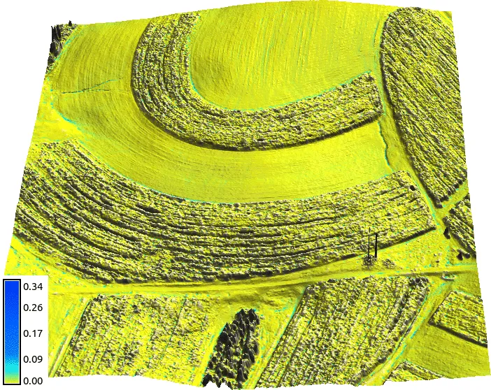{width="62%" fig-align="center" fig-alt="3D view of simulated water depth from 0 to 0.34 m, yellow to blue, on the June UAS DSM: water pools in cyan along the edges of the crop fields, with the crop rows acting as barriers"}

The crop surface acts as a barrier: water ponds against it instead of flowing through

::: {.notes}
* This is a DSM, so the simulation runs water over the top of the sorghum
* Real water runs through the stems along the soil; the DSM is the wrong surface for hydrology
* That is the motivation for fusing lidar ground into the UAS surface
:::

## Flow on a patched versus a fused DEM {.smaller}

::: {.columns}
::: {.column width="50%"}
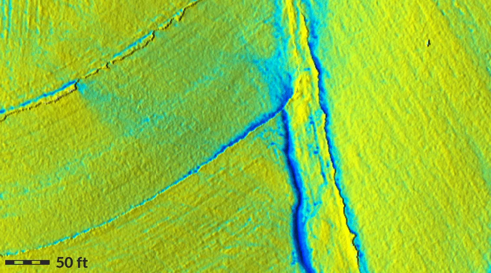{fig-alt="Simulated water depth over shaded relief of a patched DEM: a straight blue channel follows the patch edge across the field; 50 ft scale bar"}

Patched: an artificial channel along the seam
:::
::: {.column width="50%"}
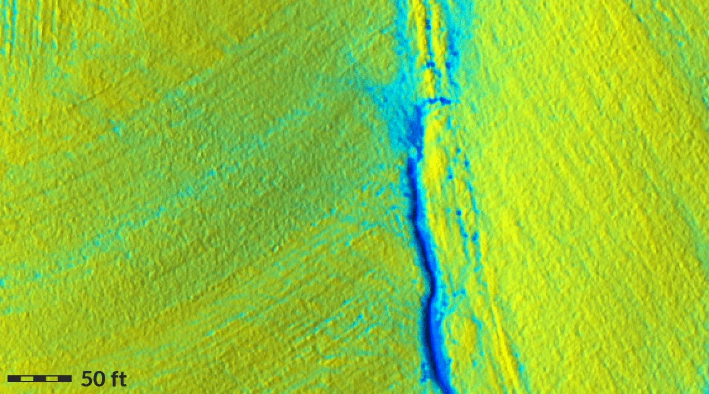{fig-alt="The same area on a smoothly fused DEM: the water follows a natural channel and the straight artificial channel is gone"}

Fused: the flow follows the terrain
:::
:::

::: {.notes}
* The seam step of a few centimeters is enough to capture the flow at 0.3 m resolution
* Smooth fusion removes the step and the artificial channel with it
* Same experiment, same site, in the lab's Part 4
:::

## Assignment example: simple and smooth patching {.smaller}

::: {.columns}
::: {.column width="50%"}
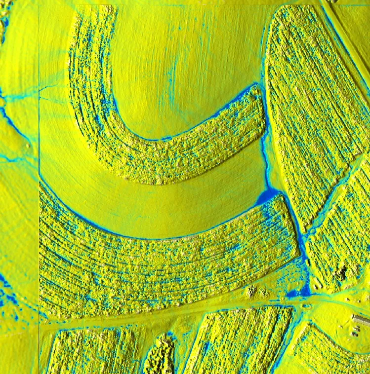{width="82%" fig-align="center" fig-alt="Simulated water depth, yellow to blue, over the Mid Pines fields on the simply patched DSM: water collects in blue lines along the straight patch edges and along the field boundaries"}

`r.patch`
:::
::: {.column width="50%"}
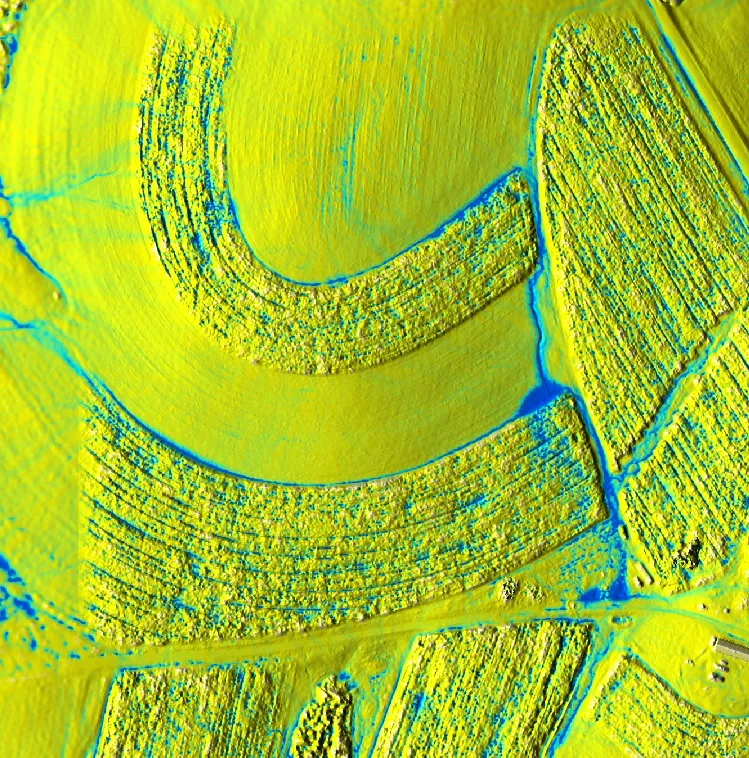{width="82%" fig-align="center" fig-alt="The same simulation on the DSM smoothed with a 20 m overlap: the straight edge lines are gone, and water still pools along the crop strips"}

Weighted average, $s = 20$ m
:::
:::

::: {.notes}
* Left: the blue lines along the clip rectangle are pure artifact
* Right: the artifact is gone, but water still ponds against the crop strips because this is still a DSM
* Compare the depth maps at the last minute of the simulation, at the edge of the UAS area
:::

## Assignment example: DSM and bare ground {.smaller}

::: {.columns}
::: {.column width="50%"}
{width="72%" fig-align="center" fig-alt="Simulated water depth on the smoothly patched DSM: water pools in blue along the crop strips and field edges"}

Smooth patched DSM
:::
::: {.column width="50%"}
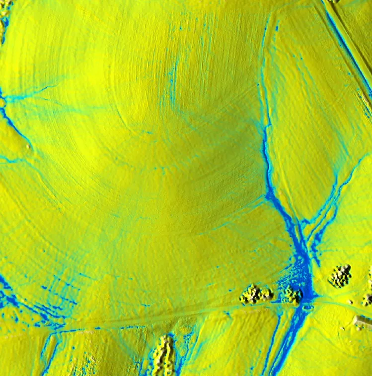{width="72%" fig-align="center" fig-alt="The same simulation on the fused bare ground: water flows in natural channels across the fields toward the stream in the southeast, and the crop barriers are gone"}

Fused bare ground
:::
:::

::: {.notes}
* With lidar ground under the crop the water follows the terrain to the stream
* This is the surface you would use for erosion or runoff questions on this farm
* The lab's last part: simulate on all three and explain the differences
:::

## Key terms {.smaller}

::: {.columns}
::: {.column width="50%"}
::: {.term-card}
**Difference map**: one surface minus the other, cell by cell; the pattern separates error, distortion and change
:::
::: {.term-card}
**Systematic error**: a shift or tilt that follows a rule over the whole surface, found with profiles over stable features
:::
::: {.term-card}
**Patching**: filling one raster with another where the first has data; fast, but leaves a seam
:::
:::
::: {.column width="50%"}
::: {.term-card}
**Smooth fusion**: a distance-weighted blend of two surfaces across an overlap zone along the edge
:::
::: {.term-card}
**Overlap width**: how far the blend reaches; fixed, or variable with the elevation difference at the edge
:::
::: {.term-card}
**Path sampling**: a stochastic overland flow simulation that keeps depressions and ponding; the test for a fused surface
:::
:::
:::

::: {.notes}
* Midterm vocabulary, and the words the lab report has to use correctly
* The grading asks for conclusions in these terms: difference pattern, systematic error, seam, overlap, flow artifact
:::

## Wrap-up

::: {.term-card}
**Assignment 5A**: [Fusion of UAS and lidar data](../assignments/assignment_5a.qmd): map and measure the differences between the 2013 lidar DSM and two June 2015 UAS DSMs, patch and fuse the UAS DSM into the lidar, build a fused bare ground, and compare the overland flow simulated on each surface
:::

::: {.notes}
* Recap: lidar and SfM have different error sources, so one checks the other; a difference map and a profile over a road show which
* Patching leaves a seam that water follows; smooth fusion across an overlap removes it
* Let the overlap width follow the difference, and test the result with `r.sim.water`
* 5B takes the same UAS flights as a time series
:::

## References {.smaller}

::: {#refs}
:::
