## Objectives {.smaller}

::: {.incremental}
- Design a UAS monitoring campaign: metrics, spatial and temporal resolution, ground control
- Register a series of DSMs as a space-time raster dataset and query it by time
- Aggregate the series over time and compute per-cell statistics
- Derive core and envelope surfaces and use them to find distorted surveys
- Apply the series to crop height and biomass, viewsheds, and volumes
:::

::: {.notes}
* 5A fused one UAS DSM with the lidar; today we work with all seven 2015 flights of Mid Pines as a time series
* The GRASS temporal framework does the bookkeeping: which map is from when, what they have in common, and how they change
* The lab (5B) registers the seven DSMs, finds the two distorted ones, and applies the series to crop biomass, a webcam viewshed, and a building volume
* Every concept today has a GRASS tool next to it; the lab uses them in the same order
:::

## Monitoring with UAS {.center .text-center .section-divider background-color="#e9f2e9"}

::: {.notes}
* Section 1: what UAS monitoring is good for, and how to design a campaign so that the data can be analyzed as a series
:::

## UAS for monitoring change {.smaller}

Low cost and rapid deployment make UAS suited to monitoring change at the local scale: fields, small watersheds, construction sites

::: {.incremental}
- **Crop monitoring**: growth, disease, stress
- **Erosion**: coastal, stream bank, rills and gullies
- **Natural hazards**: flooding, landslides, fire
- **Industrial**: mining, construction sites, stockpiles
:::

::: {.notes}
* Airborne lidar is flown every few years; a UAS can fly the same field every two weeks
* The common thread is a surface that changes faster than any regional dataset is updated
* Mid Pines in 2015 is a crop monitoring series: seven flights from March to October
:::

## Monitoring design {.smaller}

| Decision | What to settle before the first flight |
|---|---|
| Metrics | Relative height, volume, feature migration: what quantity answers the question |
| Spatial resolution | Fine enough to capture the change, coarse enough to process a series |
| Temporal resolution | Regular intervals, or flights timed to events such as storms or harvest |
| Accessibility | Flying over people, line of sight, places for GCPs |
| Georeferencing | The same GCPs surveyed once and used for every flight |

::: {.notes}
* The metric decides everything else: crop height needs a DSM and a bare ground; a stockpile volume needs two DSMs
* The hardest requirement is the last one: a series is only comparable if every flight is referenced the same way
* The Mid Pines flights used different numbers of GCPs, and the lab finds out what that did to two of them
:::

## Processing a time series {.smaller}

::: {.incremental}
- Interpolate every point cloud to a DSM on the same aligned grid at a common resolution
- Rasters suit a series better than TINs: the same cell in every map
- Check each DSM against GCPs and permanent features; correct shifts, flag distortions (5A)
- Give every DSM a time stamp and register the set in the temporal framework
:::

::: {.notes}
* Aligned grid means the same extent, resolution, and cell origin, otherwise per-cell statistics compare different ground
* The quality check per flight is 5A's difference map and profile
* Registering the maps is what turns a folder of rasters into a dataset you can query by time
:::

## Space-time datasets in GRASS {.center .text-center .section-divider background-color="#e9f2e9"}

::: {.notes}
* Section 2: the temporal framework, time stamps, and the tools that list and plot a registered series
:::

## The temporal framework {.smaller}

::: {.term-card}
**Space-time raster dataset (STRDS)**: a set of raster maps registered in a temporal database, each with a time stamp; the maps are the states of a changing surface, and the dataset is treated as one object [@gebbert_temporal_2014]
:::

::: {.incremental}
- Efficient processing, management, and analysis of space-time data
- The dataset can hold rasters, 3D rasters, or vectors
- Tools work on the whole dataset: list by time, aggregate, compute statistics, apply map algebra
- In GRASS: `t.create` makes the dataset, `t.register` adds the maps with their times
:::

::: {.notes}
* The maps themselves do not change; the database records which map belongs to which time
* Everything that follows, from aggregation to core and envelope, is a `t.*` tool reading that database
* Lab Part 1: `t.create` for `uas_dsm`, then `t.register` with a text file of map names and dates
:::

## Time stamps {.smaller}

::: {.term-card}
**Time stamp**: the time assigned to one map in the dataset, as an instant (2015-06-20) or an interval (2015-06-01 to 2015-07-01), in absolute calendar time or in relative units such as days or years
:::

::: {.incremental}
- A UAS survey is a snapshot: an instant
- Aggregating snapshots over months or seasons turns them into intervals
- The dataset's temporal type, absolute or relative, is set when it is created
:::

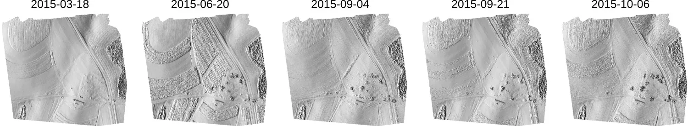{width="85%" fig-align="center" fig-alt="Five small shaded relief DSMs of the Mid Pines fields in a row, labeled 2015-03-18, 2015-06-20, 2015-09-04, 2015-09-21, and 2015-10-06"}

::: {.notes}
* Instant versus interval is independent of absolute versus relative; the lab uses absolute instants, one date per flight
* The series file is two columns: map name and date, separated by a pipe
* `t.info` reports the type and the time span of the dataset after registration
:::

## The registered series {.smaller}

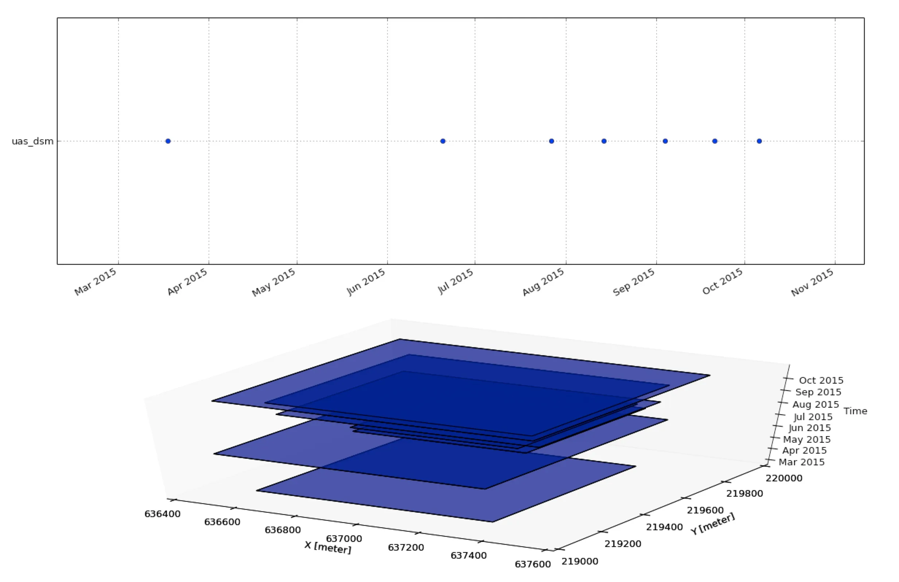{width="70%" fig-align="center" fig-alt="Timeline Tool output: a plot with seven points on a time axis from March to October 2015 for the dataset uas_dsm, and below it a 3D plot of the seven map extents stacked by time, showing that the extents differ"}

- The Timeline Tool shows when each map was taken and, in 3D, its spatial extent
- `t.rast.list` lists the maps with their times and statistics, optionally filtered with a `where` clause

::: {.notes}
* Seven flights: March, June, late July, mid August, two in September, early October
* The 3D plot shows the extents differ from flight to flight, which matters for the intersection in Section 3
* The lab lists maps with `where="start_time >= '2015-08-01'"`; SQL on the time column
:::

## Temporal plot {.smaller}

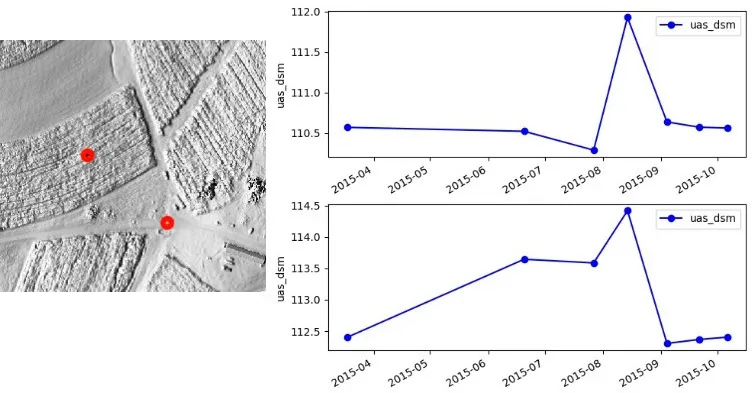{width="90%" fig-align="center" fig-alt="A shaded relief map with two red points, and two line plots of DSM elevation at those points across the 2015 flights: one point stays near 110.5 m and spikes to 112 m in August, the other rises from 112.4 m to 114.4 m in August and drops to 112.3 m in September"}

The Temporal Plot Tool plots the value of every map in the series at one location

::: {.notes}
* Pick a point on a road, in a field, and on a building and compare the three curves
* A field should rise through the season and drop at harvest; a road should stay flat
* The August spike at both points is a warning: that survey is off, which Section 3 confirms
:::

## Aggregation and per-cell statistics {.center .text-center .section-divider background-color="#e9f2e9"}

::: {.notes}
* Section 3: what the series has in common, how to aggregate it, and the per-cell statistics that summarize change
:::

## Count and intersection {.smaller}

::: {.columns}
::: {.column width="50%"}
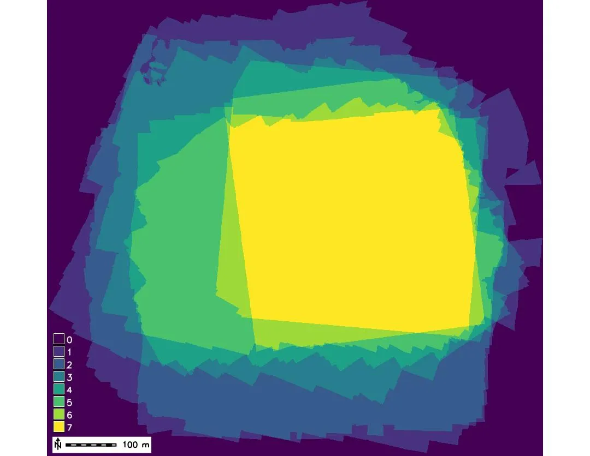{width="80%" fig-align="center" fig-alt="Map of the number of DSMs covering each cell, 0 to 7, from dark purple at the edges to yellow in the center where all seven flights overlap, with nested footprints visible; 100 m scale bar"}

Count: maps with a value in each cell
:::
::: {.column width="50%"}
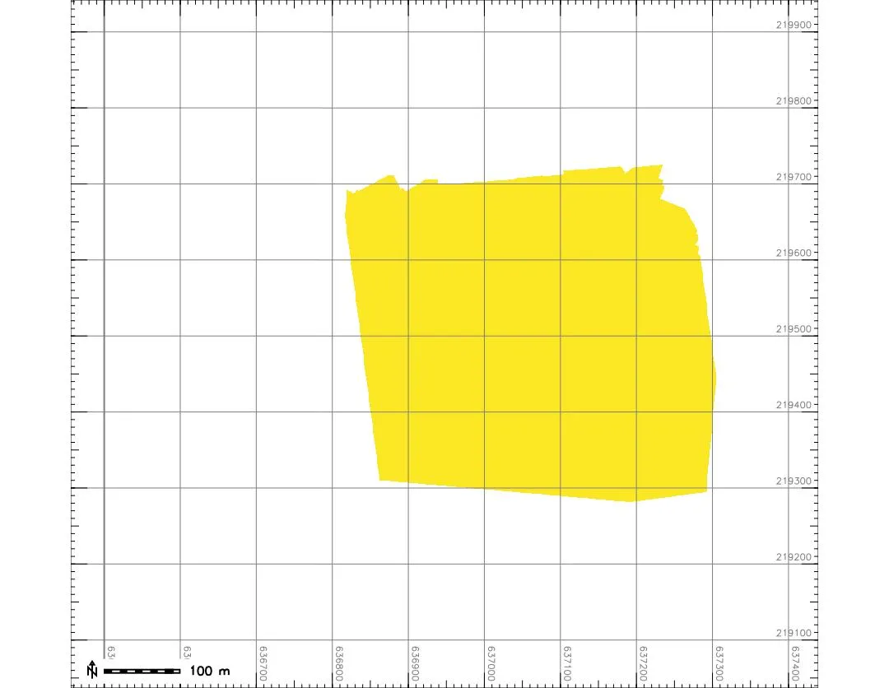{width="80%" fig-align="center" fig-alt="A single yellow polygon on a coordinate grid: the area covered by all seven DSMs; 100 m scale bar"}

Intersection: cells covered by every map
:::
:::

::: {.term-card}
In GRASS: `t.rast.series input=uas_dsm method=count output=count`, and with `-n` the count is null where any map is null, which is the intersection
:::

::: {.notes}
* The flights had different extents, so per-cell statistics are only meaningful where every map has data
* The intersection raster becomes the mask for the rest of the lab: `r.mask raster=intersection`
* Lab Part 2 computes both and zooms the region to the intersection
:::

## Temporal aggregation {.smaller}

::: {.term-card}
**Temporal aggregation**: combining the maps that fall in each interval of a chosen granularity into one map with a statistic, such as the monthly mean; `t.rast.aggregate`
:::

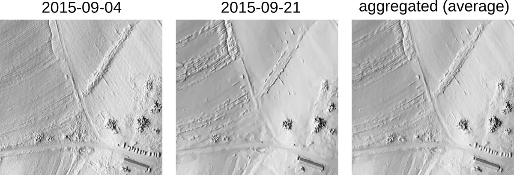{width="90%" fig-align="center" fig-alt="Three shaded relief panels of the same fields: the 2015-09-04 DSM, the 2015-09-21 DSM, and their aggregated average"}

::: {.notes}
* September has two flights; a monthly aggregation averages them into one September map
* The output is a new dataset with interval time stamps, one per month that has data
* Lab Part 2: `t.rast.aggregate ... granularity="1 months" method=average`
:::

## Per-cell statistics over time {.smaller}

::: {.incremental}
- Mean and standard deviation of the elevation at each cell
- Minimum, maximum, and range
- Time of the minimum and time of the maximum: which map it came from
- Linear regression through time: slope, offset, and coefficient of determination
:::

::: {.term-card}
In GRASS: `t.rast.series input=uas_dsm method=minimum|maximum|min_raster|max_raster|average|stddev|slope ...` [@mitasova_new_2009]
:::

::: {.notes}
* Each statistic is one raster computed down the stack of maps, cell by cell
* `min_raster` and `max_raster` return the index of the map, counted from zero, not the elevation
* The lab uses minimum, min_raster, and maximum; regression needs a longer, regular series
:::

## Core and envelope {.smaller}

::: {.term-card}
**Core surface**: the minimum elevation measured at each cell over the series. **Envelope**: the maximum. Everything the surface ever did lies between them
:::

::: {.columns}
::: {.column width="50%"}
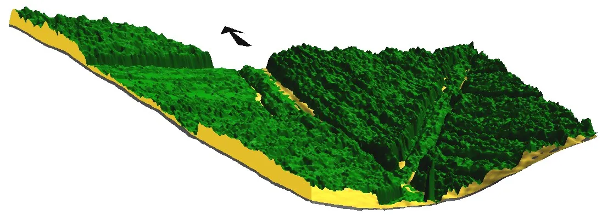{fig-alt="3D view of crop fields cut by a vertical plane: the dark green crop canopy, the envelope, stands above the yellow bare ground, the core, and the cut face shows the volume between them"}
:::
::: {.column width="50%"}
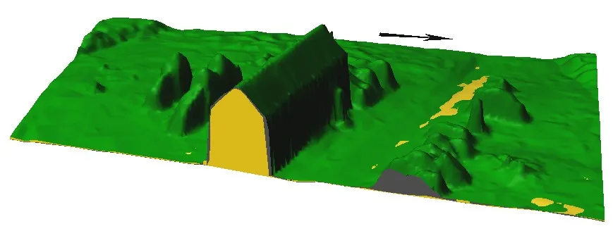{fig-alt="3D view of a long building cut by a vertical plane: the building rises in dark green from the yellow ground surface and the cut face shows its cross section"}
:::
:::

Cutting planes through the lidar ground, the core, and the envelope of the series

::: {.notes}
* On a crop field the core is close to bare ground and the envelope is the canopy at its tallest
* On a building both are the roof, so the difference is zero: a built-in test of the series
* The two surfaces come from `t.rast.series` with `method=minimum` and `method=maximum`
:::

## Finding distorted surveys {.smaller}

::: {.columns}
::: {.column width="50%"}
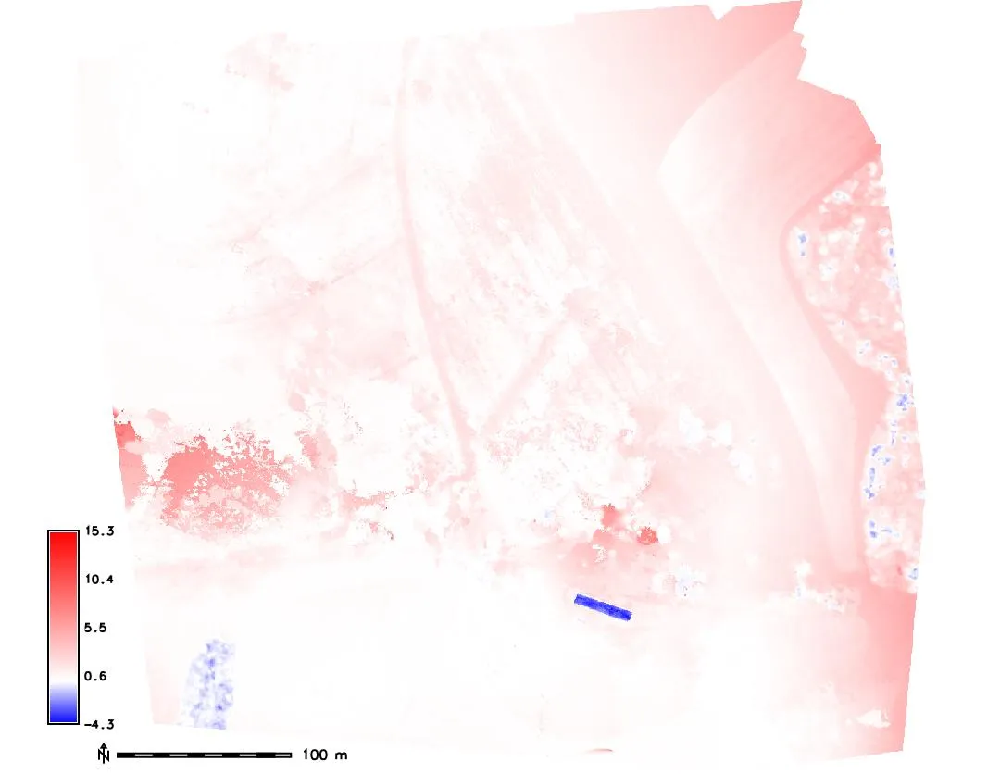{width="85%" fig-align="center" fig-alt="Map of the lidar bare ground minus the core surface: mostly white, with pink and red patches where the core lies up to 15 m below the lidar ground, and a blue building; legend from minus 4.3 to 15.3 m, 100 m scale bar"}

Lidar ground minus core
:::
::: {.column width="50%"}
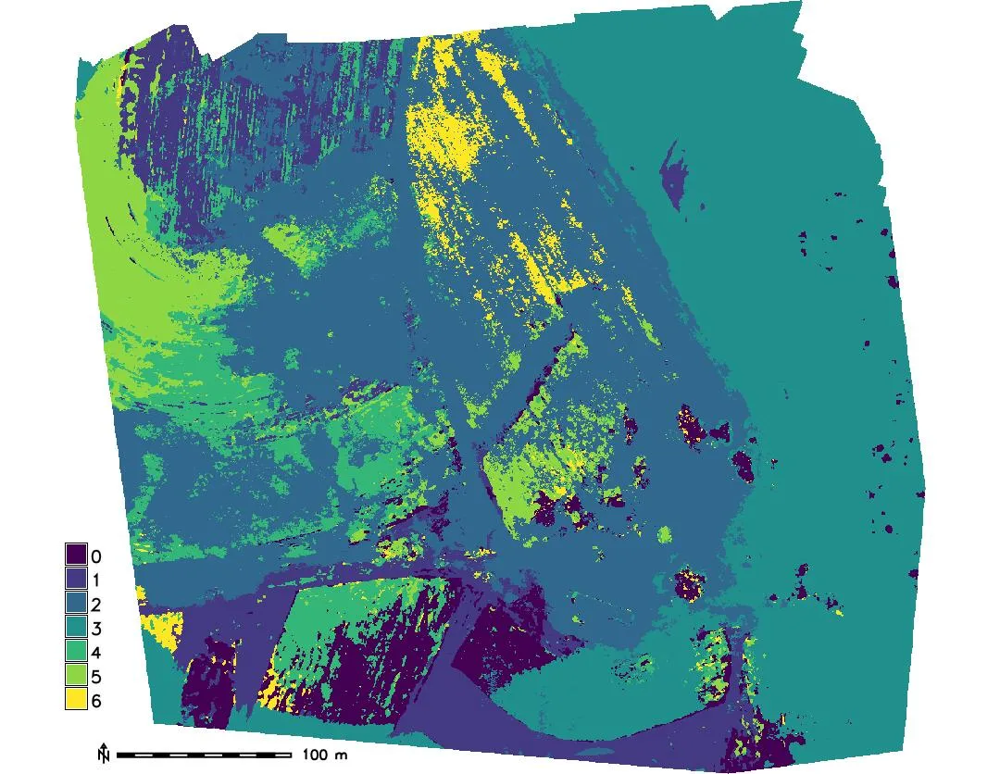{width="85%" fig-align="center" fig-alt="Map of which survey gave the minimum at each cell, indexed 0 to 6: large teal areas for index 3, green and blue for index 2, purple for 0, and yellow patches for 6; 100 m scale bar"}

Index of the map with the minimum
:::
:::

- Compute the core and subtract it from the lidar bare ground
- Where the core lies well below the ground, `min_raster` names the survey responsible

::: {.notes}
* A bare ground DSM cannot be below the real ground, so a core far under the lidar DEM is an error
* Here indexes 2 and 3, the late July and mid August flights, flown with two and three GCPs, supply most of those minima
* Lab Part 3: `r.what` on `min_raster` at two points, then exclude the two surveys with a `where` clause
:::

## Corrected core surface {.smaller}

::: {.columns}
::: {.column width="50%"}
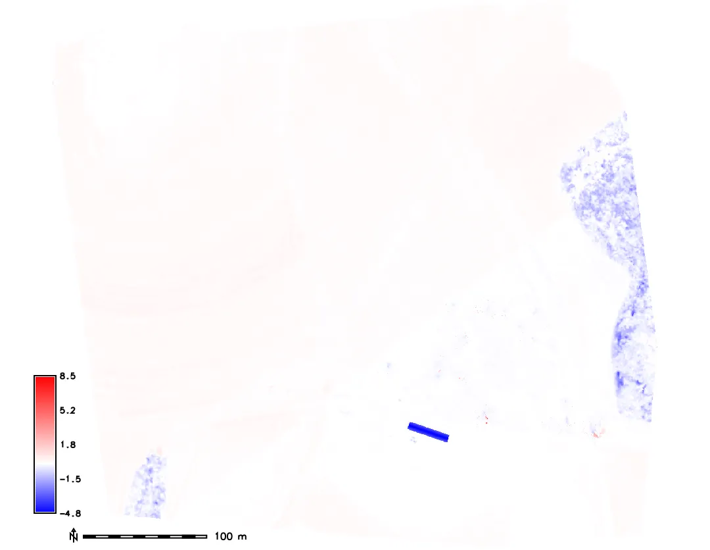{width="85%" fig-align="center" fig-alt="Lidar ground minus the core recomputed without the two distorted surveys: nearly white everywhere, with faint blue along the forest edge in the east and a blue building; legend from minus 4.8 to 8.5 m"}

Without the two distorted surveys
:::
::: {.column width="50%"}
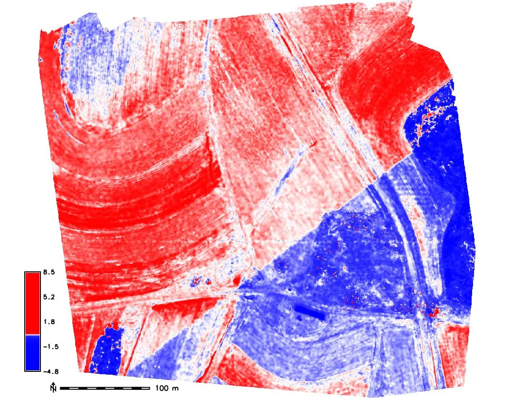{width="85%" fig-align="center" fig-alt="The same difference with a histogram-equalized color table: the northwest half is red and the southeast half blue, split along a straight diagonal line"}

Histogram-equalized colors
:::
:::

- Remove the distorted DSMs and recompute the core: the difference to the lidar ground is now small
- A histogram-equalized color table stretches the small differences and reveals a shift between two lidar swaths

::: {.notes}
* The second map is the same data; only the colors changed, and a straight line appears
* That line is a seam between two lidar flight lines, a few centimeters apart: the corduroy effect from 5A
* Equalized colors are the way to find small systematic patterns in a difference map
:::

## Envelope and range {.smaller}

::: {.columns}
::: {.column width="50%"}
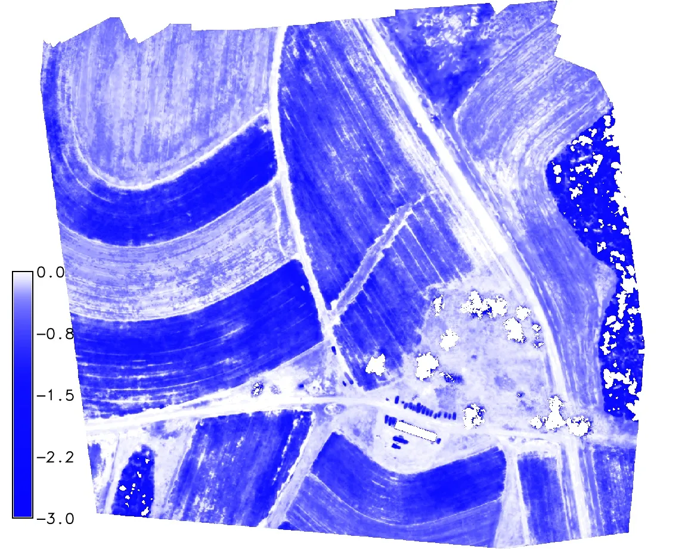{width="62%" fig-align="center" fig-alt="Map of the lidar ground minus the envelope surface: crop fields in deep blue down to minus 3 m, bare ground and roads near white, forest in blue along the east edge; legend from 0 to minus 3 m"}

Lidar ground minus envelope: the tallest crop at each cell
:::
::: {.column width="50%"}
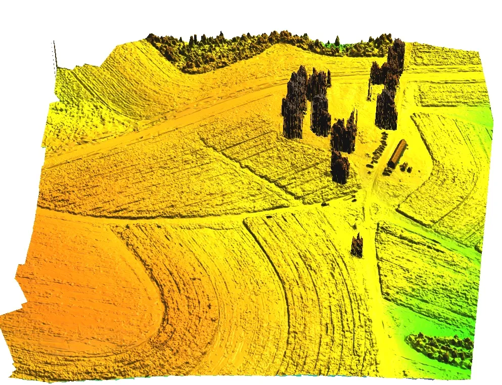{width="72%" fig-align="center" fig-alt="3D view of the envelope surface in yellow and orange: the crop fields at their tallest, trees and a building rising above them"}

The envelope surface in 3D
:::
:::

- Envelope minus ground: the maximum crop height over the season at each cell
- Time of maximum: when each cell was highest
- Range: where the surface varied most

::: {.notes}
* The envelope is the season's tallest crop, field by field, in one map
* `max_raster` gives the flight of the maximum, which differs between fields planted at different times
* The lab uses the envelope for the webcam viewshed, as the worst case for visibility
:::

## Envelope of a parking area {.smaller}

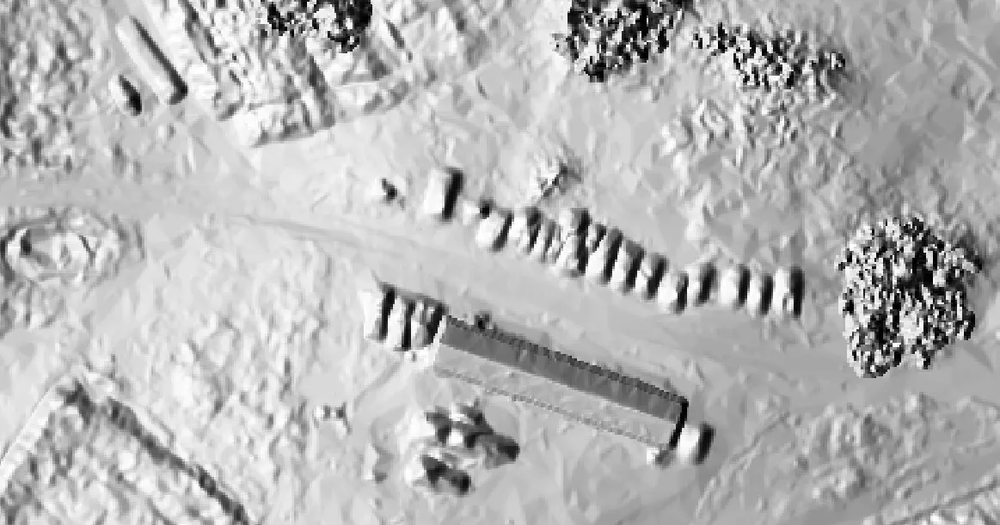{width="65%" fig-align="center" fig-alt="Shaded relief of the envelope surface around a long building: a row of car-sized bumps along the road, several more beside the building, and trees"}

- The envelope shows every car that was parked at the site during any flight
- Core, snapshot, and envelope surfaces together describe how an area is used

::: {.notes}
* A light example of the same statistic: anything that was ever there is in the envelope
* The core, by contrast, shows the lot empty
* Lab Part 5 asks you to look at the relief of the envelope DSM around the building for exactly this
:::

## Regression through time {.smaller}

::: {.incremental}
- Needs a well designed, systematic series: regular flights over a longer period
- Choose the part of the series where the change is close to linear, such as a growth period
- Per-cell linear regression gives a map of the rate of change and a map of the fit
:::

::: {.notes}
* Seven irregular flights with two bad ones are not enough for a regression; this is where a designed campaign pays
* The slope map is the growth rate in meters per day, cell by cell
* `t.rast.series method=slope` and `method=detcoeff`
:::

## Map algebra on a series {.smaller}

::: {.incremental}
- Apply one map algebra expression to every map in the series, cell by cell
- The result is a new series, registered as a new dataset with the same time stamps
- Simpler than temporal algebra, which combines maps across time
:::

::: {.term-card}
In GRASS: `t.rast.mapcalc inputs=uas_dsm expression="uas_dsm - lidar_dem" output=height basename=height`, where `uas_dsm` stands for each map in turn
:::

::: {.notes}
* The dataset name in the expression is replaced by each registered map
* Other rasters in the expression, like the lidar DEM, are the same for every map
* Lab Part 4 uses this to turn the DSM series into a crop height series
:::

## Applications {.center .text-center .section-divider background-color="#e9f2e9"}

::: {.notes}
* Section 4: three uses of the series the lab works through: crop height and biomass, a viewshed, and a volume
:::

## Crop height series {.smaller}

::: {.columns}
::: {.column width="33%"}
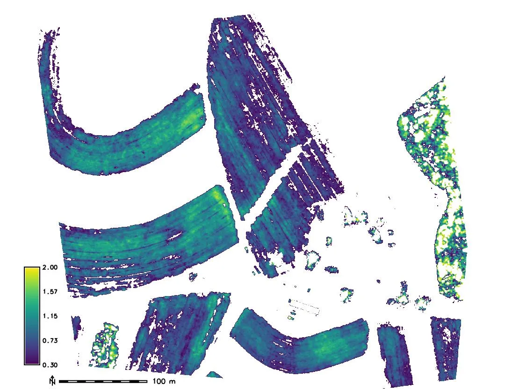{fig-alt="Crop height above the lidar ground on 2015-06-20, 0.3 to 2 m in purple to yellow: the curved field strips filled with 1 to 2 m crop, bare strips and roads blank"}

June 20
:::
::: {.column width="33%"}
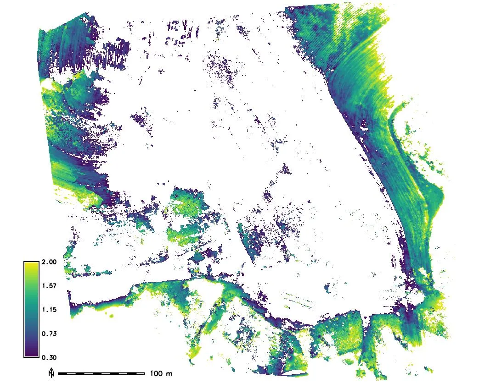{fig-alt="The same map for 2015-07-27: scattered purple and yellow patches across the whole area and along the forest edge, not following the fields, the signature of a distorted survey"}

July 27
:::
::: {.column width="33%"}
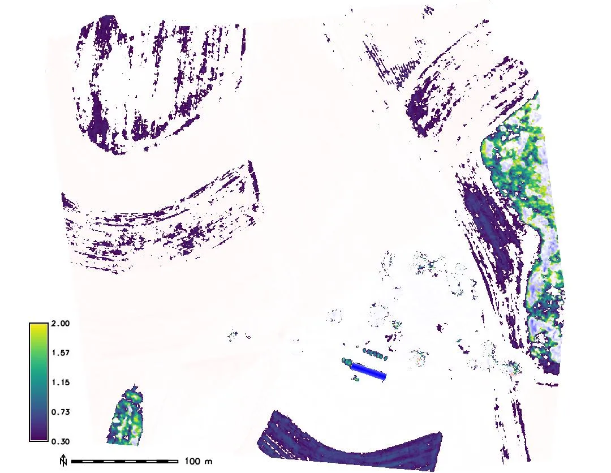{fig-alt="The same map for 2015-10-06: thin purple remnants on a few strips after harvest, the rest blank"}

October 6
:::
:::

Height above the lidar bare ground between 0.3 and 2 m, from `t.rast.mapcalc` with `if()` on the fields raster

::: {.notes}
* The window of 0.3 to 2 m keeps the crop and drops the soil noise below and the building and trees above
* The July map shows distortion rather than crop: the pattern ignores the field boundaries
* Lab Part 4: `t.rast.mapcalc` with the fields mask, then `t.rast.univar` for the statistics per date
:::

## Crop volume {.smaller}

{width="65%" fig-align="center" fig-alt="3D view of crop fields cut by a vertical plane, the dark green canopy above the yellow bare ground with the volume between them exposed on the cut face"}

- Sum of the crop height over the field cells, times the cell area, is the crop volume above ground
- A proxy for above ground biomass, and its change through the season

::: {.notes}
* `r.univar` gives the sum of heights; multiply by the cell area for cubic meters
* Comparing the volume per flight gives the growth curve of the field
* Lab Part 4 computes the June volume from `veg_uas_lidar_2` with `r.univar`
:::

## Volume of a structure {.smaller}

{width="65%" fig-align="center" fig-alt="3D view of a long building rising in dark green from the yellow ground surface, cut by a vertical plane that shows its cross section"}

- Difference between the DSM and the bare ground over the footprint of the feature
- `r.volume` sums the difference over a clump of cells and reports the volume

::: {.notes}
* Same idea as the crop volume, for one object: a building, a stockpile, a dune
* The footprint comes from a threshold on the difference, here everything more than 2 m above the ground
* Lab Part 6 does this for the building at Mid Pines
:::

## Viewsheds on a changing surface {.smaller}

::: {.term-card}
**Cumulative viewshed**: the number of observer points from which each cell is visible; `r.viewshed` per observer, then `r.series method=count`
:::

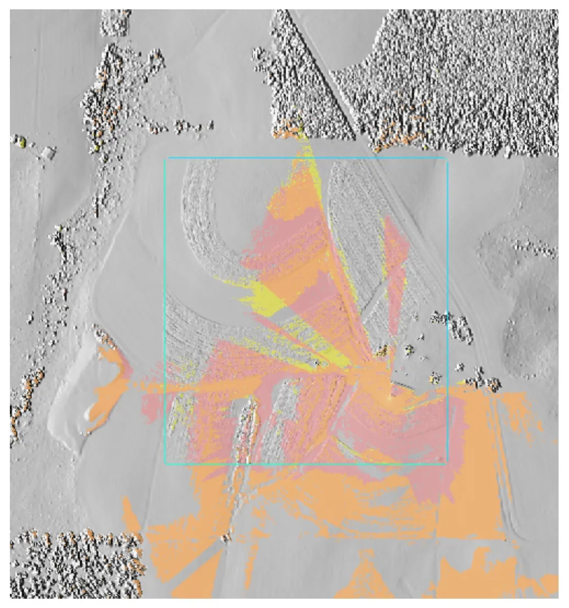{width="48%" fig-align="center" fig-alt="Shaded relief with the extent of a viewshed drawn in orange, pink, and yellow for different dates, spreading from an observer point across the fields; a cyan rectangle marks the study area"}

- The vegetation height decides what a camera sees, so the viewshed changes through the season
- Compute the viewshed on the lidar DSM and on the envelope DSM to see the best and worst case

::: {.notes}
* Different colors are the viewshed extent at different times: the crop closes the view as it grows
* Lab Part 5 sites a webcam: a cumulative viewshed from six candidate points on the lidar DSM, then the view from the chosen point on the envelope DSM
* The envelope DSM is built by fusing the UAS envelope into the lidar DSM with `r.patch.smooth` from 5A
:::

## Visualizing a series {.smaller}

::: {.incremental}
- Animation Tool: one frame per map, draped over a shaded relief, exported as a GIF (5A)
- Temporal Plot Tool: the value through time at a point
- 3D view of two surfaces with a cutting plane: core, envelope, and lidar ground
- The [GRASS temporal workshop](https://ncsu-geoforall-lab.github.io/grass-temporal-workshop/) has the terrain time series example
:::

::: {.notes}
* The flow animation in 5A used the same Animation Tool on a series of depth maps
* For a DSM series, drape the crop height over the relief and step through the flights
* The notebook does this with a series map in place of the GUI tool
:::

## Key terms {.smaller}

::: {.columns}
::: {.column width="50%"}
::: {.term-card}
**Space-time raster dataset**: a set of rasters registered with time stamps and handled as one object
:::
::: {.term-card}
**Time stamp**: an instant or an interval, in absolute or relative time, assigned to each map
:::
::: {.term-card}
**Temporal aggregation**: one map per interval of a chosen granularity, with a statistic such as the mean
:::
:::
::: {.column width="50%"}
::: {.term-card}
**Core surface**: the per-cell minimum over the series; near bare ground on a field
:::
::: {.term-card}
**Envelope surface**: the per-cell maximum over the series; the tallest the surface ever was
:::
::: {.term-card}
**Cumulative viewshed**: the number of observer points from which each cell is visible
:::
:::
:::

::: {.notes}
* Midterm vocabulary, and the words the lab report has to use correctly
* The grading asks for conclusions in these terms: intersection, aggregation, core and envelope, distorted survey
:::

## Wrap-up

::: {.term-card}
**Assignment 5B**: [Analysis of multitemporal UAS data](../assignments/assignment_5b.qmd)
:::

::: {.notes}
* Recap: register once, then every analysis is a `t.*` tool on the dataset
* Core and envelope bracket everything the surface did; a core below bare ground points at a bad survey
* Map algebra on the series turns DSMs into the quantity you care about: crop height, then biomass
* Next: the guest lecture and the midterm, then Topic 6 on image classification and change detection
:::

## References {.smaller}

::: {#refs}
:::
