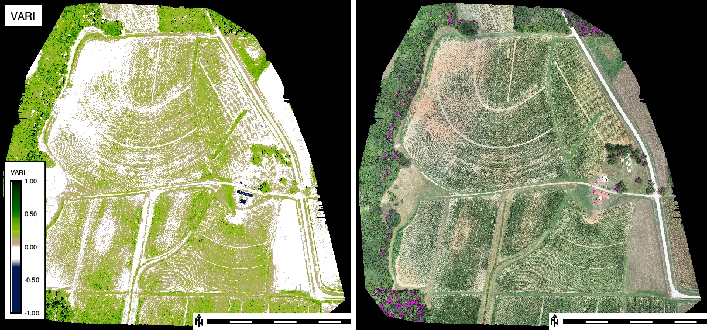
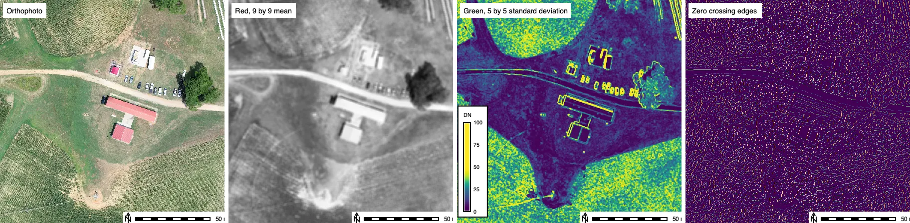
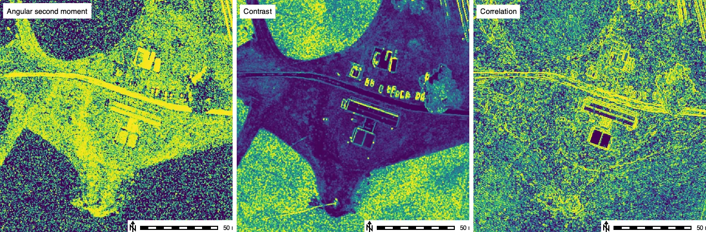
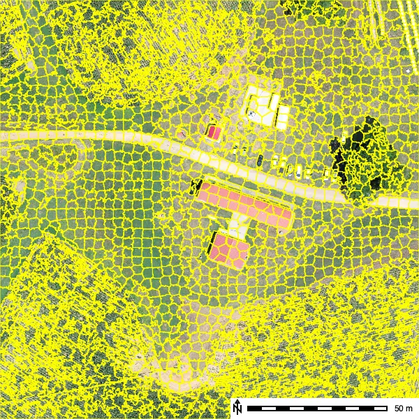
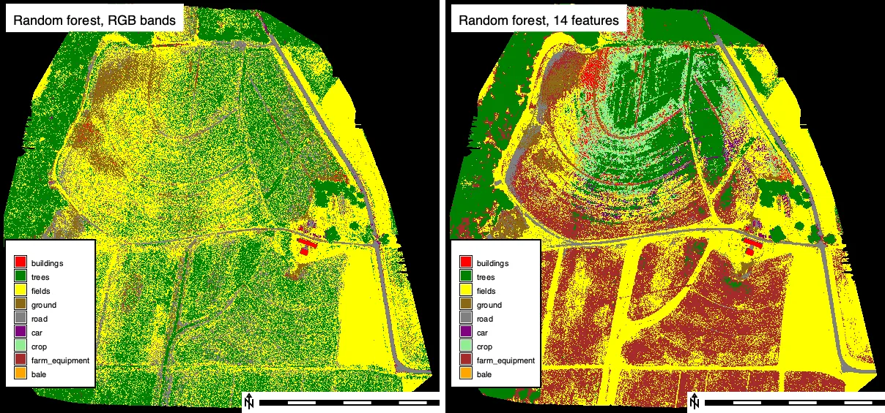
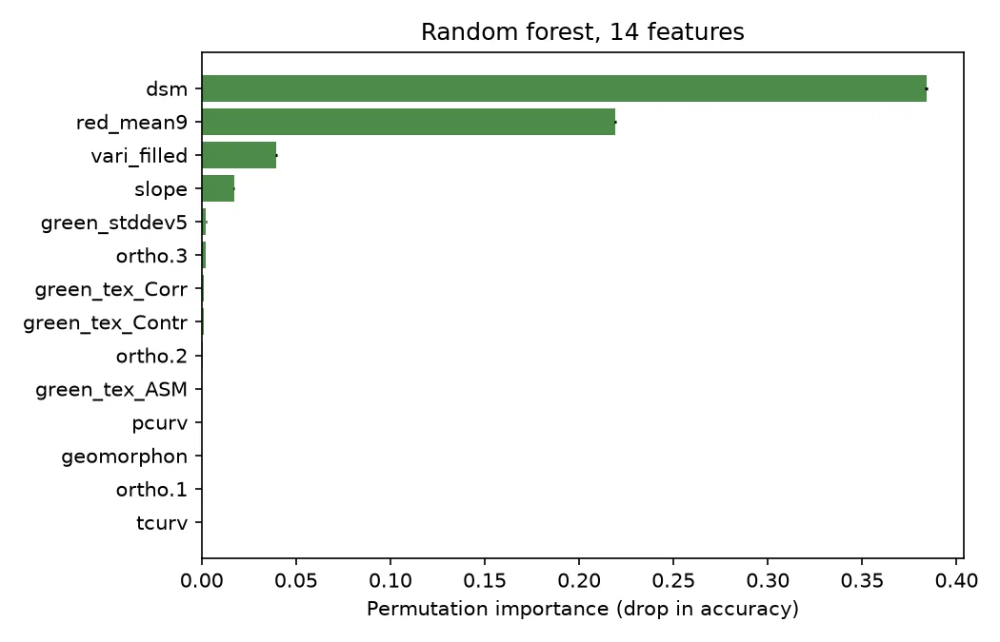
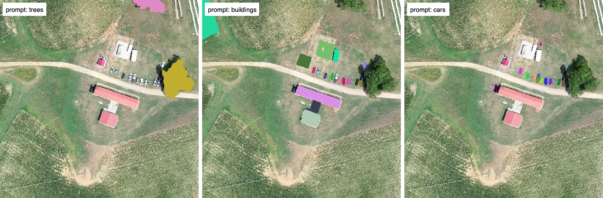
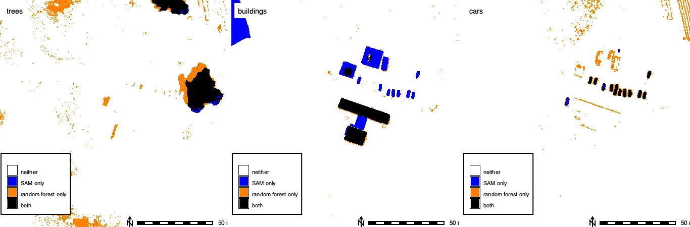

[](https://colab.research.google.com/github/ncsu-geoforall-lab/gis-584-uas-course/blob/gh-pages/course/topics/topic_6_change_detection/assignments/image_classification.ipynb)

## Task

In this assignment you classify the July 2024 orthophoto of Lake Wheeler into nine land cover classes. You derive features from the orthophoto and the DSM (a spectral index, spatial filters, texture, and terrain derivatives), group them, and segment part of the image into superpixels. You train a random forest on digitized training polygons, map the classes, read the feature importances, and assess the accuracy with a confusion matrix. In the last part you segment the same scene with a pretrained foundation model, SAM 2, from a text prompt and compare the result with the random forest classes.

Keep in mind that an accuracy computed on the training polygons describes how well the model reproduces them, not how well it maps the rest of the site. You set every third polygon aside before training and assess the model on those; the difference between the two accuracies is one of the results of the assignment. The classes are also very unequal in size, so an overall accuracy mostly reports on the largest class.

Work through the steps below in the GRASS GUI or command line, or open the notebook in Colab (badge above), which runs the same steps in Python and produces the maps and tables for you. Part 10 needs PyTorch and runs fastest on a GPU, so the notebook with a Colab GPU runtime (*Runtime > Change runtime type > T4 GPU*) is the recommended way to do it. Either way, the report is the same.

## Data

- [Lake Wheeler GRASS project: Lake_Wheeler_NCspm]() (EPSG:3358; you have it from the earlier assignments)
- [Orthophoto, July 17, 2024](): WebODM orthomosaic, RGB plus alpha, 7 cm, UTM zone 17N, [cloud optimized GeoTIFF](http://cogeo.org/) (read directly from the URL, no download needed)
- [DSM, July 17, 2024](): WebODM surface model of the same flight, 7 cm, GeoTIFF (read from the URL)
- [Training polygons: classification_training.gpkg](): 64 polygons in nine classes, GeoPackage layer `training` with the attributes `class_id` and `class`
- [Color rules for the classes: classification_colors.txt]()

## Software

- [GRASS]() 
- The addons [r.learn.ml2](https://grass.osgeo.org/grass85/manuals/addons/r.learn.ml2.html) (the tools `r.learn.train` and `r.learn.predict`), [i.superpixels.slic](https://grass.osgeo.org/grass85/manuals/addons/i.superpixels.slic.html), [i.segment.stats](https://grass.osgeo.org/grass85/manuals/addons/i.segment.stats.html), [r.confusionmatrix](https://grass.osgeo.org/grass85/manuals/addons/r.confusionmatrix.html), and [i.sam2](https://grass.osgeo.org/grass85/manuals/addons/i.sam2.html):

```bash
g.extension extension=r.learn.ml2
g.extension extension=i.superpixels.slic
g.extension extension=i.segment.stats
g.extension extension=r.confusionmatrix
g.extension extension=i.sam2
```

- Python packages in the Python that GRASS uses: [scikit-learn](https://scikit-learn.org/stable/) and pandas for `r.learn.ml2`; for `i.sam2`, [segment-geospatial](https://samgeo.gishub.org/) with its SAM 2 extra, which installs PyTorch. The `transformers` package has to stay below version 4.45, because the Grounding DINO text model in segment-geospatial does not run with newer releases:

```bash
pip install scikit-learn pandas
pip install "segment-geospatial[samgeo2]" "transformers<4.45"
```

## Part 1: Import and region

Start GRASS in the `Lake_Wheeler_NCspm` project and create a new mapset.

```bash
g.mapset -c mapset=classification
```

The orthophoto has 122 million cells at its original 7 cm resolution, and each feature below would take several minutes to compute. Work at 0.2 m: set the region to the extent of the mosaic and let `r.import` read, reproject, and resample the orthophoto to that grid. Cars, hay bales, and crop rows are still several cells wide at 0.2 m.

```bash
g.region n=219815 s=219070 w=636565 e=637355 res=0.2 -p
r.import input="/vsicurl/https://storage.googleapis.com/gis-course-data/gis584/uas-flight-data/Lake%20Wheeler%20-%20NCSU/071724/odm_orthophoto.tif" output=ortho extent=region resolution=region resample=nearest
g.list type=raster pattern="ortho*"
```

The import creates `ortho.1` (red), `ortho.2` (green), `ortho.3` (blue), and `ortho.4` (alpha, zero outside the mosaic). Turn the alpha band into a mask, so that all following tools skip the cells outside the mosaic, and import the DSM with bilinear resampling, which suits a continuous surface.

```bash
r.mapcalc expression="ortho_mask = if(ortho.4 > 0, 1, null())"
r.mask raster=ortho_mask
r.import input="/vsicurl/https://storage.googleapis.com/gis-course-data/gis584/uas-flight-data/Lake%20Wheeler%20-%20NCSU/071724/dsm.tif" output=dsm extent=region resolution=region resample=bilinear
r.colors map=dsm color=elevation
r.univar map=ortho.1
r.univar map=dsm
```

> ortho.1: n: 11484721, minimum: 0, maximum: 255
>
> dsm: minimum: 74.577, maximum: 116.062, mean: 90.117

The region has 3,725 rows and 3,950 columns (14.7 million cells), of which 11.5 million are inside the mosaic. Display the orthophoto with `d.rgb red=ortho.1 green=ortho.2 blue=ortho.3`.

## Part 2: Spectral index

The [vegetation indices lab](lab_vegetation_indices.qmd) defines the indices that can be computed from an RGB orthophoto. Here you use VARI, the visible atmospherically resistant index:

$$
VARI = \frac{Green - Red}{Green + Red - Blue}
$$

The bands are 8-bit integers (the `CELL` type in GRASS). In map algebra an integer divided by an integer gives an integer, so the first expression returns only whole numbers:

```bash
r.mapcalc expression="vari_int = (ortho.2 - ortho.1) / (ortho.2 + ortho.1 - ortho.3)"
r.univar map=vari_int
```

> minimum: -32, maximum: 27, mean: 0.001

Convert the numerator with `float()`:

```bash
r.mapcalc expression="vari_raw = float(ortho.2 - ortho.1) / (ortho.2 + ortho.1 - ortho.3)"
r.univar map=vari_raw
```

> minimum: -32, maximum: 27, mean: 0.108, standard deviation: 0.164

The mean is now plausible, but the range is not: a normalized index should stay between -1 and 1. The extreme values come from cells where the denominator is close to zero. Set cells with a denominator of 25 or less (about 0.1 in reflectance units) to null, and clamp the result to -1 to 1:

```bash
r.mapcalc expression="vari = if(ortho.2 + ortho.1 - ortho.3 <= 25, null(), max(-1.0, min(1.0, float(ortho.2 - ortho.1) / (ortho.2 + ortho.1 - ortho.3))))"
r.colors map=vari color=ndvi
r.univar map=vari
```

> n: 11404539, minimum: -1, maximum: 1, mean: 0.104, standard deviation: 0.144

The rule removes 80,182 cells. Mark them and display them over the orthophoto to see which surfaces they are:

```bash
r.mapcalc expression="vari_excluded = if(isnull(vari) && !isnull(ortho.1), 1, null())"
d.rgb red=ortho.1 green=ortho.2 blue=ortho.3
d.rast map=vari_excluded
```

{width="100%" fig-alt="Two maps of the Lake Wheeler site. Left: VARI from -1 to 1 in the ndvi color table; tree lines and the crop fields in the south are green, bare and sparsely planted fields and the roads are white. Right: the orthophoto with the cells excluded by the denominator rule in magenta, concentrated in the shadows along the tree lines."}

A classifier cannot predict a cell where one of its features is null, so the model uses a filled copy in which the excluded cells are 0:

```bash
r.mapcalc expression="vari_filled = if(isnull(vari) && !isnull(ortho.1), 0.0, vari)"
```

## Part 3: Spatial filters

A cell value alone says nothing about its surroundings; moving window filters add that context. A low pass filter smooths: the mean of the red band in a 9 by 9 window (1.8 m) removes the row pattern inside the crop fields. A high pass filter responds to local variation: the standard deviation of the green band in a 5 by 5 window (1 m) is high along edges and in rough canopies and low on uniform surfaces such as roofs and the road. Both use [r.neighbors](https://grass.osgeo.org/grass85/manuals/r.neighbors.html).

```bash
r.neighbors input=ortho.1 output=red_mean9 size=9 method=average nprocs=4
r.neighbors input=ortho.2 output=green_stddev5 size=5 method=stddev nprocs=4
r.colors map=red_mean9 color=grey
r.colors -e map=green_stddev5 color=viridis
```

Edge detection is a third kind of filter. [i.zc](https://grass.osgeo.org/grass85/manuals/i.zc.html) marks the zero crossings of the Laplacian of the smoothed image; the output is zero except on edges, where the value gives the edge orientation. Compute it for comparison; it is not used as a feature.

```bash
i.zc input=ortho.2 output=green_zc orientations=4 threshold=0.5
```

To look at the filters in detail, zoom to the 150 m block around the farm buildings, and set the region back to the full mosaic afterwards:

```bash
g.region n=219450 s=219300 w=637030 e=637180 res=0.2 save=farm
d.rast map=green_stddev5
g.region n=219815 s=219070 w=636565 e=637355 res=0.2
```

{width="100%" fig-alt="Four panels of the 150 m block around the farm buildings: the orthophoto with two red roofed buildings, a gravel road, a row of parked cars, and a large tree; the 9 by 9 mean of the red band, a blurred grey image; the 5 by 5 standard deviation of the green band, low and dark on the roofs, road, and grass and bright on building edges, cars, the tree, and the crop rows; and the zero crossing edges as thin short lines over the whole block."}

## Part 4: Texture

[r.texture](https://grass.osgeo.org/grass85/manuals/r.texture.html) computes the texture measures of Haralick, Shanmugam, and Dinstein (1973) from the grey level co-occurrence matrix (GLCM) of a moving window, which counts how often pairs of grey levels occur next to each other. Compute three of them for the green band in a 5 by 5 window, averaged over the four directions: the angular second moment (high where the window is uniform), contrast (high where neighboring cells differ strongly), and correlation (high where grey levels change gradually). This is the slowest feature of the assignment, about two minutes on four cores.

```bash
r.texture input=ortho.2 output=green_tex method=asm,contrast,corr size=5 nprocs=4
g.list type=raster pattern="green_tex*"
```

The outputs are `green_tex_ASM`, `green_tex_Contr`, and `green_tex_Corr`.

{width="100%" fig-alt="Three panels of the farm block: angular second moment, high on the mown grass, the road, and the roofs and low in the crop fields; contrast, high in the crop fields, on the tree, and along building and car edges; and correlation, a fine grained pattern with the building outlines visible."}

## Part 5: Terrain features

Features do not have to come from the image. The DSM separates tall objects from flat ones of the same color: trees from grass, roofs from gravel. Derive slope and profile and tangential curvature with [r.slope.aspect](https://grass.osgeo.org/grass85/manuals/r.slope.aspect.html), and landforms with [r.geomorphon](https://grass.osgeo.org/grass85/manuals/r.geomorphon.html) using a search radius of 15 cells (3 m). The DSM itself is also used as a feature.

```bash
r.slope.aspect elevation=dsm slope=slope pcurvature=pcurv tcurvature=tcurv nprocs=4
r.geomorphon elevation=dsm forms=geomorphon search=15 skip=0 flat=1 dist=0
```

The DSM stores elevation above the vertical datum, between 75 and 116 m on this site. Consider what a model can learn from that value: something about the land cover, or something about where on the hill a class was digitized. Part 8 returns to this.

## Part 6: Imagery groups and segmentation

GRASS imagery tools take their input as an imagery group, a named list of rasters ([i.group](https://grass.osgeo.org/grass85/manuals/i.group.html)). Create one group with the three bands and one with the bands and the eleven derived rasters, and list the second.

```bash
i.group group=rgb_group subgroup=rgb_group input=ortho.1,ortho.2,ortho.3
i.group group=features subgroup=features input=ortho.1,ortho.2,ortho.3,vari_filled,red_mean9,green_stddev5,green_tex_ASM,green_tex_Contr,green_tex_Corr,dsm,slope,pcurv,tcurv,geomorphon
i.group -l group=features
```

A pixel based classifier labels each cell on its own. An object based classification first segments the image into groups of similar neighboring cells and then classifies the groups. `i.superpixels.slic` implements SLIC (simple linear iterative clustering), which grows compact segments from a regular grid of seeds. Run it on the farm block with about 2,000 superpixels of at least 50 cells; without `minsize` the result contains tens of thousands of fragments of a few cells. `i.segment.stats` then computes the mean and standard deviation of each band and the area and compactness of each segment into the attribute table of a vector map.

```bash
g.region region=farm
i.superpixels.slic input=rgb_group output=superpixels num_pixels=2000 compactness=1 minsize=50
i.segment.stats map=superpixels rasters=ortho.1,ortho.2,ortho.3 raster_statistics=mean,stddev area_measures=area,compact_circle vectormap=segment_stats processes=4
v.db.select map=segment_stats | head
d.rgb red=ortho.1 green=ortho.2 blue=ortho.3
d.vect map=segment_stats color=yellow fill_color=none
g.region n=219815 s=219070 w=636565 e=637355 res=0.2
```

{width="60%" fig-alt="The farm block orthophoto with yellow superpixel outlines: compact segments a few meters across that follow the roof edges, the road, the cars, and the tree crown, and form an irregular mesh over the grass and the crop fields."}

The table has one row per segment and could be joined to training labels and classified with any tabular model. The rest of the assignment stays with the pixel based approach.

## Part 7: Training data and model

### Training and test polygons

The training data are 64 polygons digitized on the orthophoto. You can digitize your own with the interactive tool at *Imagery > Classify image > Interactive input for supervised classification* (`g.gui.iclass`); here you use the prepared ones. Download `classification_training.gpkg` and import it.

```bash
v.import input=classification_training.gpkg layer=training output=training
```

To test the model on data it has not seen, set every third polygon aside: polygons whose category number is divisible by 3 become the test set, the others the training set. `r.learn.train` expects the training data as a raster, so convert both sets to rasters whose values are the class numbers and whose labels are the class names.

```bash
v.extract input=training where="cat % 3 != 0" output=training_train
v.extract input=training where="cat % 3 = 0" output=training_test
v.to.rast input=training_train output=train_rast use=attr attribute_column=class_id label_column=class
v.to.rast input=training_test output=test_rast use=attr attribute_column=class_id label_column=class
r.stats -cln input=train_rast
r.stats -cln input=test_rast
```

| Class | Polygons | Training cells | Test cells |
|---|---|---|---|
| 1 buildings | 3 | 3,512 | 6,291 |
| 2 trees | 9 | 28,186 | 12,871 |
| 3 fields | 3 | 401,645 | 345,827 |
| 4 ground | 6 | 5,099 | 2,573 |
| 5 road | 8 | 22,898 | 10,920 |
| 6 car | 8 | 1,457 | 1,088 |
| 7 crop | 14 | 75 | 37 |
| 8 farm_equipment | 7 | 793 | 124 |
| 9 bale | 6 | 179 | 70 |

The three field polygons hold more than 85 percent of the cells, two of them in the training set and one in the test set, and the crop class has fewer than 100 training cells.

### Train two random forests

A random forest is a set of decision trees, each trained on a bootstrap sample of the training cells and on a random subset of the features at each split; the class of a cell is the majority vote of the trees. [r.learn.train](https://grass.osgeo.org/grass85/manuals/addons/r.learn.train.html) trains a scikit-learn model on the cells of a group under the training raster and saves it to a file. Train two models with 100 trees each: one on the three bands and one on all 14 features. `category_maps` tells the tool that the geomorphon raster holds categories, not quantities. The `-f` flag computes permutation feature importances and writes them to a CSV file. Give the model and CSV files as full paths; a bare file name is rejected.

```bash
r.learn.train group=rgb_group training_map=train_rast model_name=RandomForestClassifier n_estimators=100 random_state=1 n_jobs=4 save_model=$HOME/rf_rgb.gz
r.learn.train -f group=features training_map=train_rast model_name=RandomForestClassifier n_estimators=100 random_state=1 n_jobs=4 category_maps=geomorphon save_model=$HOME/rf_features.gz fimp_file=$HOME/feature_importance.csv
```

Training takes about 20 seconds for the first model and a minute and a half for the second on eight cores. If it is slow on your machine, reduce `n_estimators`.

## Part 8: Prediction and feature importance

[r.learn.predict](https://grass.osgeo.org/grass85/manuals/addons/r.learn.predict.html) loads a model and predicts the class of every cell of the group in the computational region (about 40 seconds each). The class names are stored with the model; the color rules file gives each class a color.

```bash
r.learn.predict group=rgb_group load_model=$HOME/rf_rgb.gz output=rf_rgb
r.learn.predict group=features load_model=$HOME/rf_features.gz output=rf_features
r.colors map=rf_rgb rules=classification_colors.txt
r.colors map=rf_features rules=classification_colors.txt
r.category map=rf_features
r.report map=rf_rgb units=h
r.report map=rf_features units=h
```

{width="100%" fig-alt="Two classification maps of the whole site with a nine class legend. Left, RGB bands only: a speckled mix of fields in yellow and trees in green over the crop fields, roads in grey. Right, 14 features: tree lines solid green, the eastern bare field solid yellow, the upper central field light green for crop, and the southern fields mostly brown for farm equipment."}

| Class | RGB bands (ha) | 14 features (ha) |
|---|---|---|
| buildings | 0.10 | 0.73 |
| trees | 16.98 | 9.40 |
| fields | 19.29 | 16.31 |
| ground | 2.47 | 1.43 |
| road | 6.47 | 1.73 |
| car | 0.06 | 0.72 |
| crop | 0.03 | 2.79 |
| farm_equipment | 0.52 | 12.54 |
| bale | 0.01 | 0.15 |

The two maps differ strongly. The RGB model confuses the crop fields with trees cell by cell, because green crop rows and tree canopy have the same colors. The 14 feature model maps the tree lines cleanly but labels more than 12 hectares of the southern fields as farm equipment, which cannot be right.

The permutation importance of a feature is the drop in accuracy when its values are shuffled among the training cells. Open `feature_importance.csv`:

{width="70%" fig-alt="Horizontal bar chart of the permutation importance of the 14 features. The DSM is highest at 0.38, the 9 by 9 mean of the red band second at 0.22, then VARI at 0.04 and slope at 0.02; the three bands, the texture measures, the curvatures, and the geomorphons are all below 0.003."}

> dsm 0.384, red_mean9 0.219, vari_filled 0.040, slope 0.017, all others below 0.003

The model depends on the DSM more than on any other feature. The training polygons of each class sit at particular elevations on the hill, so the elevation identifies the polygon, and the model applies that to the rest of the site: the farm equipment polygons lie at the elevation of the southern fields.

## Part 9: Accuracy assessment

[r.confusionmatrix](https://grass.osgeo.org/grass85/manuals/addons/r.confusionmatrix.html) cross tabulates a classification with a reference raster and derives the accuracy measures:

- **Overall accuracy**: correctly classified cells divided by all reference cells.
- **User's accuracy** of a class: of the cells mapped as the class, the share that is the class in the reference. The commission error is 100 percent minus the user's accuracy.
- **Producer's accuracy** of a class: of the reference cells of the class, the share that was mapped as the class. The omission error is 100 percent minus the producer's accuracy.
- **Kappa coefficient**: the agreement beyond what chance would produce; 0 is chance agreement and 1 is perfect agreement.

Compute them for each model against the training polygons, which the model has seen, and against the test polygons, which it has not. The `-m` flag prints the matrix and `-d` the definitions.

```bash
r.confusionmatrix -m classification=rf_rgb raster_reference=train_rast
r.confusionmatrix -m classification=rf_rgb raster_reference=test_rast
r.confusionmatrix -m classification=rf_features raster_reference=train_rast
r.confusionmatrix -m -d classification=rf_features raster_reference=test_rast
```

| Model | Reference | Overall accuracy | Kappa |
|---|---|---|---|
| RGB bands | training polygons | 99.54 % | 0.98 |
| RGB bands | test polygons | 54.64 % | 0.17 |
| 14 features | training polygons | 100.00 % | 1.00 |
| 14 features | test polygons | 53.60 % | 0.21 |

The confusion matrix of the 14 feature model on the test polygons (rows: classified map, columns: reference):

| | buildings | trees | fields | ground | road | car | crop | farm_equipment | bale | User's accuracy |
|---|---|---|---|---|---|---|---|---|---|---|
| **buildings** | 6126 | 4 | 0 | 64 | 33 | 40 | 0 | 0 | 0 | 97.75 |
| **trees** | 2 | 12765 | 63 | 0 | 0 | 109 | 2 | 0 | 0 | 98.64 |
| **fields** | 5 | 2 | 171344 | 0 | 24 | 0 | 1 | 3 | 0 | 99.98 |
| **ground** | 0 | 0 | 3109 | 2400 | 537 | 0 | 0 | 0 | 0 | 39.70 |
| **road** | 4 | 0 | 3256 | 105 | 10293 | 492 | 0 | 0 | 0 | 72.74 |
| **car** | 133 | 9 | 0 | 0 | 1 | 446 | 0 | 9 | 10 | 73.36 |
| **crop** | 1 | 0 | 4 | 0 | 0 | 0 | 20 | 0 | 0 | 80.00 |
| **farm_equipment** | 20 | 91 | 168051 | 4 | 31 | 0 | 14 | 112 | 0 | 0.07 |
| **bale** | 0 | 0 | 0 | 0 | 1 | 1 | 0 | 0 | 60 | 96.77 |
| **Producer's accuracy** | 97.38 | 99.18 | 49.55 | 93.28 | 94.26 | 40.99 | 54.05 | 90.32 | 85.71 | |

Both models are close to perfect on the polygons they were trained on and near 54 percent on the test polygons. The overall numbers hide what the features changed: compared with the RGB model, the producer's accuracy rose from 85 to 99 percent for trees, from 47 to 93 for ground, from 86 to 94 for road, from 34 to 90 for farm equipment, and from 7 to 86 for bales. The overall accuracy did not move because it is dominated by one number: 168,051 cells of the test field polygon mapped as farm equipment. With one large test polygon in the largest class, the overall accuracy is close to a statement about that polygon.

### One change to the model

Change one thing, then repeat the training, prediction, and assessment on the test polygons. One example replaces the DSM by the height above the lowest cell within 7.5 m, which describes the height of an object and not its position on the hill (the 75 by 75 minimum filter takes about two and a half minutes):

```bash
r.neighbors input=dsm output=dsm_min size=75 method=minimum nprocs=4
r.mapcalc expression="height = dsm - dsm_min"
i.group group=features_height subgroup=features_height input=ortho.1,ortho.2,ortho.3,vari_filled,red_mean9,green_stddev5,green_tex_ASM,green_tex_Contr,green_tex_Corr,height,slope,pcurv,tcurv,geomorphon
r.learn.train group=features_height training_map=train_rast model_name=RandomForestClassifier n_estimators=100 random_state=1 n_jobs=4 category_maps=geomorphon save_model=$HOME/rf_height.gz
r.learn.predict group=features_height load_model=$HOME/rf_height.gz output=rf_height
r.confusionmatrix -m classification=rf_height raster_reference=test_rast
```

> Overall accuracy 44.41, Kappa coefficient 0.16

This change does not help: the test field is now split between crop (86,761 cells) and farm equipment (81,297 cells). Removing the elevation did not fix the fields class, which points at the training data: the class "fields" contains a bare field and planted fields, and "crop" and "farm equipment" have very few training cells. Other changes to try: remove a feature, balance the classes with the `-b` flag, use more trees, choose another `model_name`, merge or redefine classes, or digitize additional training polygons.

## Part 10: Segmentation with a foundation model

The random forest learned the classes from the training polygons. A foundation model is trained once on a very large collection of images and then used without further training. [i.sam2](https://grass.osgeo.org/grass85/manuals/addons/i.sam2.html) runs two of them through the segment-geospatial package: Grounding DINO finds boxes in the image that match a text prompt, and SAM 2 (Segment Anything Model 2) outlines the object in each box. The output raster is 0 in the background and numbers the objects from 1.

The tool reads the whole computational region as one image, so use the farm block at 0.1 m (1,500 by 1,500 cells) and import the orthophoto again at that resolution. The model weights (about 1.5 GB) are downloaded on the first run. On a GPU a prompt takes a few seconds. Without a GPU, set `CUDA_VISIBLE_DEVICES=-1` before starting; a prompt then takes about a minute.

```bash
export CUDA_VISIBLE_DEVICES=-1    # only on a machine without a CUDA GPU
g.region region=farm res=0.1
r.import input="/vsicurl/https://storage.googleapis.com/gis-course-data/gis584/uas-flight-data/Lake%20Wheeler%20-%20NCSU/071724/odm_orthophoto.tif" output=farm_ortho extent=region resolution=region resample=nearest
i.group group=farm_rgb subgroup=farm_rgb input=farm_ortho.1,farm_ortho.2,farm_ortho.3
i.sam2 group=farm_rgb output=sam_trees text_prompt="trees"
i.sam2 group=farm_rgb output=sam_buildings text_prompt="buildings"
i.sam2 group=farm_rgb output=sam_cars text_prompt="cars"
r.info -r map=sam_buildings
```

> trees: 2 objects, buildings: 15 objects, cars: 15 objects

{width="100%" fig-alt="Three panels of the farm block orthophoto with the objects found by i.sam2 in random colors. Prompt trees: the large tree by the road and a clump at the top edge. Prompt buildings: the two red roofed buildings, the connecting walkway, two concrete pads, a strip at the top left corner, and nine parked cars. Prompt cars: the parked cars along the road and three objects next to the pads."}

### Thresholds

`box_threshold` is the minimum confidence of a box and `text_threshold` the minimum similarity between the box and the words of the prompt; both default to 0.24. The prompt "buildings" at the default also returns the parked cars and the concrete pads. Raise the box threshold:

```bash
i.sam2 group=farm_rgb output=sam_buildings_35 text_prompt="buildings" box_threshold=0.35
i.sam2 group=farm_rgb output=sam_buildings_50 text_prompt="buildings" box_threshold=0.5
```

> box_threshold 0.24: 15 objects, 0.35: 5 objects, 0.5: 3 objects

The tool stops with the error "No masks found" when no box passes the threshold.

### Comparison with the random forest

For each prompt, compare the SAM mask with the cells of the same class in the 14 feature random forest map inside the farm block. The map `cmp_trees` is 1 where only SAM found trees, 2 where only the random forest did, and 3 where both did; `r.report` gives the areas. The intersection over union (IoU) is the area of both divided by the area of either: 1 for identical masks, 0 for masks that do not overlap.

```bash
r.mapcalc expression="cmp_trees = if(sam_trees > 0, 1, 0) + if(rf_features == 2, 2, 0)"
r.mapcalc expression="cmp_buildings = if(sam_buildings > 0, 1, 0) + if(rf_features == 1, 2, 0)"
r.mapcalc expression="cmp_cars = if(sam_cars > 0, 1, 0) + if(rf_features == 6, 2, 0)"
r.report map=cmp_trees units=me
g.region n=219815 s=219070 w=636565 e=637355 res=0.2
```

| Prompt | SAM (m2) | Random forest (m2) | Both (m2) | IoU |
|---|---|---|---|---|
| trees | 600 | 1,295 | 565 | 0.43 |
| buildings | 1,050 | 477 | 412 | 0.37 |
| cars | 131 | 459 | 112 | 0.23 |

{width="100%" fig-alt="Three comparison maps of the farm block for trees, buildings, and cars: black where SAM and the random forest agree, blue where only SAM marked the class, orange where only the random forest did. Trees: the large tree is black with an orange fringe, and orange speckle is scattered in the crop fields. Buildings: the two buildings are black, the pads, walkway, cars, and a corner strip are blue. Cars: the parked cars are black with orange outlines, and orange lines follow the building edges and the bale rows."}

The two approaches fail in different ways. The random forest labels every cell of the site, including scattered cells of trees in the crop rows and cars along roof edges. SAM returns whole objects with clean outlines, but what counts as a match for the word is decided by the model: pads and cars are returned for "buildings", and a low threshold adds a field corner.

## Report

Prepare a report (3 to 5 pages including figures):

1. **Region and features**: the resolution and number of cells of the computational region, the VARI map, and one filter or texture map, with a sentence on which surfaces each one separates.
2. **VARI outliers**: which surfaces were excluded by the denominator rule, why they produce extreme values, and one other way to handle them.
3. **Classification**: the two classification maps and the class areas, where the RGB model and the 14 feature model differ most, and which features explain it according to the feature importances.
4. **Accuracy**: the overall accuracy and kappa of both models on the training and on the test polygons, and the confusion matrix of the 14 feature model on the test polygons, with a paragraph on which classes are mapped well, which are confused, and why the training numbers are so much higher.
5. **One change**: the change you made to the model, the accuracy on the test polygons before and after, and whether and why it helped.
6. **SAM 2**: the objects found for two prompts, the effect of the box threshold, and the comparison table, with a paragraph on which task on this site you would give to the random forest and which to the text prompt.

## Submission

Upload to Moodle, Assignment 6A:

* Your report as a PDF.
* Optional: your completed notebook (`.ipynb`) if you worked in Colab.

## Grading

* **Region and features**: the features are computed on the stated region and described by the surfaces they separate.
* **VARI outliers**: the excluded surfaces are identified and the cause of the extreme values is explained.
* **Classification**: both models are trained and mapped, and their differences are explained with the feature importances.
* **Accuracy**: the four accuracy assessments and the confusion matrix are reported and read by class, and the gap between training and test accuracy is explained.
* **One change**: one change is made, assessed on the test polygons, and interpreted.
* **SAM 2**: two prompts and the threshold experiment are run and compared with the random forest classes.
* **Interpretation**: conclusions tie back to the lecture: features, training and test data, user's and producer's accuracy, class imbalance, pixel based and object based classification, foundation models.
* On-time submission.

### Due 
