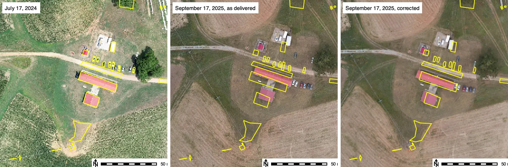
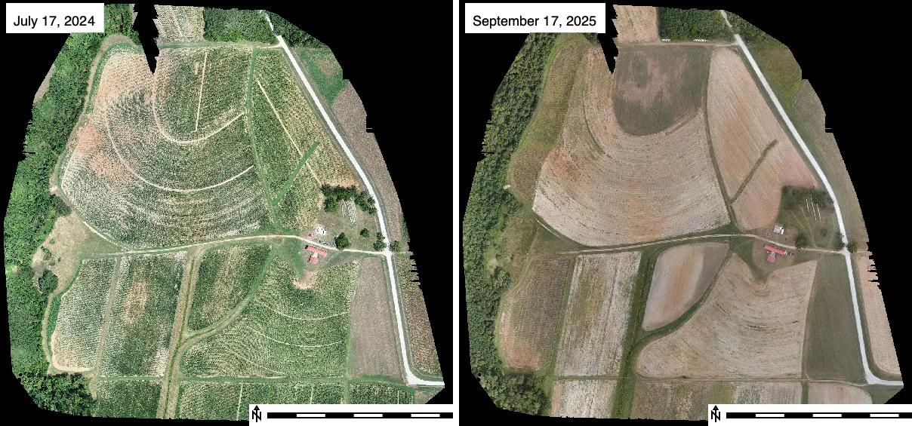
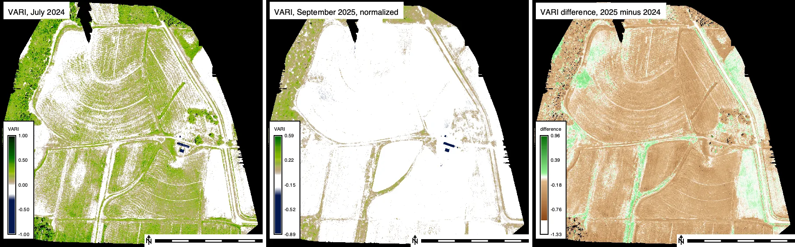
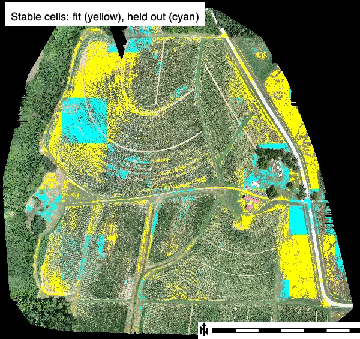
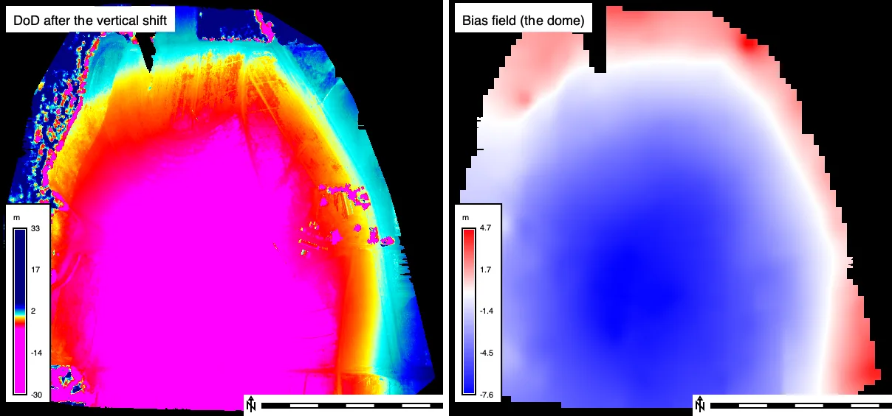
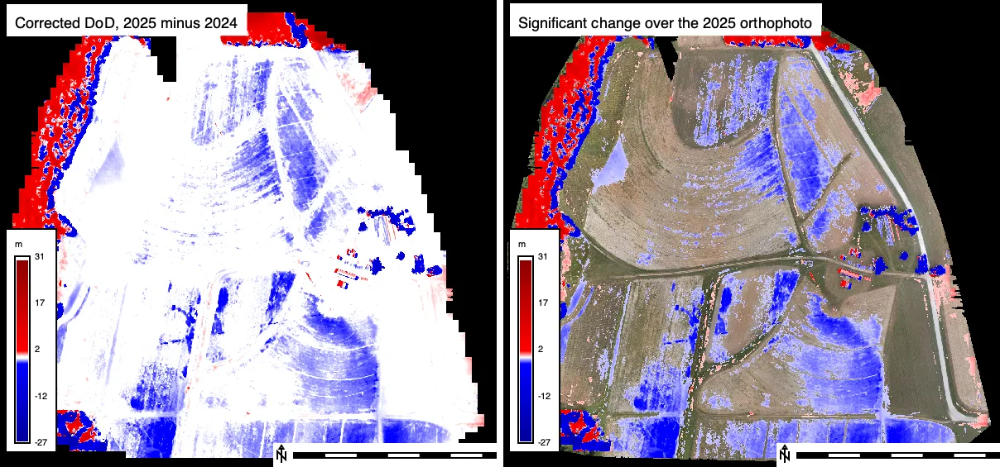
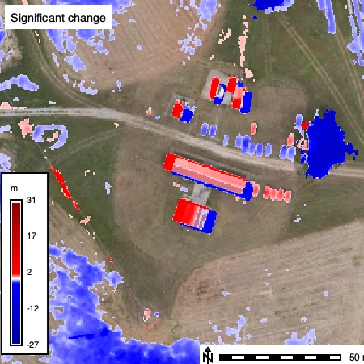
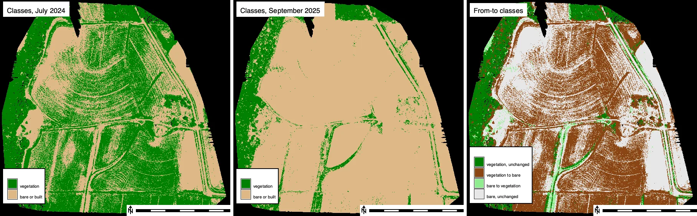

[](https://colab.research.google.com/github/ncsu-geoforall-lab/gis-584-uas-course/blob/gh-pages/course/topics/topic_6_change_detection/assignments/change_detection.ipynb)

## Task

In this assignment you detect change at Lake Wheeler between two UAS surveys: July 17, 2024 and September 17, 2025. The 2024 survey is georeferenced. The 2025 survey was processed without ground control points: its orthophoto is displaced by several meters, and its DSM is in an arbitrary vertical reference and is bent into a dome. You first co-register the 2025 products to the 2024 ones, horizontally and vertically. You then detect change in three ways: by differencing a spectral index, by differencing the DSMs with a level of detection, and by comparing two classified maps.

Keep in mind that a difference between two surveys contains real change, registration error, and measurement noise. The level of detection is the size of difference that the noise alone can produce; only larger differences are reported as change. The two flights are also from different months, so part of the spectral difference is the season and not a change in land cover.

Work through the steps below in the GRASS GUI or command line, or open the notebook in Colab (badge above), which runs the same steps in Python and produces the maps and tables for you. The offsets between the two orthophotos in Part 2 are measured by the notebook with a cross-correlation; on the command line you use the values given here and check them with the Map Swipe tool. Either way, the report is the same.

## Data

- [Lake Wheeler GRASS project: Lake_Wheeler_NCspm]() (EPSG:3358; you have it from the earlier assignments)
- July 17, 2024, the reference survey: [orthophoto]() and [DSM]() (WebODM, 7 cm, UTM zone 17N; read from the URL)
- September 17, 2025, processed without ground control points: [orthophoto]() (7 cm) and [DSM]() (8.5 cm), both in the coordinate system of the project (read from the URL)
- [Polygons of Assignment 6A: classification_training.gpkg](); its road polygons (`class_id = 5`) are used as surfaces that did not change

## Software

- [GRASS]() 
- The [r.dem](https://grass.osgeo.org/grass85/manuals/addons/r.dem.html) toolset, which installs `r.dem.coregister`, `r.dem.dod`, `r.dem.bias`, `r.dem.lod`, `r.dem.change`, and related tools. `r.dem.lod` needs the Python package scipy.

```bash
g.extension extension=r.dem
```

## Part 1: Import the two surveys

Start GRASS in the `Lake_Wheeler_NCspm` project and create a new mapset. Work at 0.5 m on the extent of Assignment 6A, and import the 2024 orthophoto and DSM, which `r.import` reprojects and resamples to the region.

```bash
g.mapset -c mapset=change_detection
g.region n=219815 s=219070 w=636565 e=637355 res=0.5 -p
r.import input="/vsicurl/https://storage.googleapis.com/gis-course-data/gis584/uas-flight-data/Lake%20Wheeler%20-%20NCSU/071724/odm_orthophoto.tif" output=ortho_2024 extent=region resolution=region resample=nearest
r.import input="/vsicurl/https://storage.googleapis.com/gis-course-data/gis584/uas-flight-data/Lake%20Wheeler%20-%20NCSU/071724/dsm.tif" output=dsm_2024 extent=region resolution=region resample=bilinear
```

The 2025 products are already in the coordinate system of the project. Import a window 20 m larger than the region on every side, because the data will be moved. These rasters keep their original resolution, so the import takes two to three minutes. Then set the region back.

```bash
g.region n=219835 s=219050 w=636545 e=637375 res=0.5
r.import input="/vsicurl/https://storage.googleapis.com/gis-course-data/gis584/uas-flight-data/Lake%20Wheeler%20-%20NCSU/091725/ortho_2025_09_17.cog.tif" output=ortho_2025_raw extent=region resolution=region resample=nearest
r.import input="/vsicurl/https://storage.googleapis.com/gis-course-data/gis584/uas-flight-data/Lake%20Wheeler%20-%20NCSU/091725/dsm.tif" output=dsm_2025_raw extent=region resolution=region resample=bilinear
g.region n=219815 s=219070 w=636565 e=637355 res=0.5
r.univar map=dsm_2024
r.univar map=dsm_2025_raw
```

> dsm_2024: minimum: 74.63, maximum: 115.96, mean: 90.12
>
> dsm_2025_raw: minimum: -14.71, maximum: 57.72, mean: 0.55

The 2024 DSM holds the elevation of the site above the vertical datum. The 2025 DSM does not, and its range is almost twice as large. Import the polygons of Assignment 6A, which were digitized on the 2024 orthophoto, and display them over both orthophotos around the farm buildings:

```bash
v.import input=classification_training.gpkg layer=training output=training
g.region n=219450 s=219300 w=637030 e=637180 res=0.1
d.rgb red=ortho_2025_raw.1 green=ortho_2025_raw.2 blue=ortho_2025_raw.3
d.vect map=training color=yellow fill_color=none
g.region n=219815 s=219070 w=636565 e=637355 res=0.5
```

{width="100%" fig-alt="Three panels of the 150 m block around the farm buildings with the yellow building, road, and car outlines digitized in 2024. July 2024: the outlines fit the roofs and cars. September 2025 as delivered: the red roofed buildings lie several meters to the east and north of their outlines. September 2025 corrected: the roofs lie within two to three meters of the outlines."}

The left and middle panels show the two orthophotos as delivered; the right panel is the result of Part 2.

## Part 2: Horizontal co-registration

### Measure the offset

To measure the displacement, compare surfaces that look the same in both images: the gravel roads, the roofs, and the concrete pads. In the GUI, open *File > Map Swipe*, load `ortho_2024` and `ortho_2025_raw`, and measure the displacement of a road intersection or a roof corner with the measuring tool at several places from south to north. The notebook does this automatically: for 200 m blocks every 100 m it finds the shift at which the brightest surfaces of the two images agree best. The offset to apply to the 2025 image, in blocks along the east road:

| Block center northing (m) | East offset (m) | North offset (m) |
|---|---|---|
| 219150 | -7.5 | -0.5 |
| 219250 | -7.5 | 0.0 |
| 219350 | -6.5 to -7.0 | -3.0 to -5.0 |
| 219450 | -7.0 | -4.5 to -5.0 |
| 219550 | -8.0 | -4.0 |
| 219650 | -7.0 | -6.0 |
| 219750 | -3.5 | -11.0 |

The east offset is nearly constant. The north offset is close to zero in the south and grows to about 11 m in the north, so a single shift cannot remove it. The simplest model that fits is a constant east offset and a north offset that changes linearly with the northing:

> east offset: -7.0 m
>
> north offset: -3.32 - 0.0126 * (northing - 219400) m, residual standard deviation 1.3 m

### Apply the correction

A raster in GRASS is a grid of cells plus the coordinates of its edges. [r.region](https://grass.osgeo.org/grass85/manuals/r.region.html) changes those coordinates without touching the cells. Moving all four edges by the same amount shifts the raster; moving the north and south edges by different amounts also stretches it, which is the model above. Copy the 2025 rasters and give the copies corrected edges: the east and west edges move by -7.0 m, and each north and south edge moves by the north offset at its corrected northing. For the rasters imported above the corrected edges are:

```bash
for band in 1 2 3 4; do
    g.copy raster=ortho_2025_raw.$band,ortho_2025_moved.$band
    r.region map=ortho_2025_moved.$band n=219826.364 s=219051.004 w=636537.987 e=637368.040
done
g.copy raster=dsm_2025_raw,dsm_2025_moved
r.region map=dsm_2025_moved n=219826.344 s=219051.017 w=636537.961 e=637368.013
```

Aggregate the moved rasters from their original resolution to the 0.5 m cells of the region with [r.resamp.stats](https://grass.osgeo.org/grass85/manuals/r.resamp.stats.html): the mean of the cells that fall into each 0.5 m cell, and the minimum for the alpha band.

```bash
for band in 1 2 3; do
    r.resamp.stats input=ortho_2025_moved.$band output=ortho_2025.$band method=average
done
r.resamp.stats input=ortho_2025_moved.4 output=ortho_2025.4 method=minimum
r.resamp.stats input=dsm_2025_moved output=dsm_2025_h method=average
```

### Check the result

Compare `ortho_2024` and `ortho_2025` in Map Swipe again. The offsets measured by the notebook after the correction:

> east: median 0.0 m; north: median -1.0 m; largest 4.0 m (in the northernmost block)

The correction is a model with three numbers, fitted to blocks along the roads on the east side of the site. Offsets of 1 to 3 m remain (right panel of the figure above). Everything that follows compares the two dates cell by cell at 0.5 m, so the edges of objects will show apparent change that is only this remaining misregistration.

Restrict the analysis to the cells covered by both surveys:

```bash
r.mapcalc expression="both = if(ortho_2024.4 > 0 && ortho_2025.4 > 0 && !isnull(dsm_2024) && !isnull(dsm_2025_h), 1, null())"
r.mask raster=both
```

> area covered by both surveys: 45.6 hectares

{width="100%" fig-alt="The whole Lake Wheeler site at both dates. July 17, 2024: green tree lines and crop fields with visible rows, one bare field in the east. September 17, 2025: the same fields brown and harvested, the tree lines still green."}

## Part 3: Index differencing

### VARI at both dates

Compute VARI for both dates with the expression of Assignment 6A.

```bash
r.mapcalc expression="vari_2024 = if(ortho_2024.2 + ortho_2024.1 - ortho_2024.3 <= 25, null(), max(-1.0, min(1.0, float(ortho_2024.2 - ortho_2024.1) / (ortho_2024.2 + ortho_2024.1 - ortho_2024.3))))"
r.mapcalc expression="vari_2025 = if(ortho_2025.2 + ortho_2025.1 - ortho_2025.3 <= 25, null(), max(-1.0, min(1.0, float(ortho_2025.2 - ortho_2025.1) / (ortho_2025.2 + ortho_2025.1 - ortho_2025.3))))"
r.colors map=vari_2024,vari_2025 color=ndvi
r.univar map=vari_2024
r.univar map=vari_2025
```

> vari_2024: mean: 0.104, standard deviation: 0.143
>
> vari_2025: mean: -0.043, standard deviation: 0.085

### Relative normalization

The two orthophotos come from different cameras, processing software, and light. A surface that did not change should have the same index value at both dates, so use the gravel roads as pseudo-invariant features. The difference between the median VARI of the road cells at the two dates is the radiometric offset between the images; subtract it from the 2025 index. `r.univar -e` with the road raster as `zones` gives the medians.

```bash
v.extract input=training where="class_id = 5" output=roads
v.to.rast input=roads output=roads_rast use=val value=1
r.univar -e map=vari_2024 zones=roads_rast
r.univar -e map=vari_2025 zones=roads_rast
r.mapcalc expression="vari_2025n = vari_2025 - (-0.005)"
r.colors map=vari_2025n color=ndvi
```

> roads, 2024: median: -0.004; roads, 2025: median: -0.009; radiometric offset: -0.005

On this pair the offset is small: the index is a ratio of bands, which cancels most of the brightness difference between the images. A single band would need a larger correction.

### The difference and a threshold

The difference is the normalized 2025 index minus the 2024 index: negative where vegetation was lost, positive where it was gained.

```bash
r.mapcalc expression="vari_diff = vari_2025n - vari_2024"
r.univar map=vari_diff
r.univar map=vari_diff zones=roads_rast
```

> all cells: mean: -0.143, standard deviation: 0.135
>
> roads: mean: -0.012, standard deviation: 0.039

A threshold turns the difference into a change map. Use 0.1, which is well above the standard deviation of the difference on the roads, where nothing changed:

```bash
r.mapcalc expression="vari_change = if(vari_diff < -0.1, 1, if(vari_diff > 0.1, 3, 2))"
r.category map=vari_change separator=pipe rules=- <<EOF
1|vegetation decrease
2|no change
3|vegetation increase
EOF
r.report map=vari_change units=h,p
```

> vegetation decrease: 26.74 ha (59.1 %), no change: 17.66 ha (39.0 %), vegetation increase: 0.86 ha (1.9 %)

{width="100%" fig-alt="Three maps of the site. VARI in July 2024: tree lines and most fields green. VARI in September 2025, normalized: almost the whole site white, near zero, with only the tree lines and grassed strips slightly green. The difference, 2025 minus 2024: brown, a decrease, over the fields and tree lines; white on roads and the bare eastern field; light green on a few grassed waterways."}

More than half of the site shows a decrease. July is the middle of the growing season and mid September is harvest time, so most of this is the crop cycle and would reverse by the next July.

## Part 4: DSM co-registration

The 2025 DSM now lines up horizontally (`dsm_2025_h`), but its elevations are not in the vertical datum. Bring it to the 2024 surface in two steps with the `r.dem` tools.

### Vertical shift from pseudo ground control points

[r.dem.coregister](https://grass.osgeo.org/grass85/manuals/addons/r.dem.coregister.html) samples the difference between the two DSMs on features that are assumed not to have changed, here the road polygons, and subtracts the median difference. It reports the bias and the NMAD (normalized median absolute deviation), a robust standard deviation of the remaining difference on those features.

```bash
r.dem.coregister dem=dsm_2025_h reference=dsm_2024 pgcp=roads output=dsm_2025_v method=pgcp_vertical buffer=0.5
```

> N samples: 6834, Median bias: -89.3323 m, NMAD: 4.7858 m

The bias is about -89 m, and after removing it the roads still disagree by almost 5 m. Compute the DEM of Difference (DoD), the later surface minus the earlier one, with [r.dem.dod](https://grass.osgeo.org/grass85/manuals/addons/r.dem.dod.html):

```bash
r.dem.dod dem=dsm_2025_v reference=dsm_2024 output=dod_shifted range=5
r.univar map=dod_shifted
```

> minimum: -30.19, maximum: 33.25, mean: -2.76, standard deviation: 4.38

The DoD is not noise around zero. It is a smooth shape several meters high: one sign in the middle of the site and the other toward the edges (left panel of the figure below). This is the dome, a known distortion of surfaces reconstructed from nadir images without ground control: an error in the estimated lens distortion bends the whole model. A shift cannot remove it, and neither can a rotation.

### Stable surfaces

To model the dome you need many cells, spread over the whole site, where the real surface did not change. The roads alone are too few and all on one side. Bare ground is a larger candidate: a cell with VARI below 0 at both dates carried no green vegetation at either date, so its surface is soil, gravel, or a roof. Also require a slope of less than 8 degrees within one meter in the 2024 DSM, to exclude the edges of buildings and trees, where the remaining horizontal offset turns into large height differences.

For an independent check, divide the stable cells by a 100 m checkerboard: two thirds of the blocks are used to fit the correction, one third is held out.

```bash
r.slope.aspect elevation=dsm_2024 slope=slope_2024
r.neighbors input=slope_2024 output=slope_2024_max size=5 method=maximum
r.mapcalc expression="stable = if(vari_2024 < 0 && vari_2025 < 0 && slope_2024_max < 8, 1, null())"
r.mapcalc expression="holdout_block = (int(x() / 100) + int(y() / 100)) % 3 == 0"
r.mapcalc expression="stable_fit = if(stable && !holdout_block, 1, null())"
r.mapcalc expression="stable_check = if(stable && holdout_block, 1, null())"
```

> stable: 265,748 cells (6.6 ha); stable_fit: 187,495 cells (4.7 ha); stable_check: 78,253 cells (2.0 ha)

{width="60%" fig-alt="The 2024 orthophoto with the stable cells: yellow cells used for the fit along the roads, in the bare eastern field, and scattered between crop rows over the whole site; cyan cells held out in a few 100 m blocks."}

### Remove the dome

[r.dem.bias](https://grass.osgeo.org/grass85/manuals/addons/r.dem.bias.html) with `method=spline` interpolates the DoD of the stable fit cells into a smooth surface, the bias field, and subtracts it from the DoD. The spline is fitted at 10 m resolution with strong smoothing, because the dome is a long wavelength shape.

```bash
r.dem.bias dod=dod_shifted output=dod method=spline stable_mask=stable_fit bias_field=dome
r.univar map=dome
r.univar map=dod zones=stable_fit
r.univar map=dod zones=stable_check
r.univar map=dod zones=roads_rast
```

> bias field: minimum: -7.56, maximum: 4.74
>
> corrected DoD on the fit cells: mean: -0.001, standard deviation: 0.113
>
> corrected DoD on the held out cells: mean: -0.043, standard deviation: 0.354
>
> corrected DoD on the road polygons: mean: 0.088, standard deviation: 0.198

{width="100%" fig-alt="Two maps. The DoD after the vertical shift: strongly negative over the whole center of the site and positive along the western, northern, and eastern edges. The bias field fitted by the spline: the same shape as a smooth surface, about -7 m in the center and up to almost 5 m toward the edges."}

The bias field spans 12 m across the site. After removing it, the stable cells agree to about 0.1 m where the correction was fitted and to 0.35 m in the held out blocks. The held out number is the one to report: it describes cells the correction did not see.

## Part 5: Level of detection and significant change

### Level of detection

The level of detection (LoD) is the smallest difference that can be told apart from noise at a chosen confidence. [r.dem.lod](https://grass.osgeo.org/grass85/manuals/addons/r.dem.lod.html) estimates the noise as the NMAD of the corrected DoD on stable cells and multiplies it by the critical value of the normal distribution, 1.96 for 95 percent. Give it the held out cells.

```bash
r.dem.lod dod=dod output=lod method=global stable_mask=stable_check confidence=0.95
```

> NMAD: 0.1781 m, LoD: 0.3490 m (uniform)

### Significant change and volumes

[r.dem.change](https://grass.osgeo.org/grass85/manuals/addons/r.dem.change.html) keeps the cells of the DoD whose absolute value exceeds the LoD, removes isolated cells with the `-n` flag, and sums the volumes of surface raising and lowering. The tool uses the terms of geomorphology, deposition and erosion; on this site a raised surface is mostly taller vegetation and a lowered surface mostly vegetation that was removed.

```bash
r.dem.change -n dod=dod lod=lod output_sig=dod_significant volume_csv=$HOME/volume.csv
r.mapcalc expression="dod_class = if(isnull(dod_significant), 2, if(dod_significant < 0, 1, 3))"
r.report map=dod_class units=h,p
```

> Deposition: 222,506.9 m3 (201,289 cells), Erosion: 221,508.8 m3 (513,187 cells), Net: 998.1 m3
>
> surface lowered: 12.83 ha (28.1 %), below the level of detection: 27.73 ha (60.8 %), surface raised: 5.03 ha (11.0 %)

{width="100%" fig-alt="Two maps. The corrected DoD: white, near zero, over most of the site, light blue lowering in several fields, and saturated red and blue along the western tree line and around the trees at the farm. The significant change drawn over the 2025 orthophoto: blue lowering over the fields that carried a crop in 2024, red raising along the tree lines, and no color on the roads and the bare field."}

The lowered cells have a median of -0.9 m and cover the fields that carried a crop in July 2024 and were harvested by September 2025. The raised cells have a median of 3.8 m and lie almost entirely along the tree lines, where a horizontal offset of a few meters against 15 m trees produces large differences of both signs. The two volumes are therefore not a crop volume: the tree line cells dominate them.

Zoom to the farm buildings:

```bash
g.region n=219450 s=219300 w=637030 e=637180 res=0.1
d.rgb red=ortho_2025.1 green=ortho_2025.2 blue=ortho_2025.3
d.rast map=dod_significant
g.region n=219815 s=219070 w=636565 e=637355 res=0.5
```

{width="50%" fig-alt="Significant change around the farm buildings over the 2025 orthophoto: each building has a red band along one edge and a blue band along the opposite edge, the parked cars of 2024 appear as small blue patches and those of 2025 as red patches, the large tree is blue, and the crop field at the bottom is light blue."}

Each building shows a raised band on one side and a lowered band on the other. The buildings did not move; the pattern is the remaining horizontal misregistration. The cars are real change: they were parked in different places.

Connect this result with Part 3 by the mean DoD inside each VARI change class (make a raster of each class with `r.mapcalc` and use it as `zones`):

> where VARI shows a vegetation decrease: median -0.22 m; no change: median -0.02 m; vegetation increase: median 0.11 m

## Part 6: Post-classification comparison

The third way to detect change is to classify each date on its own and compare the two maps. Use a classification that can be applied to both orthophotos: a cell is vegetation if its VARI is above 0.05 and bare or built otherwise, with the normalized index for 2025. `r.stats` on the two maps together gives the from-to matrix, the area of each combination of class in 2024 and class in 2025.

```bash
r.mapcalc expression="class_2024 = if(vari_2024 > 0.05, 1, 2)"
r.mapcalc expression="class_2025 = if(vari_2025n > 0.05, 1, 2)"
r.stats -an input=class_2024,class_2025
r.mapcalc expression="from_to = (class_2024 - 1) * 2 + class_2025"
```

| 2024 \\ 2025 (ha) | vegetation | bare or built | total 2024 |
|---|---|---|---|
| **vegetation** | 5.57 | 20.20 | 25.77 |
| **bare or built** | 1.12 | 18.37 | 19.49 |
| **total 2025** | 6.69 | 38.57 | 45.26 |

{width="100%" fig-alt="Three maps of the site. Classes in July 2024: vegetation in green over the tree lines and most fields, bare or built in tan. Classes in September 2025: bare or built over almost all fields, vegetation only on the tree lines and grassed strips. From-to classes: vegetation to bare in brown over the crop fields, unchanged vegetation in green on the tree lines, unchanged bare in grey on the roads and the eastern field, and bare to vegetation in light green on a few strips."}

### The three methods side by side

The area each method reports as a loss of vegetation, from `r.stats` on the three maps together:

| Method | Area (ha) |
|---|---|
| VARI decrease below -0.1 (Part 3) | 26.74 |
| Surface lowered beyond the LoD (Part 5) | 12.72 |
| Vegetation to bare (Part 6) | 20.20 |
| All three agree | 9.27 |

The spectral methods report twice the area of the DoD. A crop row that was green in July and stubble in September changes the index everywhere, but the surface drops by more than 0.35 m only where the crop was tall. Remove the mask when you are done:

```bash
r.mask -r
```

## Report

Prepare a report (3 to 5 pages including figures):

1. **The uncontrolled survey**: the elevation ranges of the two DSMs, the farm building maps before the correction, and what they tell you about how the 2025 survey was processed.
2. **Horizontal co-registration**: the offset model, the remaining offsets, and the farm building map after the correction, with a sentence on where the correction is least reliable and why.
3. **Index differencing**: the radiometric offset, the VARI difference map, and the areas of the three change classes, with a paragraph on how much of the decrease you attribute to the season.
4. **DSM co-registration**: the vertical bias, the DoD after the vertical shift, the bias field, and the standard deviation of the corrected DoD on the fit cells, the held out cells, and the roads, with a paragraph on what the dome is and why the vertical shift did not remove it.
5. **Level of detection and change**: the LoD, the map of significant change, and the volumes, with a paragraph on which changes are real and which are artifacts of the registration.
6. **Comparison of methods**: the from-to matrix and the areas of vegetation loss from the three methods, why they differ, and what ground control points in the 2025 survey would have changed in this assignment.

## Submission

Upload to Moodle, Assignment 6B:

* Your report as a PDF.
* Optional: your completed notebook (`.ipynb`) if you worked in Colab.

## Grading

* **The uncontrolled survey**: the horizontal and vertical offsets are reported and attributed to the missing ground control.
* **Horizontal co-registration**: the correction is applied and its remaining error is reported.
* **Index differencing**: the index is normalized, differenced, and thresholded, and the seasonal part of the change is discussed.
* **DSM co-registration**: the vertical shift and the bias field are computed, and the correction is assessed on held out cells.
* **Level of detection and change**: the LoD is derived from stable cells, significant change is mapped, and real change is separated from registration artifacts.
* **Comparison of methods**: the from-to matrix is computed and the three results are compared.
* **Interpretation**: conclusions tie back to the lecture: co-registration, stable surfaces, pseudo-invariant features, DEM of Difference, level of detection, post-classification comparison.
* On-time submission.

### Due 
