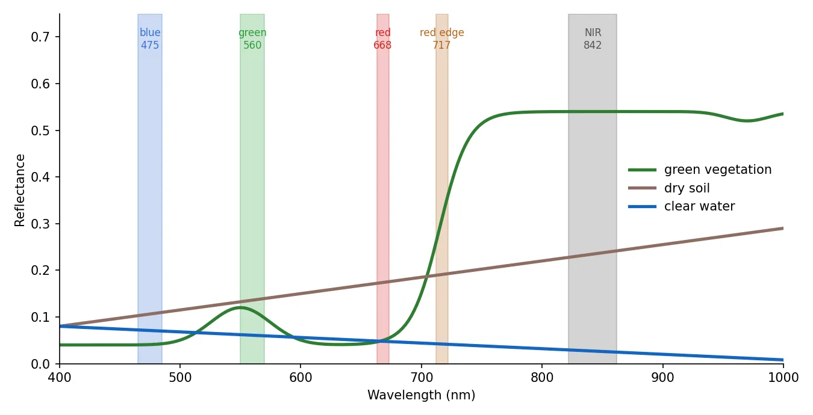
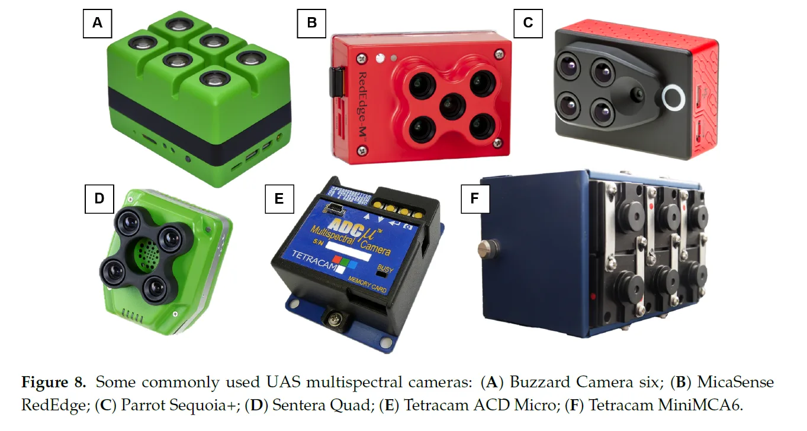
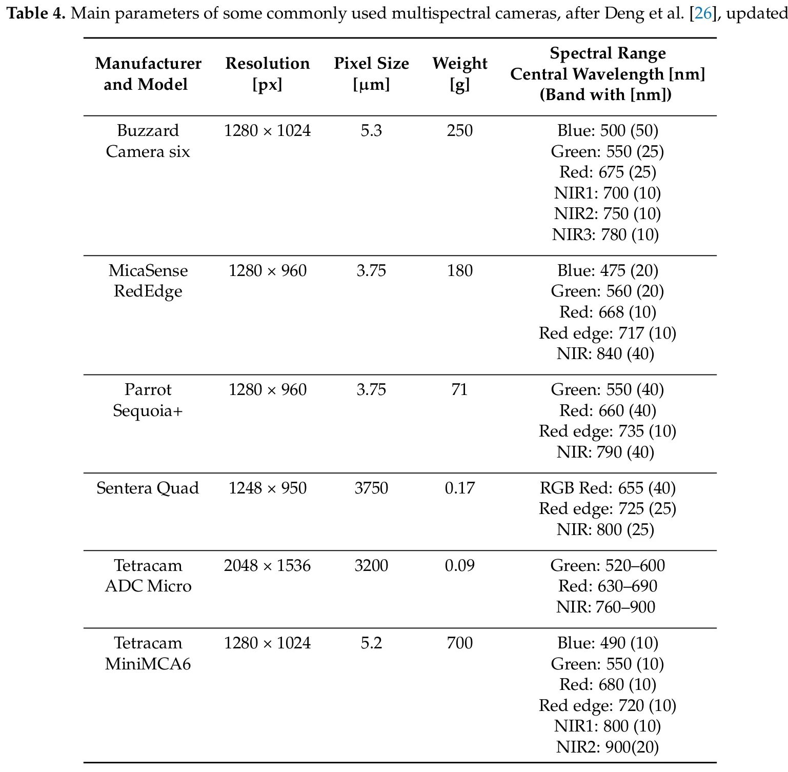
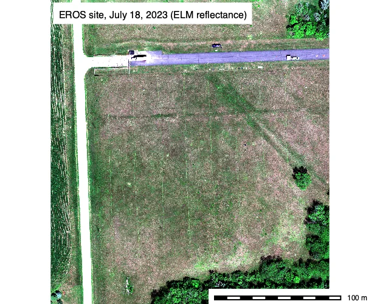
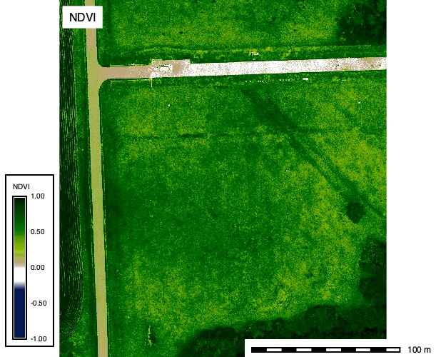
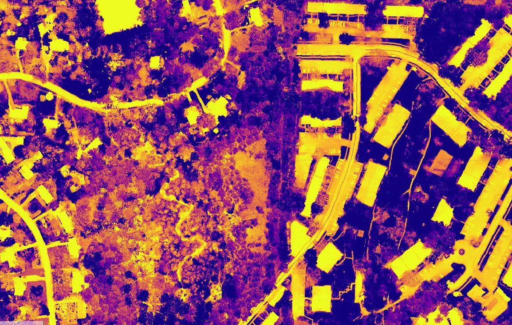
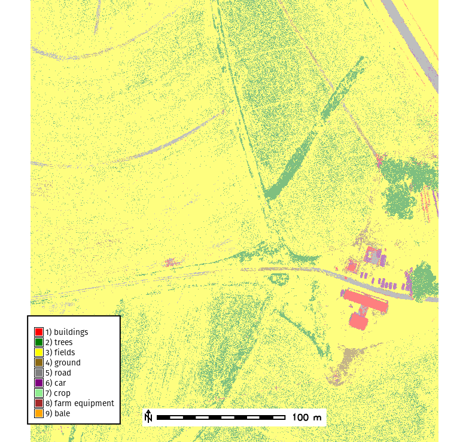

## Outline

- Pixel, Object, Image Classification
- Supervised vs Unsupervised learning
- Segmentation
- Feature Extraction
- Model Selection and Validation
- Real-time UAS analysis

## What is image classification?

- Labling images with sematic lables

Car, house, lake, tree, forest, etc..

## Image classification applications

- Land cover/land use classifcation
- Flood detection
- Species Identifcation
- Surveillance
- Object Tracking

## UAS Data Characteristics

- High spatial resolution (1 to 10 cm)
- Limited spectral bands (RGB or multispectral)
- High within-class variability
- Shadows, BRDF effects, and illumination differences

::: notes
Discuss how UAS imagery differs from satellite data: small footprint, variable lighting, and high geometric accuracy.
:::

## Types of classification

## Pixel-based classification

Each pixel is given a semantic label

## Object-based classification
The image is segmented into objects (groups of pixels) and the objects are classified

## Semantic Scene classification
The entire image is classified into a semantic scene

## Machine Learning Methods

- Supervised Learning
- Unsupervised Learning
- Deep Learning

## Supervised Learning

- Labeled features are used to train ML model
- May require significant amount of training data.
- Subject to the nonstationarity nature of spatial-temporal data 

- Random Forest, Gradient Boot, SVM

## Unsupervised Learning

- Data is classified through statistical modeling.
- No training data is required
- Classes are not defined and require interpretation

- k-means, ISODATA

## Deep Learning

- Artificial Neural Network (ANN)
- Convolutional Neural Network (CNN)
- Deep Neural Networks (UNET, )

## Spectral Properties

- Every surface has a **unique spectral reflectance curve**
- UAS sensors capture reflected light in discrete bands:
  - Red, Green, Blue (visible)
  - NIR (if multispectral)
  - Thermal
  - etc..
- Used to derive **spectral indices** for classification

## Reflectance spectra and sensor bands {.smaller}

{width=78% fig-alt="Reflectance against wavelength from 400 to 1000 nm for green vegetation, dry soil, and clear water, with the five MicaSense RedEdge bands drawn as shaded strips: blue 475, green 560, red 668, red edge 717, and NIR 842 nm. Vegetation is low in the visible with a small green peak, rises steeply across the red edge, and stays high in the NIR; soil rises slowly; water falls toward zero."}

Schematic spectra; the band positions are those of the MicaSense RedEdge (center wavelength, width in the shaded strip).

::: notes
The eye sees 400 to 700 nm. Green vegetation reflects little red and blue (chlorophyll absorbs them), a little more green, and about half of the near infrared, because the leaf cell structure scatters it. The steep rise between 700 and 740 nm is the red edge. Dry soil rises slowly and smoothly across the whole range; clear water reflects almost nothing in the NIR. A camera band is a slice of this curve: a 10 nm red band at 668 nm reads the bottom of the chlorophyll absorption, a 40 nm NIR band at 842 nm reads the plateau. Every index in this lecture is a combination of such slices.
:::

## The bands of a multispectral UAS camera {.smaller}

| Band | Typical range | What it responds to |
|---|---|---|
| Green | 500 to 600 nm, peak near 550 | Chlorophyll reflection; healthy leaves look green |
| Red | 600 to 700 nm | Chlorophyll absorption; low for vegetation, higher for soil |
| Red edge | 700 to 730 nm | The transition from absorption to NIR reflection; sensitive to chlorophyll content and stress |
| NIR | 700 nm to 1.3 µm | Leaf cell structure; the strongest reflectance of healthy vegetation |

::: notes
RGB cameras give three wide bands; a multispectral camera adds narrow red edge and NIR bands, and often a narrow red and green as well. The red edge is the most informative band for plant condition because its position shifts with chlorophyll content: a stressed plant absorbs less red, and the rise moves toward shorter wavelengths. NIR separates vegetation from soil and water better than any visible band. Thermal and shortwave infrared are different sensors and are not covered here.
:::

## Multispectral cameras {.smaller}

::: {.columns}
::: {.column width="48%"}
{width=92% fig-alt="Six multispectral UAS cameras photographed side by side: Buzzard Camera six, MicaSense RedEdge, Parrot Sequoia plus, Sentera Quad, Tetracam ADC Micro, and Tetracam MiniMCA6. Each has several small lenses, one per band."}
:::
::: {.column width="52%"}
{width=62% fig-alt="Table of the same cameras with resolution, pixel size, weight, and the center wavelength and width of each band, for example MicaSense RedEdge: blue 475, green 560, red 668, red edge 717, NIR 840 nm."}
:::
:::

Figure and table from @jeziorska_uas_2019. One lens and sensor per band, so the bands are offset and aligned in processing.

::: notes
These are the common cameras of the last decade; the DJI Mavic 3 Multispectral and the MicaSense RedEdge-P and Altum are the current equivalents. The design is the same: one small sensor per band behind its own filter, so a frame is really four to ten frames taken from slightly different positions. Photogrammetry software aligns them during processing; a raw frame shows color fringes along edges. The band widths matter: a 10 nm red band and a 40 nm NIR band read different parts of the spectra on the previous slide than the wide bands of an RGB camera.
:::

## From digital numbers to reflectance {.smaller}

- A camera records **digital numbers**: counts that depend on the sun, the atmosphere, the exposure, and the surface
- Indices and comparisons between dates need **reflectance**: the fraction of incoming light the surface reflects
- Calibration: a **reflectance panel** of known reflectance imaged before and after the flight, plus a **downwelling light sensor** on the aircraft that records the incoming light during the flight
- The **empirical line method** fits a line between the digital numbers of several targets and their measured reflectance, per band

::: notes
Processing software (Metashape, Pix4D) does the panel and sun sensor correction when told which images show the panel. The USGS campaign in the lab tested how good that correction is: the manufacturer workflow left the MicaSense reflectance about 0.015 too low, and the empirical line method with two well sized targets brought the error under 0.005 [@shrestha_absolute_2025]. For a single flight and a single index the offset hardly matters; for comparing dates, sensors, or thresholds published elsewhere it does. The USGS guidelines report [@sampath_guidelines_2023] describes both methods, and @poncet_multispectral_2019 compare five of them for a Parrot Sequoia camera, with the manufacturer method about as accurate as the best empirical fit.
:::

## Vegetation indices {.smaller}

- An index combines bands arithmetically so that one number tracks one property, mostly green vegetation
- Normalized differences, (A - B) / (A + B), range from -1 to 1 and cancel part of the illumination differences
- NDVI [@rouse_monitoring_1974] is the reference; VARI [@gitelson_novel_2002] does the same job with RGB only; SAVI [@huete_soil-adjusted_1988] corrects for bright soil between sparse plants

::: notes
An index is a transformation of the bands, not a measurement of its own: the numbers depend on the sensor bands and the calibration. The idea behind all of them is the contrast between the visible, where chlorophyll absorbs, and the NIR, where leaves reflect. With an RGB camera the NIR is missing, so VARI and the green leaf index use the contrast between green and red instead; they work for separating green vegetation from soil and pavement, less well for plant condition. In GRASS, `i.vi` computes the common ones from the band rasters and `r.mapcalc` any other.
:::

## Index maps from the lab {.smaller}

::: {.columns}
::: {.column width="50%"}
{width=100% fig-alt="True color composite of a 220 by 240 m block at the USGS EROS site: a grass field, crop rows on the left, a gravel road, an asphalt road with a row of calibration targets, and trees in the corners."}
:::
::: {.column width="50%"}
{width=100% fig-alt="NDVI map of the same block: the grass field in medium green, crop rows and trees in dark green, the roads and targets in white and tan near zero."}
:::
:::

MicaSense RedEdge-MX Dual, 10 bands, July 18, 2023, EROS calibration site, South Dakota [@irwin_eccoe_2025]. NDVI from the 668 and 842 nm bands: grass 0.5 to 0.7, crop rows and trees 0.8 to 1, roads near zero.

::: notes
These are two maps from the vegetation indices lab. The left panel is the composite of the red, green, and blue bands after a color stretch; reflectance of grass is only a few percent, so the raw composite is dark. The right panel is NDVI. The field is a mown grass plot and reads 0.5 to 0.7; the crop rows on the left and the trees reach 0.9; the asphalt and gravel roads, the calibration tarps, and the vehicles are near zero. The histogram of this map has almost no cells between 0.2 and 0.3, which is where a vegetation threshold belongs. The lab computes the same NDVI from the manufacturer-calibrated and the empirical line calibrated versions of the flight and compares them.
:::

## Common Spectral Indices {.smaller}

| Index | Formula | Bands | Purpose |
|--------|----------|----------|----------|
| NDVI | (NIR - Red) / (NIR + Red) | NIR, red | Green vegetation; 0.2 to 0.8 for crops and forest |
| NDRE | (NIR - RedEdge) / (NIR + RedEdge) | NIR, red edge | Chlorophyll in dense canopies, late season crops |
| SAVI | (1 + L) (NIR - Red) / (NIR + Red + L), L = 0.5 | NIR, red | Sparse vegetation over bright soil |
| GNDVI | (NIR - Green) / (NIR + Green) | NIR, green | Chlorophyll, less saturation than NDVI |
| NDWI | (Green - NIR) / (Green + NIR) | green, NIR | Open water |
| VARI | (Green - Red) / (Green + Red - Blue) | RGB | Green vegetation from RGB |
| GLI | (2 Green - Red - Blue) / (2 Green + Red + Blue) | RGB | Green vegetation from RGB |
| NDBI | (SWIR - NIR) / (SWIR + NIR) | SWIR, NIR | Built-up areas (satellite sensors) |

## Feature Engineering {.smaller}

:::{.columns}
:::{.column width=60%}
- **Normalized Indices**
    - NDVI, NDWI, VARI, etc..
- **Low and High Pass Filters**
    - Low Pass - Smoothing Kernal
    - High Pass - Edge Detection
- **Textural features**
    - Grey level co-occurrence matrix (GLCM)
        - Angular Second Moment
        - Contrast
        - Correlation
- **Geometric Characteristics**
- **Principal component analysis (PCA)**
:::
:::{.column width=40%}

$$
VARI = \frac{(Green - Red)}{(Green + Red - Blue)}
$$
:::
:::

## Sampling Methods

- **Random Sample**
    - Sample the entire spatial extent $n$ number of locations
- **Cluster Sampling**
    - Sample by different clusters
- **Stratified Random Sample**
    - Sample by different classes (e.g. Developed, Undeveloped) 

## Training a model

- Break data into training and testing dataset 80/20
- Avoid overfitting data
- May require a large volume of data

## Classification Results

{width=75%}

## Model Validation {.smaller}

#### Confusion Matrix

| Reference \ Predicted | Forest | Water | Urban | Agriculture | User's Accuracy (%) |
|-----------------------|--------|-------|-------|-------------|---------------------|
| **Forest**            | 50     | 2     | 3     | 0           | 90.9                |
| **Water**             | 1      | 45    | 0     | 4           | 88.2                |
| **Urban**             | 2      | 1     | 40    | 7           | 80.0                |
| **Agriculture**       | 0      | 3     | 5     | 42          | 85.7                |
| **Producer's Accuracy (%)** | 94.3 | 86.5 | 83.3 | 79.2 |                     |

- $Overall\ Accuarcy = \frac{Correctly\ classified\ samples}{Total\ samples}$
- Kappa coefficient (Cohen's Kappa): inter-rater agreement

## Challenges

- Handling multiple spatial scales
- Nonstationarity
- Processing/Training

## References {.smaller}

::: {#refs}
:::
