## Objectives {.smaller}

::: {.incremental}
- Distinguish pixel based, object based, and scene classification of UAS imagery
- Explain what the bands of RGB and multispectral cameras record and compute spectral indices from them
- Derive spatial, textural, and terrain features and segment an image into objects
- Train a random forest, map its predictions, and read the feature importances
- Assess a classification with a confusion matrix on reference data the model has not seen
:::

::: {.notes}
* Topic 5 analyzed the surface models; Topic 6 turns to the imagery and to what is on the surface
* Today: from bands to features to a trained model to an accuracy statement, plus segmentation with a pretrained model
* The assignment (6A) classifies the July 2024 Lake Wheeler orthophoto into nine classes with a random forest and compares it with SAM 2
* Every step has a GRASS tool next to it; the assignment uses them in the same order
:::

## Image classification {.center .text-center .section-divider background-color="#e9f2e9"}

::: {.notes}
* Section 1: what classification is, what it is used for, and what is particular about UAS imagery
:::

## What is image classification? {.smaller}

::: {.term-card}
**Image classification**: assigning a label from a fixed set of classes (building, tree, road, crop) to each unit of an image
:::

::: {.incremental}
- Land cover and land use mapping
- Crop type, weed, and disease mapping
- Flood and damage extent after an event
- Species identification and counts of individuals
- Detection and tracking of objects such as vehicles
:::

::: {.notes}
* The output is a categorical raster or a set of labeled objects, and it is only useful with a statement of how accurate it is
* The classes are a decision made before any model is trained; unclear class definitions are the most common source of error
* Assignment: nine classes on a research farm, from fields and trees down to cars and hay bales
:::

## UAS data characteristics {.smaller}

- Very high spatial resolution, 1 to 10 cm: objects are many pixels wide
- Few spectral bands: RGB, or four to ten narrow bands with a multispectral camera
- High variability within a class: a tree crown contains sunlit leaves, shaded leaves, and branches
- Shadows, view angle effects, and illumination that changes during the flight
- A DSM from the same flight, registered to the image

::: {.notes}
* With satellite pixels of 10 to 30 m, a pixel is a mixture and its spectrum carries most of the information
* With 5 cm pixels the spectrum of one pixel says little; the neighborhood, the texture, and the height carry it
* The DSM is the advantage of photogrammetric UAS products: every image comes with a height for each cell
:::

## Units of classification {.smaller}

::: {.columns}
::: {.column width="33%"}
::: {.term-card}
**Pixel based**: each cell receives a label from its own feature values
:::
:::
::: {.column width="33%"}
::: {.term-card}
**Object based**: the image is first segmented into groups of similar cells; the groups are classified
:::
:::
::: {.column width="33%"}
::: {.term-card}
**Scene classification**: a whole image or image tile receives one label
:::
:::
:::

- Pixel based maps of UAS imagery are speckled: neighboring cells of one object receive different labels
- Object based maps follow object outlines but depend on the segmentation
- Deep learning adds two more outputs: boxes around objects (detection) and a label per cell from a network that sees the neighborhood (semantic segmentation)

::: {.notes}
* The assignment is pixel based, with neighborhood features to reduce the speckle, and shows the object based route up to the table of segment statistics
* Object based image analysis became standard for very high resolution imagery for exactly this reason
* Scene classification is what a model does when it says "this tile shows a parking lot"
:::

## Spectral information {.center .text-center .section-divider background-color="#e9f2e9"}

::: {.notes}
* Section 2: what the bands record, how they are calibrated, and the indices derived from them
:::

## Spectral properties {.smaller}

- Each surface reflects a characteristic share of the incoming light at each wavelength: its **spectral reflectance curve**
- UAS sensors record reflected light in discrete bands
  - Red, green, and blue with a standard camera
  - Red edge and near infrared with a multispectral camera
  - Thermal infrared with a separate sensor
- Bands are combined into **spectral indices** that are used as features for classification

::: {.notes}
* Two surfaces can only be separated spectrally if their curves differ in a band the camera records
* Green crop and green tree canopy do not differ much in RGB; the assignment shows the consequence
* The next slides come from the vegetation indices lab, which is the optional preparation for the assignment
:::

## Reflectance spectra and sensor bands {.smaller}

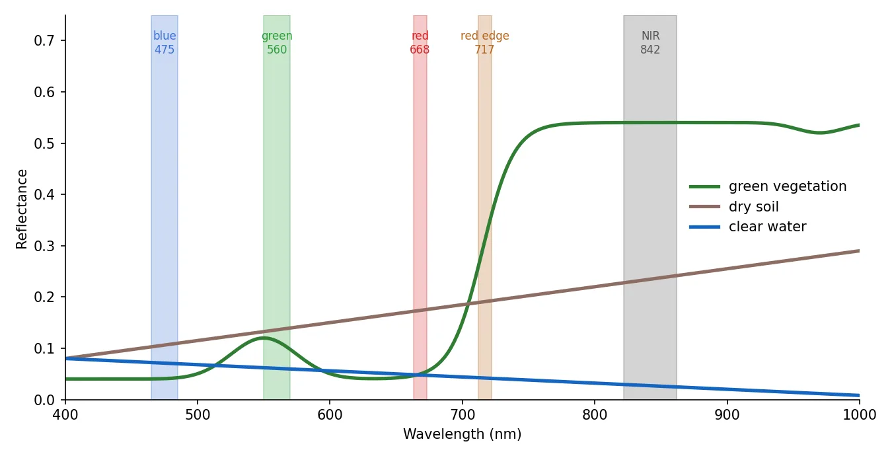{width=78% fig-alt="Reflectance against wavelength from 400 to 1000 nm for green vegetation, dry soil, and clear water, with the five MicaSense RedEdge bands drawn as shaded strips: blue 475, green 560, red 668, red edge 717, and NIR 842 nm. Vegetation is low in the visible with a small green peak, rises steeply across the red edge, and stays high in the NIR; soil rises slowly; water falls toward zero."}

Schematic spectra; the band positions are those of the MicaSense RedEdge (center wavelength, width in the shaded strip).

::: {.notes}
The eye sees 400 to 700 nm. Green vegetation reflects little red and blue (chlorophyll absorbs them), a little more green, and about half of the near infrared, because the leaf cell structure scatters it. The steep rise between 700 and 740 nm is the red edge. Dry soil rises slowly and smoothly across the whole range; clear water reflects almost nothing in the NIR. A camera band is a slice of this curve: a 10 nm red band at 668 nm reads the bottom of the chlorophyll absorption, a 40 nm NIR band at 842 nm reads the plateau. Every index in this lecture is a combination of such slices.
:::

## The bands of a multispectral UAS camera {.smaller}

| Band | Typical range | What it responds to |
|---|---|---|
| Green | 500 to 600 nm, peak near 550 | Chlorophyll reflection; healthy leaves look green |
| Red | 600 to 700 nm | Chlorophyll absorption; low for vegetation, higher for soil |
| Red edge | 700 to 730 nm | The transition from absorption to NIR reflection; sensitive to chlorophyll content and stress |
| NIR | 700 nm to 1.3 µm | Leaf cell structure; the strongest reflectance of healthy vegetation |

::: {.notes}
RGB cameras give three wide bands; a multispectral camera adds narrow red edge and NIR bands, and often a narrow red and green as well. The red edge is the most informative band for plant condition because its position shifts with chlorophyll content: a stressed plant absorbs less red, and the rise moves toward shorter wavelengths. NIR separates vegetation from soil and water better than any visible band. Thermal and shortwave infrared are different sensors and are not covered here.
:::

## Multispectral cameras {.smaller}

::: {.columns}
::: {.column width="48%"}
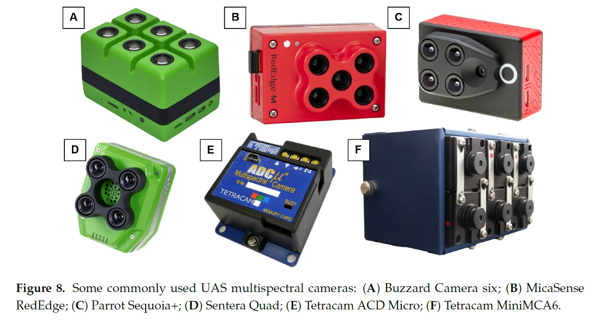{width=92% fig-alt="Six multispectral UAS cameras photographed side by side: Buzzard Camera six, MicaSense RedEdge, Parrot Sequoia plus, Sentera Quad, Tetracam ADC Micro, and Tetracam MiniMCA6. Each has several small lenses, one per band."}
:::
::: {.column width="52%"}
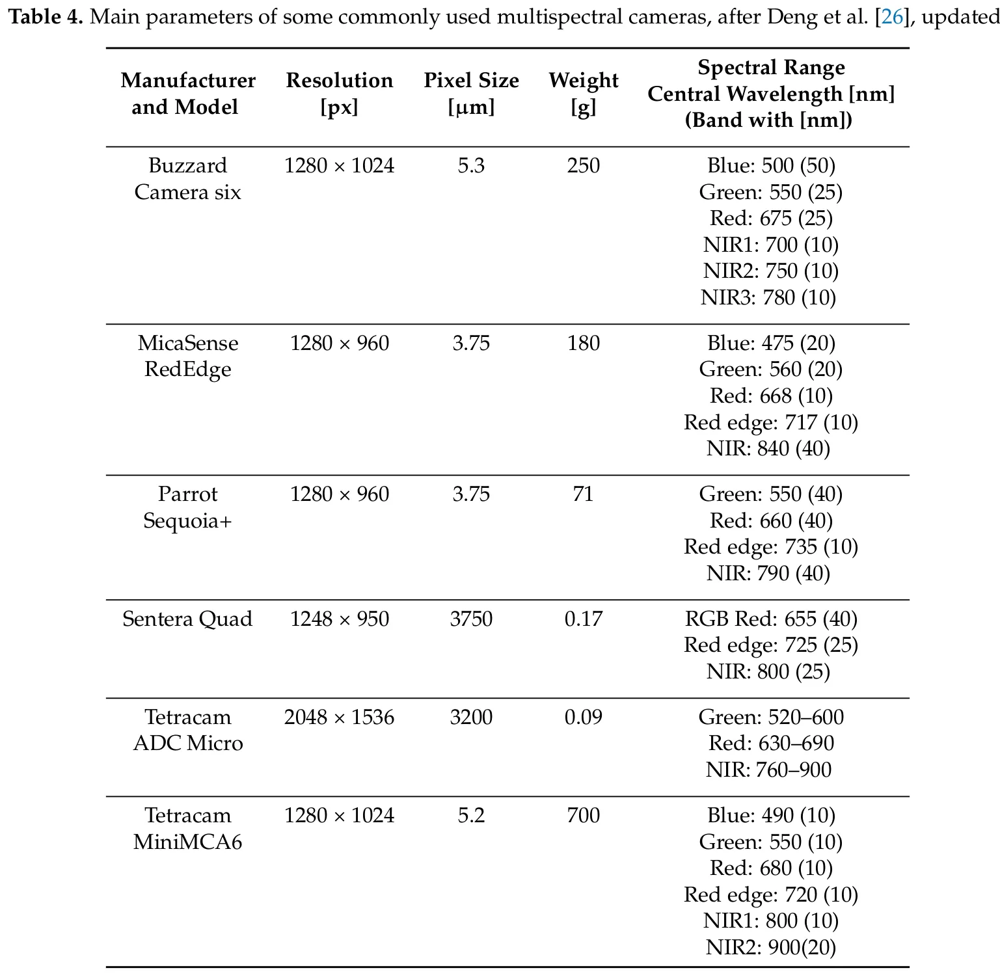{width=62% fig-alt="Table of the same cameras with resolution, pixel size, weight, and the center wavelength and width of each band, for example MicaSense RedEdge: blue 475, green 560, red 668, red edge 717, NIR 840 nm."}
:::
:::

Figure and table from @jeziorska_uas_2019. One lens and sensor per band, so the bands are offset and aligned in processing.

::: {.notes}
These are the common cameras of the last decade; the DJI Mavic 3 Multispectral and the MicaSense RedEdge-P and Altum are the current equivalents. The design is the same: one small sensor per band behind its own filter, so a frame is really four to ten frames taken from slightly different positions. Photogrammetry software aligns them during processing; a raw frame shows color fringes along edges. The band widths matter: a 10 nm red band and a 40 nm NIR band read different parts of the spectra on the previous slide than the wide bands of an RGB camera.
:::

## From digital numbers to reflectance {.smaller}

- A camera records **digital numbers**: counts that depend on the sun, the atmosphere, the exposure, and the surface
- Indices and comparisons between dates need **reflectance**: the fraction of incoming light the surface reflects
- Calibration: a **reflectance panel** of known reflectance imaged before and after the flight, plus a **downwelling light sensor** on the aircraft that records the incoming light during the flight
- The **empirical line method** fits a line between the digital numbers of several targets and their measured reflectance, per band

::: {.notes}
Processing software (Metashape, Pix4D) does the panel and sun sensor correction when told which images show the panel. The USGS campaign in the lab tested how good that correction is: the manufacturer workflow left the MicaSense reflectance about 0.015 too low, and the empirical line method with two well sized targets brought the error under 0.005 [@shrestha_absolute_2025]. For a single flight and a single index the offset hardly matters; for comparing dates, sensors, or thresholds published elsewhere it does. The USGS guidelines report [@sampath_guidelines_2023] describes both methods, and @poncet_multispectral_2019 compare five of them for a Parrot Sequoia camera, with the manufacturer method about as accurate as the best empirical fit.
:::

## Vegetation indices {.smaller}

- An index combines bands arithmetically so that one number tracks one property, mostly green vegetation
- Normalized differences, (A - B) / (A + B), range from -1 to 1 and cancel part of the illumination differences
- NDVI [@rouse_monitoring_1974] is the reference; VARI [@gitelson_novel_2002] does the same job with RGB only; SAVI [@huete_soil-adjusted_1988] corrects for bright soil between sparse plants

::: {.notes}
An index is a transformation of the bands, not a measurement of its own: the numbers depend on the sensor bands and the calibration. The idea behind all of them is the contrast between the visible, where chlorophyll absorbs, and the NIR, where leaves reflect. With an RGB camera the NIR is missing, so VARI and the green leaf index use the contrast between green and red instead; they work for separating green vegetation from soil and pavement, less well for plant condition. In GRASS, `i.vi` computes the common ones from the band rasters and `r.mapcalc` any other.
:::

## Index maps from the lab {.smaller}

::: {.columns}
::: {.column width="50%"}
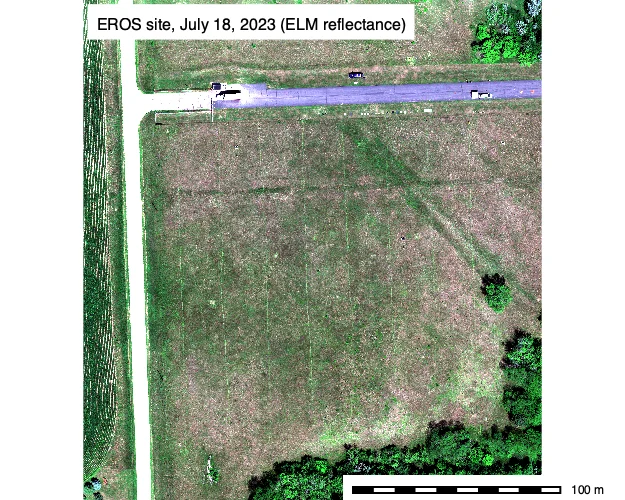{width=100% fig-alt="True color composite of a 220 by 240 m block at the USGS EROS site: a grass field, crop rows on the left, a gravel road, an asphalt road with a row of calibration targets, and trees in the corners."}
:::
::: {.column width="50%"}
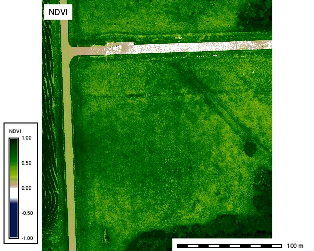{width=100% fig-alt="NDVI map of the same block: the grass field in medium green, crop rows and trees in dark green, the roads and targets in white and tan near zero."}
:::
:::

MicaSense RedEdge-MX Dual, 10 bands, July 18, 2023, EROS calibration site, South Dakota [@irwin_eccoe_2025]. NDVI from the 668 and 842 nm bands: grass 0.5 to 0.7, crop rows and trees 0.8 to 1, roads near zero.

::: {.notes}
These are two maps from the vegetation indices lab. The left panel is the composite of the red, green, and blue bands after a color stretch; reflectance of grass is only a few percent, so the raw composite is dark. The right panel is NDVI. The field is a mown grass plot and reads 0.5 to 0.7; the crop rows on the left and the trees reach 0.9; the asphalt and gravel roads, the calibration tarps, and the vehicles are near zero. The histogram of this map has almost no cells between 0.2 and 0.3, which is where a vegetation threshold belongs. The lab computes the same NDVI from the manufacturer-calibrated and the empirical line calibrated versions of the flight and compares them.
:::

## Common spectral indices {.smaller}

| Index | Formula | Bands | Purpose |
|--------|----------|----------|----------|
| NDVI | (NIR - Red) / (NIR + Red) | NIR, red | Green vegetation; 0.2 to 0.8 for crops and forest |
| NDRE | (NIR - RedEdge) / (NIR + RedEdge) | NIR, red edge | Chlorophyll in dense canopies, late season crops |
| SAVI | (1 + L) (NIR - Red) / (NIR + Red + L), L = 0.5 | NIR, red | Sparse vegetation over bright soil |
| GNDVI | (NIR - Green) / (NIR + Green) | NIR, green | Chlorophyll, less saturation than NDVI |
| NDWI | (Green - NIR) / (Green + NIR) | green, NIR | Open water |
| VARI | (Green - Red) / (Green + Red - Blue) | RGB | Green vegetation from RGB |
| GLI | (2 Green - Red - Blue) / (2 Green + Red + Blue) | RGB | Green vegetation from RGB |
| NDBI | (SWIR - NIR) / (SWIR + NIR) | SWIR, NIR | Built-up areas (satellite sensors) |

::: {.notes}
* A reference table; the lab computes NDVI, NDRE, SAVI, GNDVI, VARI, and GLI
* The last two rows of RGB indices are the ones available for the Lake Wheeler orthophoto
* NDBI needs a shortwave infrared band, which UAS cameras do not have; it is listed because it appears in the satellite literature
:::

## Features {.center .text-center .section-divider background-color="#e9f2e9"}

::: {.notes}
* Section 3: feature engineering, the rasters a model is given in addition to the bands
:::

## Feature engineering {.smaller}

::: {.term-card}
**Feature**: one raster of values offered to the model for each cell: a band, an index, a filter result, a texture measure, or a terrain derivative
:::

| Group | Examples | What it adds |
|---|---|---|
| Spectral | Bands, VARI, NDVI | Color and vegetation contrast |
| Spatial filters | Mean, standard deviation, edges | The neighborhood of the cell |
| Texture | GLCM measures | The pattern of grey levels |
| Terrain | Height, slope, curvature, landforms | The shape of the surface |
| Transformations | Principal components | Fewer, uncorrelated bands |

::: {.notes}
* With three bands and 5 cm pixels, the features carry most of the information a model can use
* Features should describe the class, not the location of the training sample; the assignment has an example of a feature that does the second
* Assignment Parts 2 to 5 compute one or more features from each of the first four groups
:::

## A spectral index as a feature {.smaller}

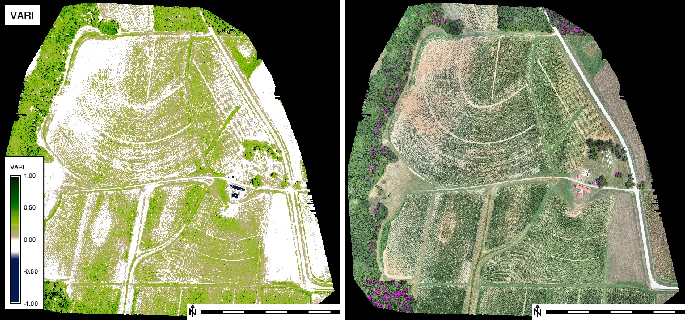{width="88%" fig-align="center" fig-alt="Two maps of the Lake Wheeler site. Left: VARI from -1 to 1; tree lines and the crop fields in the south are green, bare and sparsely planted fields and the roads are white. Right: the orthophoto with the cells excluded by the denominator rule in magenta, concentrated in the shadows along the tree lines."}

::: {.term-card}
In GRASS: `r.mapcalc expression="vari = float(ortho.2 - ortho.1) / (ortho.2 + ortho.1 - ortho.3)"`; `float()` avoids integer division of the 8-bit bands
:::

::: {.notes}
* Left: VARI of the July 2024 orthophoto; right: the cells where the denominator is near zero, in magenta
* Those cells are mostly deep shadows along the tree lines, where all three bands are low and green plus red is hardly larger than blue
* Assignment Part 2: integer division, the unbounded range, and the rule that masks and clamps the index
:::

## Spatial filters {.smaller}

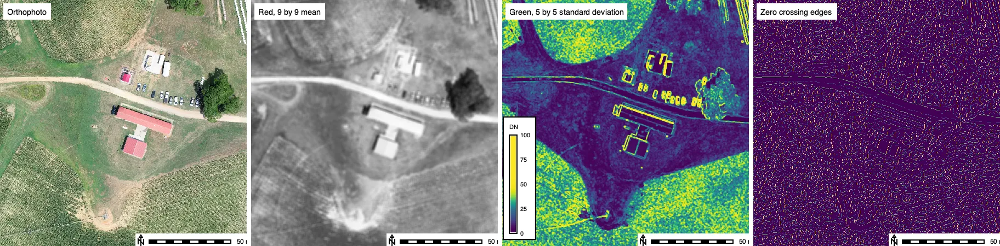{width="100%" fig-alt="Four panels of a 150 m block around the farm buildings: the orthophoto; the 9 by 9 mean of the red band, a blurred image; the 5 by 5 standard deviation of the green band, dark on roofs, road, and grass and bright on edges, cars, the tree, and crop rows; and zero crossing edges as short thin lines."}

::: {.columns}
::: {.column width="50%"}
::: {.term-card}
**Low pass filter**: a moving window mean; removes fine variation such as crop rows
:::
:::
::: {.column width="50%"}
::: {.term-card}
**High pass filter**: local variation or edges; standard deviation, zero crossings
:::
:::
:::

::: {.notes}
* Orthophoto, 9 by 9 mean of red, 5 by 5 standard deviation of green, and zero crossing edges for the farm block
* In GRASS: `r.neighbors` with `method=average` or `method=stddev`, and `i.zc` for edges
* Assignment Part 3: the smoothed red band becomes the second most important feature of the model
:::

## Texture {.smaller}

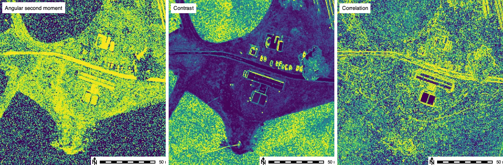{width="100%" fig-alt="Three panels of the farm block: angular second moment, high on mown grass, road, and roofs and low in crop fields; contrast, high in crop fields, on the tree, and along building and car edges; and correlation, a fine pattern with the building outlines visible."}

::: {.term-card}
**Grey level co-occurrence matrix (GLCM)**: counts how often pairs of grey levels occur in neighboring cells of a window; its statistics describe texture [@haralick_textural_1973]. In GRASS: `r.texture input=ortho.2 output=green_tex method=asm,contrast,corr size=5`
:::

::: {.notes}
* Angular second moment is high where the window is uniform; contrast where neighbors differ strongly; correlation where grey levels change gradually
* Crop rows have high contrast and low uniformity; mown grass and roofs the opposite
* Assignment Part 4; this is the slowest feature, about two minutes at 0.2 m
:::

## Terrain features {.smaller}

::: {.columns}
::: {.column width="50%"}
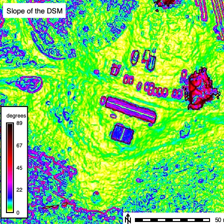{width="70%" fig-align="center" fig-alt="Slope of the DSM for the farm block: low slopes in green over grass and fields, steep slopes in magenta and red outlining the buildings, the cars, and the tree crown."}

Slope of the DSM
:::
::: {.column width="50%"}
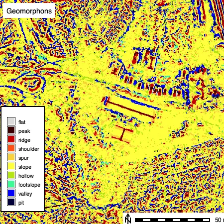{width="70%" fig-align="center" fig-alt="Geomorphon landforms of the DSM for the farm block: slope class in yellow over most of the block, with ridges, shoulders, footslopes, and valleys along building edges and in the crop rows."}

Geomorphons, 3 m search radius
:::
:::

::: {.term-card}
In GRASS: `r.slope.aspect` for slope and curvatures, `r.geomorphon` for landforms [@jasiewicz_geomorphons_2013]
:::

::: {.notes}
* The DSM separates what color cannot: a tree from grass, a roof from a gravel pad
* Slope outlines everything that stands up from the ground; geomorphons classify the local shape into ten forms
* Absolute elevation is also a candidate feature, and a risky one: it describes where on the hill a cell lies. Assignment Parts 5 and 8
:::

## Segmentation {.center .text-center .section-divider background-color="#e9f2e9"}

::: {.notes}
* Section 4: grouping cells into objects, with a classical algorithm and with a pretrained model
:::

## Superpixels and object statistics {.smaller}

::: {.columns}
::: {.column width="45%"}
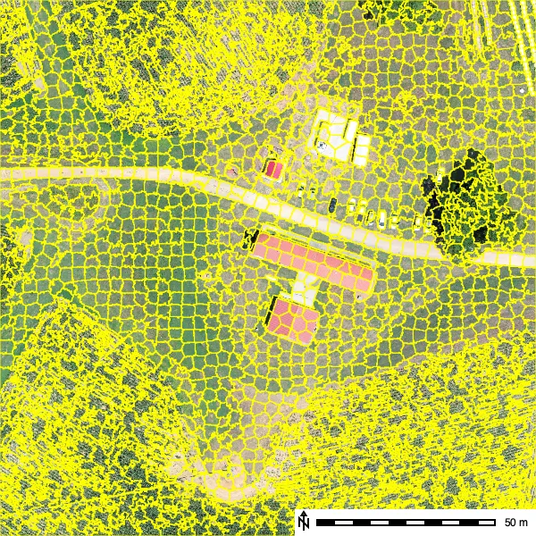{width="100%" fig-alt="The farm block orthophoto with yellow superpixel outlines: compact segments a few meters across that follow roof edges, the road, the cars, and the tree crown."}
:::
::: {.column width="55%"}
::: {.term-card}
**Superpixel**: a compact group of neighboring cells with similar values; SLIC grows them from a regular grid of seeds [@achanta_slic_2012]
:::

- Each segment becomes one row of a table: mean and spread of each band, area, compactness
- The table is classified in place of the cells
- In GRASS: `i.superpixels.slic` and `i.segment.stats`; `i.segment` for region growing
:::
:::

::: {.notes}
* About 2,000 superpixels of at least 50 cells on the farm block
* The segment statistics add shape as a feature, which a cell does not have
* Assignment Part 6 stops at the table; an object based classification would join labels to it and train on the rows
:::

## Promptable foundation models {.smaller}

::: {.term-card}
**Foundation model**: a model trained once on a very large dataset and used for many tasks without further training. SAM [@kirillov_segment_2023] and SAM 2 [@ravi_sam2_2024] return the outline of an object for a prompt: a point, a box, or, combined with a text model, a word
:::

::: {.incremental}
- Text prompts: Grounding DINO [@liu_grounding_2024] finds boxes that match the words, SAM 2 outlines the object in each box
- No training polygons, no features; the output is a set of objects, not a label for every cell
- Thresholds control how confident a box and its match to the text must be
- In GRASS: `i.sam2 group=farm_rgb output=sam_trees text_prompt="trees"`, through the samgeo package [@wu_samgeo_2023]
:::

::: {.notes}
* The model was trained on about a billion masks of everyday photographs, not on aerial imagery; that it works on orthophotos at all is the notable result
* It processes one image tile at a time and needs a GPU to be fast: seconds per prompt on a GPU, about a minute on a CPU
* Assignment Part 10 runs three prompts on the farm block
:::

## Text prompted segmentation at Lake Wheeler {.smaller}

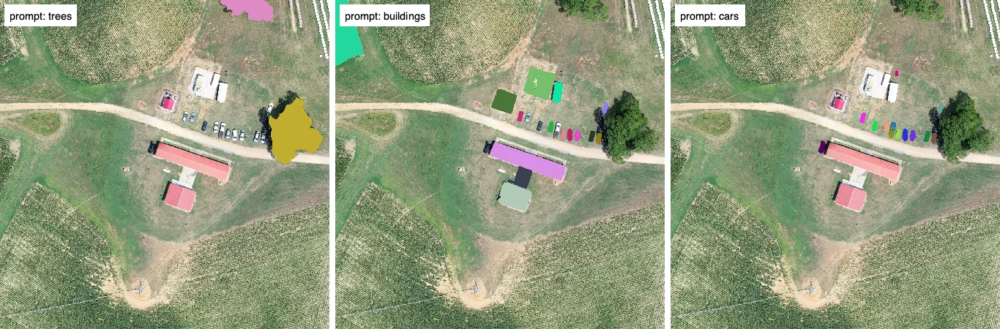{width="100%" fig-alt="Three panels of the farm block orthophoto with the objects found by i.sam2 in random colors. Prompt trees: the large tree and a clump at the top edge. Prompt buildings: the two buildings, the walkway, two concrete pads, a strip at the top left corner, and nine parked cars. Prompt cars: the parked cars and three objects next to the pads."}

Prompts "trees", "buildings", and "cars" at the default thresholds of 0.24: 2, 15, and 15 objects.

::: {.notes}
* Outlines are clean and follow the objects, which the pixel based map does not achieve
* The prompt "buildings" also returns the parked cars and the concrete pads; a box threshold of 0.35 leaves 5 objects, 0.5 leaves 3
* What counts as a match for a word is decided by the model, and it cannot be corrected with a few training polygons
:::

## Training and prediction {.center .text-center .section-divider background-color="#e9f2e9"}

::: {.notes}
* Section 5: the families of methods, how training data are sampled, and the random forest used in the assignment
:::

## Supervised and unsupervised learning {.smaller}

::: {.columns}
::: {.column width="50%"}
::: {.term-card}
**Supervised**: the model learns the classes from labeled samples
:::

- Random forest, gradient boosting, support vector machines
- Needs training data for every class
- Training data from one place or date may not hold for another
:::
::: {.column width="50%"}
::: {.term-card}
**Unsupervised**: cells are grouped by similarity; the analyst names the groups afterwards
:::

- k-means, ISODATA
- No training data
- The clusters need not correspond to the classes of interest
:::
:::

::: {.notes}
* Supervised methods dominate when the classes are defined in advance, as in a land cover legend
* Unsupervised clustering is useful for a first look at how many spectrally distinct surfaces an image contains
* In GRASS: `r.learn.train` for supervised models from scikit-learn, `i.cluster` with `i.maxlik` for the unsupervised route
:::

## Deep learning {.smaller}

- **Convolutional neural networks** learn their own spatial features from the image, in place of hand made filters and textures
- Architectures by task: classification networks for scenes, U-Net for a label per cell, detectors for boxes
- They need many labeled examples and a GPU for training; pretrained models reduce both
- Foundation models such as SAM 2 are the same idea at a larger scale: pretrained once, prompted for each task

::: {.notes}
* The filters and textures of the previous section are fixed versions of what the first layers of a convolutional network learn
* For a single farm and nine classes, a random forest on a dozen features is the proportionate tool; for a counting task over thousands of images, a detector is
* The assignment uses both ends: a random forest trained on site and a pretrained model that is only prompted
:::

## Sampling design {.smaller}

| Design | How samples are placed | Consideration |
|---|---|---|
| Random | Anywhere in the extent with equal probability | Rare classes receive few samples |
| Stratified random | A fixed number per class or stratum | Needs a prior map of the strata |
| Cluster | Groups of nearby samples, such as digitized polygons | Efficient to collect; samples within a polygon are not independent |

::: {.incremental}
- Reference data are divided into a **training set** and a **test set** the model never sees
- Neighboring cells are spatially autocorrelated: dividing the cells of one polygon at random puts near copies on both sides
- Divide by polygon or by area, not by cell
:::

::: {.notes}
* @congalton_review_1991 and @olofsson_good_2014 are the standard references for sampling and accuracy assessment
* In GRASS: `r.random` and the addon `r.sample.category` place random and stratified samples
* Assignment Part 7: 64 digitized polygons, every third one set aside for testing
:::

## Random forest {.smaller}

::: {.term-card}
**Random forest**: many decision trees, each trained on a bootstrap sample of the training data and a random subset of the features at each split; the class is the majority vote [@breiman_random_2001]
:::

::: {.incremental}
- Works with features of different units and ranges without scaling
- Few parameters: the number of trees and the number of features tried at each split
- **Feature importance**: the drop in accuracy when one feature is shuffled
- In GRASS: `r.learn.train group=features training_map=train_rast model_name=RandomForestClassifier`, then `r.learn.predict`
:::

::: {.notes}
* The addon `r.learn.ml2` is an interface to scikit-learn; the same two tools run gradient boosting, support vector machines, and others by changing `model_name`
* The training raster holds the class numbers; the group holds the features
* Assignment Parts 7 and 8: one model on the three bands, one on 14 features, 100 trees each
:::

## Two classifications of Lake Wheeler {.smaller}

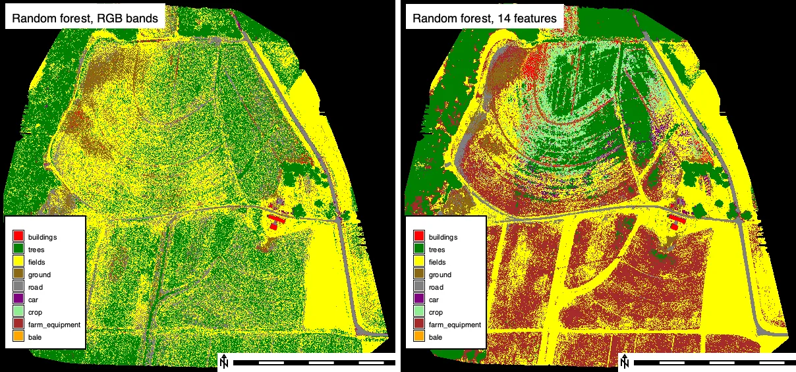{width="92%" fig-align="center" fig-alt="Two classification maps of the whole site with a nine class legend. Left, RGB bands only: a speckled mix of fields in yellow and trees in green over the crop fields. Right, 14 features: tree lines solid green, the eastern bare field solid yellow, the upper central field light green for crop, and the southern fields mostly brown for farm equipment."}

RGB bands (left) and 14 features (right), July 17, 2024

::: {.notes}
* RGB only: crop rows and tree canopy have the same colors, so the fields are a speckle of both classes
* 14 features: tree lines, roads, and buildings are clean, but 12.5 hectares of the southern fields are labeled farm equipment
* The next slide shows why
:::

## Feature importance {.smaller}

::: {.columns}
::: {.column width="58%"}
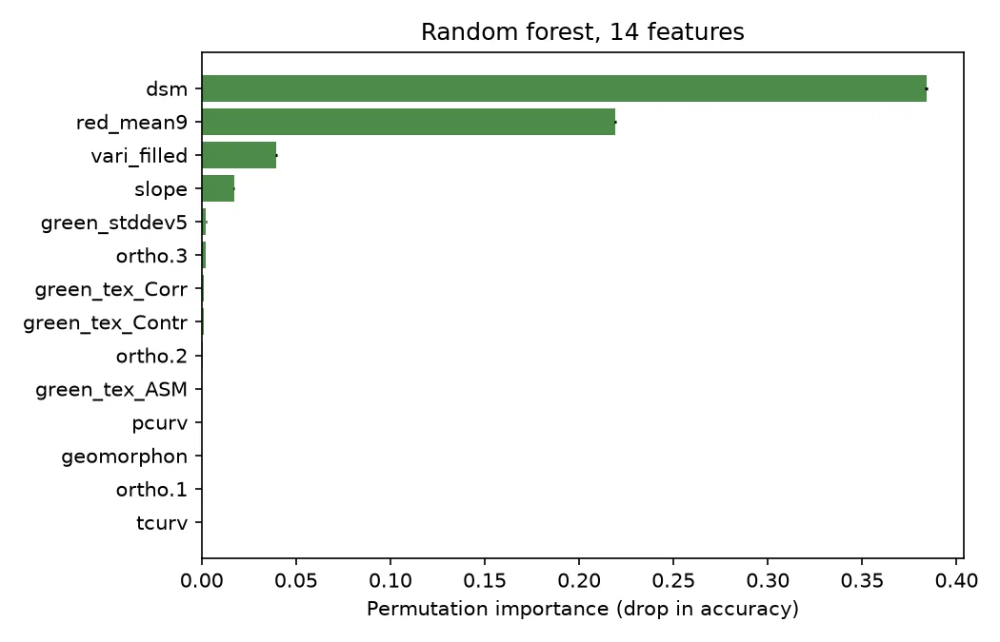{width="100%" fig-alt="Horizontal bar chart of the permutation importance of the 14 features. The DSM is highest at 0.38, the 9 by 9 mean of the red band second at 0.22, then VARI at 0.04 and slope at 0.02; all other features are below 0.003."}
:::
::: {.column width="42%"}
- The DSM is the most important feature, ahead of the smoothed red band, VARI, and slope
- Elevation is a property of the location, not of the class
- The farm equipment polygons lie at the elevation of the southern fields
:::
:::

::: {.notes}
* The model found the shortest path to reproducing the training polygons: each class was digitized at particular elevations
* On the training polygons this is perfectly accurate; on the rest of the site it is wrong
* A feature importance reports what the model used, not whether using it was sound
:::

## Accuracy assessment {.center .text-center .section-divider background-color="#e9f2e9"}

::: {.notes}
* Section 6: the confusion matrix, the measures derived from it, and which reference data to use
:::

## The confusion matrix {.smaller}

| Map \\ Reference | Forest | Water | Urban | Agriculture | User's accuracy (%) |
|-----------------------|--------|-------|-------|-------------|---------------------|
| **Forest**            | 50     | 2     | 3     | 0           | 90.9                |
| **Water**             | 1      | 45    | 0     | 4           | 90.0                |
| **Urban**             | 2      | 1     | 40    | 7           | 80.0                |
| **Agriculture**       | 0      | 3     | 5     | 42          | 84.0                |
| **Producer's accuracy (%)** | 94.3 | 88.2 | 83.3 | 79.2 |                     |

- **Overall accuracy**: correct samples divided by all samples, 177 / 205 = 86.3 %
- **User's accuracy**: of the samples mapped as a class, the share that is the class (row); 100 % minus the commission error
- **Producer's accuracy**: of the reference samples of a class, the share mapped as the class (column); 100 % minus the omission error
- **Kappa**: agreement beyond chance, here 0.82

::: {.notes}
* Rows are the map, columns the reference, the layout `r.confusionmatrix` prints
* User's accuracy answers "if the map says forest, how often is it forest"; producer's accuracy answers "how much of the real forest did the map find"
* In GRASS: `r.confusionmatrix classification=rf_features raster_reference=test_rast -m`, or `r.kappa`
:::

## Training accuracy and test accuracy {.smaller}

| Model | Training polygons | Test polygons |
|---|---|---|
| RGB bands | 99.5 %, kappa 0.98 | 54.6 %, kappa 0.17 |
| 14 features | 100 %, kappa 1.00 | 53.6 %, kappa 0.21 |

::: {.incremental}
- A random forest reproduces its training data almost perfectly; that number says nothing about the rest of the map
- On the test polygons the features raise the producer's accuracy of trees from 85 to 99 %, ground from 47 to 93 %, and bales from 7 to 86 %
- The overall accuracy does not change: 168,051 cells of one test field are mapped as farm equipment
- With unequal classes, the overall accuracy mostly reports on the largest class
:::

::: {.notes}
* These are the assignment results for the two models
* Read the matrix by class before quoting one number; kappa and the per class accuracies show the improvement that the overall accuracy hides
* The test set here is small and clustered, with one field polygon holding most of its cells, so its overall accuracy is close to a statement about that polygon
:::

## Challenges {.smaller}

- **Class definitions**: "fields" covers bare soil and planted rows; "crop" and "farm equipment" have very few training cells
- **Transfer**: a model trained on one flight meets different illumination, phenology, and sensors on the next
- **Scale**: the features that describe a car differ from the ones that describe a field
- **Location proxies**: features such as elevation or coordinates that identify the training polygon in place of the class
- **Computation**: 122 million cells at 7 cm; the assignment works at 0.2 m

::: {.notes}
* Most improvements to a classification come from the training data and the class legend, not from a different algorithm
* Transfer between dates is the bridge to Topic 6B: comparing two classified maps multiplies their errors
* The assignment asks for one change to the model and an honest report of whether it helped
:::

## Key terms {.smaller}

::: {.columns}
::: {.column width="50%"}
::: {.term-card}
**Feature**: a raster of values offered to the model for each cell
:::
::: {.term-card}
**Random forest**: an ensemble of decision trees trained on bootstrap samples; the class is their majority vote
:::
::: {.term-card}
**Foundation model**: a model pretrained on a very large dataset and prompted for a task without further training
:::
:::
::: {.column width="50%"}
::: {.term-card}
**Confusion matrix**: the cross tabulation of mapped and reference classes
:::
::: {.term-card}
**User's accuracy**: the share of a mapped class that is correct; the complement of the commission error
:::
::: {.term-card}
**Producer's accuracy**: the share of a reference class that was found; the complement of the omission error
:::
:::
:::

::: {.notes}
* The words the assignment report has to use correctly
* The grading asks for conclusions in these terms: features, training and test data, user's and producer's accuracy, class imbalance
:::

## Wrap-up

::: {.term-card}
**Assignment 6A**: [UAS image classification](../assignments/assignment_6a.qmd)

**Lab (optional)**: [Vegetation indices from UAS imagery](../assignments/lab_vegetation_indices.qmd)
:::

::: {.notes}
* Recap: bands and indices, then neighborhood, texture, and terrain features, then a model, then an accuracy statement on data the model has not seen
* A pretrained model returns objects from a word; a trained model labels every cell from your polygons; they fail in different ways
* Next: Topic 6B, change detection, which compares images, indices, surfaces, and classified maps between dates
:::

## References {.smaller}

::: {#refs}
:::
