## Objectives {.smaller}

::: {.incremental}
- Name the components of a difference between two surveys: real change, registration error, and noise
- Prepare two surveys for comparison: radiometric normalization and horizontal and vertical co-registration
- Detect change before classification: image and index differencing and the DEM of Difference
- Estimate a level of detection from stable surfaces and report significant change
- Compare classified maps with a from-to matrix and explain how their errors combine
:::

::: {.notes}
* Topic 5B treated a series of surveys that were already registered; today the question is what has to be true before two surveys can be subtracted
* Three families of methods: pre-classification (differences of values), object based, and post-classification (differences of labels)
* The assignment (6B) compares Lake Wheeler in July 2024 and September 2025; the 2025 survey has no ground control, so co-registration is half of the work
* Every method has a GRASS tool next to it; the assignment uses them in the same order
:::

## Change detection with UAS {.center .text-center .section-divider background-color="#e9f2e9"}

::: {.notes}
* Section 1: what change detection is used for, what UAS add, and how scale affects what can be detected
:::

## Why change detection? {.smaller}

::: {.term-card}
**Change detection**: identifying differences in the state of a surface or object by observing it at different times [@singh_digital_1989]
:::

::: {.incremental}
- **Geomorphic processes**: erosion, deposition, landslides, dune migration
- **Vegetation**: growth, stress, harvest, clearing, regrowth
- **Infrastructure**: construction progress, stockpiles, demolition
- **Events**: flood, storm, and fire damage and the recovery afterwards
:::

::: {.notes}
* The question always has two parts: where did something change, and by how much
* A change map is a claim about the world between two dates; the lecture is about what supports that claim
* The same methods apply to satellite images, lidar, and UAS products; what differs is the resolution and the registration effort
:::

## What UAS add {.smaller}

::: {.columns}
::: {.column width="45%"}
- Centimeter resolution in the image and in the surface model
- Surveys timed to an event or a season, not to an orbit
- Low cost of repeating a survey
- An orthophoto and a DSM from the same flight
- Local detail for a regional change signal from satellites
:::
::: {.column width="55%"}
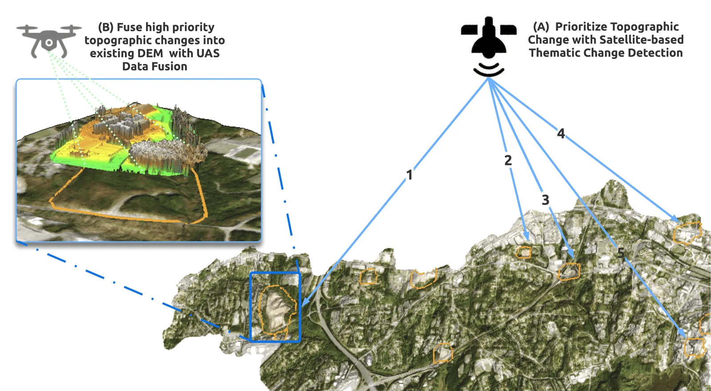{width="100%" fig-alt="Diagram of the Rapid-DEM workflow: a satellite detects areas of land cover change across a county, numbered priority areas are selected, and a UAS surveys one of them; its DSM is fused into the existing lidar DEM."}

Satellite change detection selects the areas a UAS then surveys [@white_rapid-dem_2022]
:::
:::

::: {.notes}
* The figure is from the Rapid-DEM study: annual land cover change from satellites tells you where the topography is out of date, and a UAS flight updates the DEM there
* The two scales complement each other: the satellite covers everything coarsely and often, the UAS covers little in detail and on demand
* The short repeat interval is the main advantage for change detection: the interval can match the process
:::

## Spatial and temporal scale {.smaller}

::: {.columns}
::: {.column width="50%"}
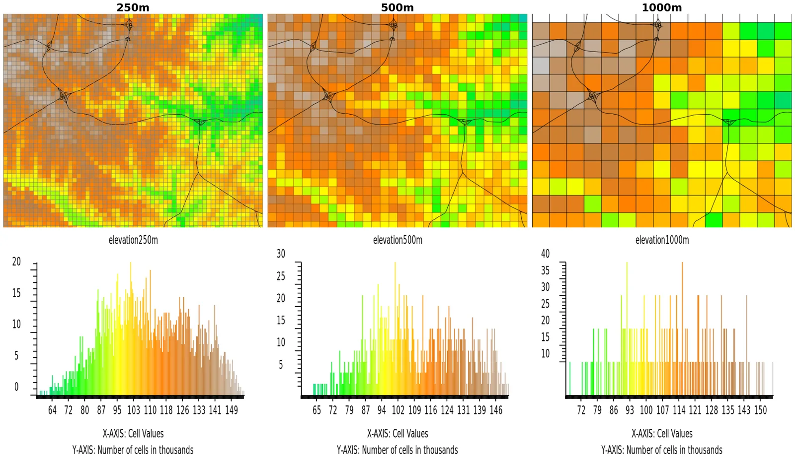{width="100%" fig-alt="An elevation model of the same area at 250, 500, and 1000 m cells, with the histogram of elevation below each: the terrain pattern coarsens and the histogram loses detail as the cells grow."}

Elevation at 250, 500, and 1000 m
:::
::: {.column width="50%"}
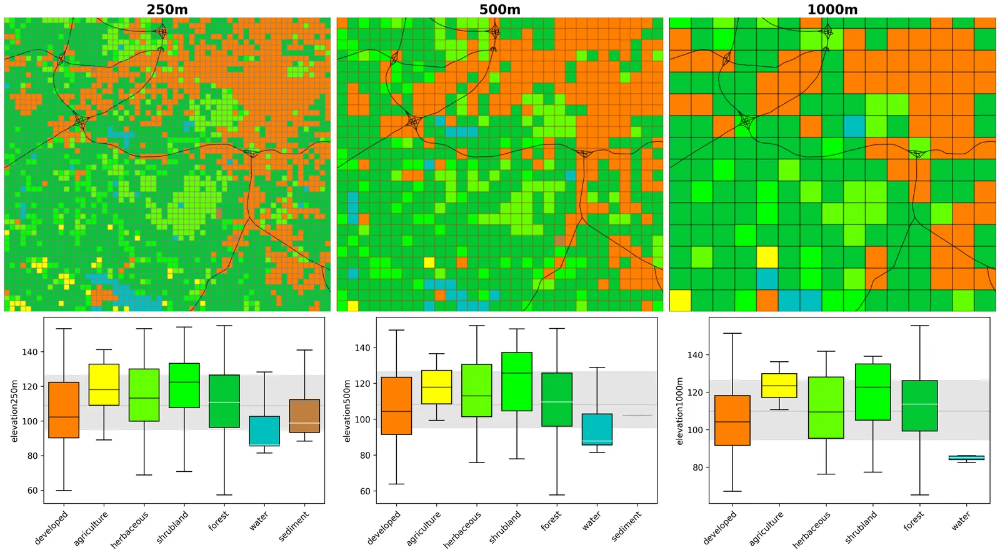{width="100%" fig-alt="A land cover map of the same area at 250, 500, and 1000 m cells, with box plots of elevation by class below each: small patches of the minor classes disappear at coarser cells."}

Land cover at 250, 500, and 1000 m
:::
:::

- A change smaller than a cell, or shorter than the interval between surveys, is not detected
- Resolution, interval, and extent are chosen for the process: a rill, a crop cycle, a subdivision

::: {.notes}
* The same landscape at three cell sizes: the coarser the cells, the more the small features and the minor classes disappear
* The temporal equivalent: two surveys a year apart cannot tell whether a field was harvested once or three times
* With UAS the resolution is rarely the limit; the registration between surveys is, which is the next section
:::

## A long record: Jockey's Ridge {.smaller}

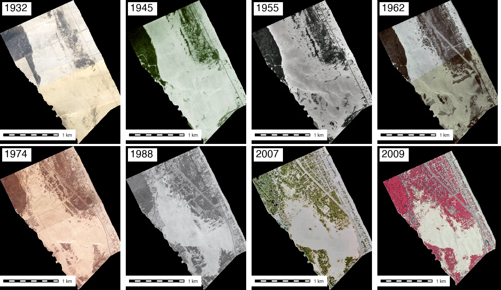{width="78%" fig-align="center" fig-alt="Eight historical aerial photographs of Jockey's Ridge, North Carolina, from 1932, 1945, 1955, 1962, 1974, 1988, 2007, and 2009: the bright dune field shrinks and shifts while vegetation and development expand around it."}

Aerial photographs, 1932 to 2009: different cameras, films, scales, and seasons

::: {.notes}
* Jockey's Ridge is the tallest active dune system in the eastern United States; the photographs show the dune field migrating and being enclosed by vegetation and development
* Eight images from eight different sensors: panchromatic film, color infrared, digital color; none of them registered to the others when acquired
* Before any of them can be compared they have to be brought into the same geometry and, for quantitative work, into comparable brightness
:::

## Pre-processing {.center .text-center .section-divider background-color="#e9f2e9"}

::: {.notes}
* Section 2: radiometric normalization and co-registration, the conditions for a meaningful difference
:::

## What a difference contains {.smaller}

::: {.term-card}
**Observed difference** = real change + registration error + radiometric or vertical bias + noise
:::

::: {.incremental}
- **Registration error**: the two surveys do not line up, so different places are compared
- **Bias**: one survey is systematically brighter, or higher, than the other
- **Noise**: the random part of each measurement
- Pre-processing removes the first two as far as possible; the remainder sets the smallest change that can be reported
:::

::: {.notes}
* This equation organizes the whole lecture: every method is a way to isolate the first term
* Registration error is not random: it produces structured false change along every edge
* The level of detection in section 4 is the formal statement of the last sentence
:::

## Radiometric normalization {.smaller}

- **Absolute calibration** converts each image to reflectance with panels and a light sensor (Lecture 6A) [@sampath_guidelines_2023]
- **Relative normalization** adjusts one image to the other using surfaces that did not change

::: {.term-card}
**Pseudo-invariant features**: surfaces whose reflectance is assumed constant between dates, such as roads, roofs, and bare rock; the difference of their values is the radiometric offset between the images [@schott_radiometric_1988]
:::

- Ratios and normalized indices cancel part of the brightness difference; single bands do not
- Shadows and sun angle differ between dates and are not removed by either method

::: {.notes}
* RGB orthophotos from consumer cameras are not calibrated, so relative normalization is usually the only option
* Assignment Part 3: the gravel roads serve as pseudo-invariant features; the VARI offset between the two orthophotos is only -0.005, because the index is a ratio
* In GRASS: `r.univar` with the road raster as `zones` for the medians, then `r.mapcalc` to subtract the offset
:::

## Co-registration {.smaller}

::: {.term-card}
**Co-registration**: aligning one dataset to another so that the same coordinates refer to the same place
:::

| Method | Works on | Idea |
|---|---|---|
| Ground control points | Images | The same surveyed targets in every flight [@mitasova_raster-based_2009] |
| Feature matching | Images | Automated tie points between the images [@sedaghat_high-resolution_2019] |
| Nuth and Kääb | DEMs | Shift from the slope and aspect pattern of the difference [@nuth_co-registration_2011] |
| Iterative closest point | DEMs, point clouds | Rigid fit that minimizes the surface distance [@segal_generalized-icp_2009] |

::: {.notes}
* Ground control used in every flight is the best co-registration, because it happens before the products exist; relative accuracy between the surveys matters more than absolute accuracy
* The other methods repair products after the fact, and all of them need terrain that did not change
* In GRASS: `r.dem.coregister` chains a vertical shift from stable features with the Nuth and Kääb and ICP steps (`r.dem.nk`, `r.dem.icp`)
:::

## A survey without ground control {.smaller}

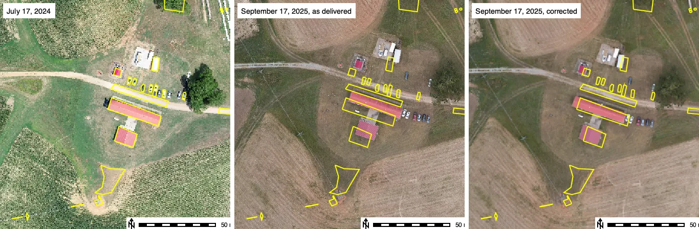{width="100%" fig-alt="Three panels of the farm buildings at Lake Wheeler with outlines digitized in 2024. July 2024: the outlines fit the roofs. September 2025 as delivered: the buildings lie several meters east and north of their outlines. September 2025 corrected: the roofs lie within two to three meters of the outlines."}

2024 reference, 2025 as delivered, and 2025 after a horizontal correction

::: {.notes}
* The 2025 survey of Lake Wheeler was processed with the camera positions only; the yellow outlines were digitized on the 2024 orthophoto
* The offset is 7 m to the east and between 0 and 11 m to the north, growing from south to north: a shift and a stretch, not a shift alone
* Assignment Part 2: the offset is measured by cross-correlating the bright surfaces in blocks, modeled with three numbers, and applied with `r.region`; 1 to 3 m remain
:::

## Measuring registration quality {.smaller}

::: {.columns}
::: {.column width="50%"}
::: {.term-card}
**RMSE**: root mean square of the differences at check locations; sensitive to outliers
:::
::: {.term-card}
**NMAD**: 1.4826 times the median absolute deviation from the median; a robust standard deviation [@hohle_accuracy_2009]
:::
:::
::: {.column width="50%"}
- Measure on **stable surfaces**: roads, roofs, bare ground
- Hold out part of the stable surfaces from any fitting and report the error there
- Inspect the difference map and its histogram: structure in the map is a registration problem, not noise
:::
:::

::: {.notes}
* Elevation differences have heavy tails from edges and vegetation, so the median based NMAD is preferred over the standard deviation
* A registration error turns into false change: one meter of horizontal offset next to a 15 m tree is a 15 m difference
* Assignment Parts 4 and 5 use both: the standard deviation on held out cells and the NMAD for the level of detection
:::

## Pre-classification methods {.center .text-center .section-divider background-color="#e9f2e9"}

::: {.notes}
* Section 3: methods that subtract values (brightness, an index, elevation) before anything is classified
:::

## Image differencing and ratioing {.smaller}

- Subtract or divide co-registered bands of the two dates: $\Delta B = B_{t2} - B_{t1}$
- Unchanged cells cluster around zero (difference) or one (ratio); changed cells lie in the tails
- A **threshold** separates change from no change
  - Chosen from the histogram, or as a multiple of the standard deviation
  - Automatic, for example Otsu's method [@sha_robust_2016]
  - Calibrated on stable surfaces, where the difference should be zero
- The result says that something changed and in which direction, not what it changed into

::: {.notes}
* The simplest method and the most sensitive to the pre-processing: every radiometric and geometric difference ends up in the result
* Works on continuous values; categorical maps need the post-classification comparison
* In GRASS: `r.mapcalc` for the difference, `r.univar` and `r.stats` for the distribution
:::

## Spectral index differencing {.smaller}

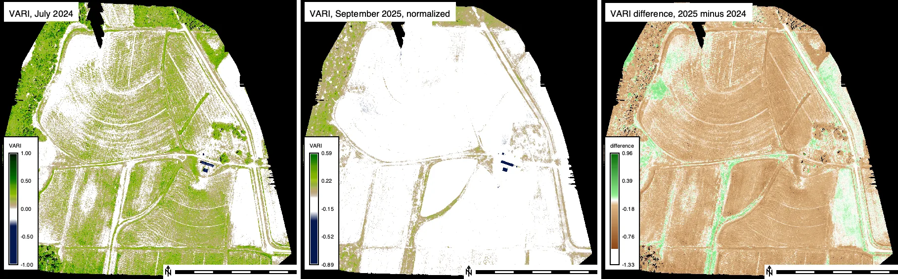{width="100%" fig-alt="Three maps of Lake Wheeler. VARI in July 2024: tree lines and most fields green. VARI in September 2025: almost the whole site near zero. The difference, 2025 minus 2024: a decrease over the fields and tree lines, no change on roads and the bare eastern field."}

VARI in July 2024, in September 2025, and the difference: $\Delta VARI = VARI_{t2} - VARI_{t1}$

::: {.notes}
* An index difference is easier to read than a band difference: negative means less green vegetation
* With a threshold of 0.1, 59 percent of the site shows a decrease, 39 percent no change, 2 percent an increase
* Most of that decrease is the crop cycle, July against harvest time in September: the method detects a difference, the interpretation needs the calendar. Assignment Part 3
:::

## DEM of Difference {.smaller}

::: {.term-card}
**DEM of Difference (DoD)**: the later surface minus the earlier one, $DoD = DEM_{t2} - DEM_{t1}$; negative values are lowering, positive values raising [@wheaton_accounting_2010]
:::

::: {.incremental}
- Elevation change per cell; multiplied by the cell area and summed, a volume
- Needs horizontal and vertical co-registration
- With DSMs, the change includes vegetation and structures, not only the ground
- In GRASS: `r.dem.dod dem=dsm_2025_v reference=dsm_2024 output=dod`
:::

::: {.notes}
* The standard tool of geomorphic change detection: sediment budgets of rivers, dunes, landslides, and stockpile volumes
* Topic 5A and 5B already subtracted surfaces; what is new here is the treatment of error
* For the UAS DSMs at Lake Wheeler most of the real change is vegetation: crop removed, trees grown
:::

## The dome {.smaller}

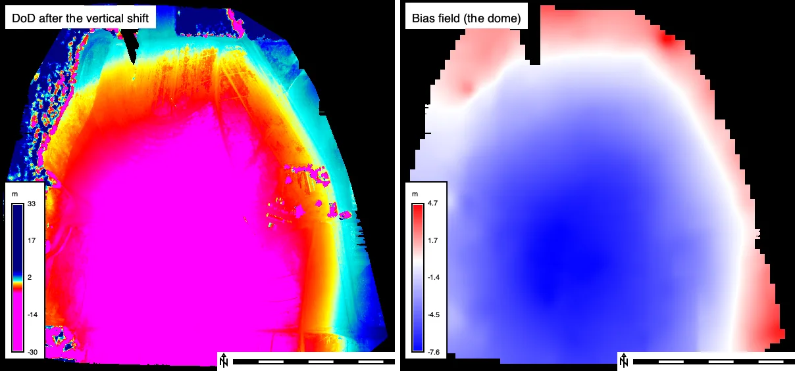{width="82%" fig-align="center" fig-alt="Two maps of Lake Wheeler. The DoD after a vertical shift: strongly negative over the center of the site and positive toward the edges. The bias field fitted to stable cells: the same shape as a smooth surface, about -7 m in the center and almost 5 m toward the edges."}

DoD after a vertical shift (left) and the bias field fitted on stable cells (right)

::: {.notes}
* After removing a vertical bias of -89 m the two surfaces still differ by a smooth shape 12 m high: the dome
* It comes from self-calibration of the lens distortion in a block of parallel nadir images without ground control [@james_mitigating_2014]; ground control and oblique or crossing flight lines reduce it
* A shift or a rotation cannot remove it. In GRASS: `r.dem.bias method=spline` fits a smooth surface to the DoD on stable cells and subtracts it. Assignment Part 4
:::

## Multitemporal transformations {.smaller}

::: {.columns}
::: {.column width="50%"}
::: {.term-card}
**Principal component analysis**: the bands of both dates are transformed together; the first components hold what the dates share, later components hold the change
:::
:::
::: {.column width="50%"}
::: {.term-card}
**Change vector analysis**: the difference of the two spectral vectors of a cell; its length is the amount of change, its direction the kind of change
:::
:::
:::

- Both use all bands at once and suit multispectral data
- The components and directions have to be interpreted for each pair of images

::: {.notes}
* Change vector analysis in two bands: a cell moving toward lower red and higher NIR is gaining vegetation; the opposite direction is losing it
* Principal components of a two date stack: unchanged cells are correlated between dates and load on the first components
* In GRASS: `i.pca` on a group holding the bands of both dates
:::

## Uncertainty and significant change {.center .text-center .section-divider background-color="#e9f2e9"}

::: {.notes}
* Section 4: how large a difference has to be before it is reported as change
:::

## Sources of uncertainty {.smaller}

| Source | Effect on the difference |
|---|---|
| Horizontal misregistration | Paired false gains and losses along edges |
| Vertical bias and doming | Smooth false change over large areas |
| Radiometric differences | False index change, uniform or with the sun angle |
| Shadows and occlusion | Local false change near tall objects |
| Timing | Seasonal change reported as land cover change |
| Surface roughness and vegetation | Larger noise where the surface is rough |

::: {.notes}
* The first three are systematic and are reduced by pre-processing; what remains of them, plus the noise, is the error budget
* The spatial pattern identifies the source: paired red and blue bands on opposite sides of a building are horizontal misregistration
* Timing is not an error of the data but of the interpretation
:::

## Level of detection {.smaller}

::: {.term-card}
**Level of detection (LoD)**: the smallest difference distinguishable from noise at a chosen confidence, $LoD = z \, \sigma_{DoD}$ with $z = 1.96$ for 95 %
:::

::: {.incremental}
- From the errors of the two surveys: $\sigma_{DoD} = \sqrt{\sigma_{1}^2 + \sigma_{2}^2}$ [@brasington_methodological_2003; @lane_estimation_2003]
- Or measured directly as the NMAD of the DoD on **stable surfaces**, which includes the remaining registration error
- A uniform LoD for the whole map, or a spatially variable one where the noise differs between surfaces [@wheaton_accounting_2010]
- In GRASS: `r.dem.lod dod=dod output=lod method=global stable_mask=stable_check`
:::

::: {.notes}
* Two surveys with 5 cm vertical error each give a difference error of 7 cm and an LoD of 14 cm at 95 percent
* Lake Wheeler: the NMAD on held out stable cells is 0.18 m after the dome correction, so the LoD is 0.35 m; with ground control in both surveys it would be a few centimeters
* Cells below the LoD are not "no change"; they are "change not detectable with these data"
:::

## Significant change {.smaller}

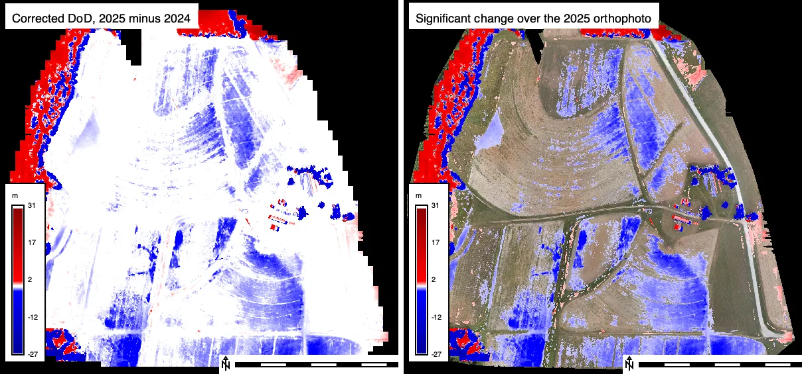{width="82%" fig-align="center" fig-alt="Two maps of Lake Wheeler. The corrected DoD: near zero over most of the site, light lowering in several fields, large values of both signs along the tree lines. The significant change over the 2025 orthophoto: lowering over the fields that carried a crop in 2024, raising along the tree lines, nothing on the roads and the bare field."}

Corrected DoD (left) and the cells beyond the LoD of 0.35 m (right)

::: {.notes}
* In GRASS: `r.dem.change` keeps the cells beyond the LoD, removes isolated cells, and sums the volumes
* Lowered: 12.8 hectares, median 0.9 m, the fields with a crop in July 2024 and stubble in September 2025. Raised: 5 hectares, median 3.8 m, almost all along the tree lines
* The tree line values are large and of both signs: a few meters of horizontal offset against tall trees. They dominate the volumes, so the volumes are not a crop volume. Assignment Part 5
:::

## Reading the artifacts {.smaller}

::: {.columns}
::: {.column width="48%"}
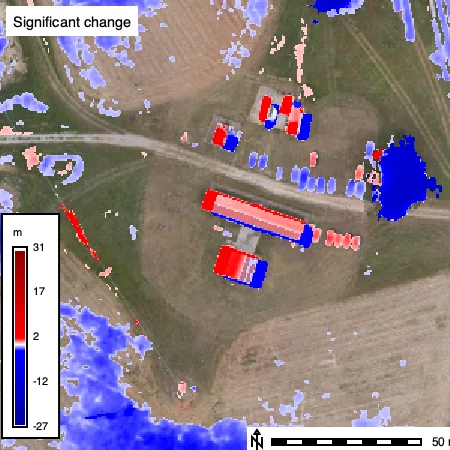{width="100%" fig-alt="Significant change around the farm buildings over the 2025 orthophoto: each building has a red band along one edge and a blue band along the opposite edge, parked cars appear as small red and blue patches, the large tree is blue, and the crop field at the bottom is light blue."}
:::
::: {.column width="52%"}
- **Buildings**: a raised band on one side and a lowered band on the other; the building did not move, the surveys are offset
- **Cars**: lowered where a car stood in 2024, raised where one stands in 2025; real change
- **Field**: uniform lowering of a few decimeters; the harvested crop
- **Tree**: lowering over the crown; leaf condition, reconstruction of the canopy, and offset together
:::
:::

::: {.notes}
* The farm block of the same map; the remaining horizontal offset here is 1 to 3 m
* The signature of misregistration is the pair: equal and opposite bands on opposite edges of an object
* A report of change separates these cases; the LoD alone does not, because the edge artifacts are far above it
:::

## Object based and post-classification methods {.center .text-center .section-divider background-color="#e9f2e9"}

::: {.notes}
* Section 5: methods that compare objects or class labels in place of cell values
:::

## Object based change detection {.smaller}

::: {.columns}
::: {.column width="50%"}
- Segment each date, or both dates together, into objects (Lecture 6A)
- Describe each object: mean index, texture, height, shape
- Compare objects between dates: overlap, attribute change, appearance and disappearance

::: {.term-card}
Objects absorb small registration errors and remove the speckle of cell by cell differences; the result depends on the segmentation
:::
:::
::: {.column width="50%"}
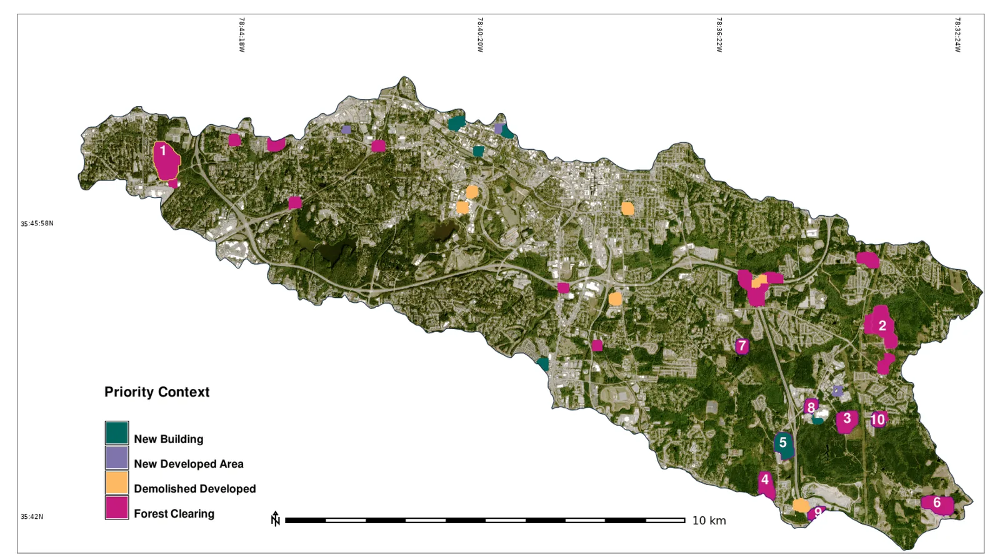{width="100%" fig-alt="Map of a county with patches of detected land cover change colored by type: new building, new developed area, demolished development, and forest clearing, with numbered priority areas."}

Change objects by type [@white_rapid-dem_2022]
:::
:::

::: {.notes}
* An object a few meters across is not affected by a one meter offset in the way a single cell is
* The figure shows change objects labeled by the kind of change, which is what a planner needs, not a map of changed cells
* In GRASS: `i.segment` or `i.superpixels.slic` with `i.segment.stats`; text prompted segmentation with `i.sam2` gives objects per date that can be compared
:::

## Post-classification comparison {.smaller}

::: {.term-card}
**Post-classification comparison**: each date is classified on its own and the two maps are cross tabulated; the result is a **from-to matrix** of class transitions
:::

1. Classify each date with the same legend
2. Co-register the two class maps
3. Cross tabulate: the area of every combination of class at date 1 and class at date 2
4. Map the transitions of interest

- Radiometric differences between the dates matter less, because each image is classified separately
- The only method here that says what a place changed from and to

::: {.notes}
* The diagonal of the matrix is no change; every off-diagonal cell is a kind of change with its own meaning
* The legend has to be identical at both dates, and the classifier consistent; a model trained on one date often does not transfer (Lecture 6A)
* In GRASS: `r.stats -a input=class_2024,class_2025`, or `r.cross` for a map of the combinations
:::

## A from-to matrix {.smaller}

| 2024 \\ 2025 (ha) | vegetation | bare or built | total 2024 |
|---|---|---|---|
| **vegetation** | 5.57 | 20.20 | 25.77 |
| **bare or built** | 1.12 | 18.37 | 19.49 |
| **total 2025** | 6.69 | 38.57 | 45.26 |

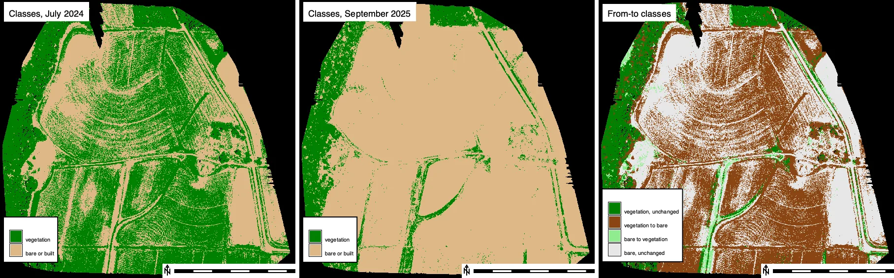{width="88%" fig-align="center" fig-alt="Three maps of Lake Wheeler. Classes in July 2024: vegetation over tree lines and most fields. Classes in September 2025: bare or built over almost all fields. From-to classes: vegetation to bare over the crop fields, unchanged vegetation on the tree lines, unchanged bare on roads and the eastern field."}

::: {.notes}
* Lake Wheeler with two classes from a VARI threshold: 20.2 hectares went from vegetation to bare, 1.1 the other way
* The totals alone, 25.8 to 6.7 hectares of vegetation, hide the 1.1 hectares that went the other way; the matrix shows both
* Assignment Part 6
:::

## How classification errors combine {.smaller}

- Each class map has its own errors; a cell is correct in the comparison only if it is correct at both dates
- With independent errors, the accuracy of the comparison is about the product of the two accuracies: 0.9 x 0.9 = 0.81
- Misclassified cells appear as change, so rare transitions are the least reliable
- Reference data for the change classes themselves give the accuracy of the change map [@olofsson_good_2014]

::: {.notes}
* Two maps at 90 percent accuracy can produce a change map in which a fifth of the cells is wrong, more than the real change in many landscapes
* The 6A result is a warning: a model at 54 percent on held out polygons would give a from-to matrix dominated by its own errors
* This is why the assignment uses a simple two class rule that behaves the same way on both dates
:::

## Three methods on the same site {.smaller}

| Method | Reports | Vegetation loss at Lake Wheeler |
|---|---|---|
| Index differencing | Less green than before | 26.7 ha |
| DEM of Difference with LoD | Surface lower than before | 12.7 ha |
| Post-classification | Vegetation class to bare class | 20.2 ha |
| All three agree | | 9.3 ha |

::: {.incremental}
- The methods answer different questions and are expected to differ
- The spectral methods respond to any loss of green; the DoD only where the crop was taller than the LoD
- Agreement between independent methods is the strongest evidence of change
:::

::: {.notes}
* The same two surveys, three numbers between 13 and 27 hectares
* For "how much crop was harvested" the DoD is the wrong tool on this pair: its LoD of 0.35 m is close to the height of a low crop
* For "where did the surface change by more than a third of a meter" it is the only tool
:::

## Applications {.smaller}

::: {.columns}
::: {.column width="50%"}
- **Geomorphology**: river bank erosion and bar deposition, landslide volumes, dune migration [@fonstad_topographic_2013]
- **Vegetation**: crop growth and harvest, post-fire recovery, invasive species
- **Infrastructure and events**: construction progress, stockpile volumes, flood and storm damage
:::
::: {.column width="50%"}
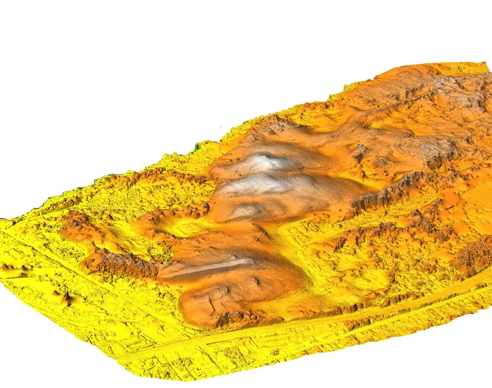{width="100%" fig-alt="Shaded three dimensional view of a UAS surface model of the Jockey's Ridge dunes from 2024, with the dune crests in light tones above the surrounding sand."}

Jockey's Ridge, UAS surface model, 2024
:::
:::

::: {.notes}
* Structure from motion made repeat topographic surveys affordable for geomorphology; river reaches, dunes, and gullies are surveyed after each event
* The Jockey's Ridge air photos of section 1 continue as UAS surface models, so the dune volume can now be differenced, not only its outline
* In each application the reportable change is limited by the LoD, and the LoD by the ground control
:::

## Key terms {.smaller}

::: {.columns}
::: {.column width="50%"}
::: {.term-card}
**Co-registration**: aligning one dataset to another so that the same coordinates refer to the same place
:::
::: {.term-card}
**Pseudo-invariant features**: unchanged surfaces used to normalize brightness between dates
:::
::: {.term-card}
**Stable surfaces**: unchanged terrain used to measure and correct elevation differences
:::
:::
::: {.column width="50%"}
::: {.term-card}
**DEM of Difference**: the later surface minus the earlier one
:::
::: {.term-card}
**Level of detection**: the smallest difference distinguishable from noise at a chosen confidence
:::
::: {.term-card}
**From-to matrix**: the area of every transition between classes at two dates
:::
:::
:::

::: {.notes}
* The words the assignment report has to use correctly
* The grading asks for conclusions in these terms: co-registration, stable surfaces, level of detection, post-classification comparison
:::

## Wrap-up

::: {.term-card}
**Assignment 6B**: [UAS change detection](../assignments/assignment_6b.qmd)
:::

::: {.notes}
* Recap: a difference contains change, registration error, bias, and noise; pre-processing removes what it can, and the level of detection states what is left
* Choose the method by the question: values for how much, classes for from what to what, objects for which things
* Ground control in every flight is the least expensive co-registration there is; the assignment shows the cost of leaving it out
* Next: project work and the project presentations
:::

## References {.smaller}

::: {#refs}
:::
